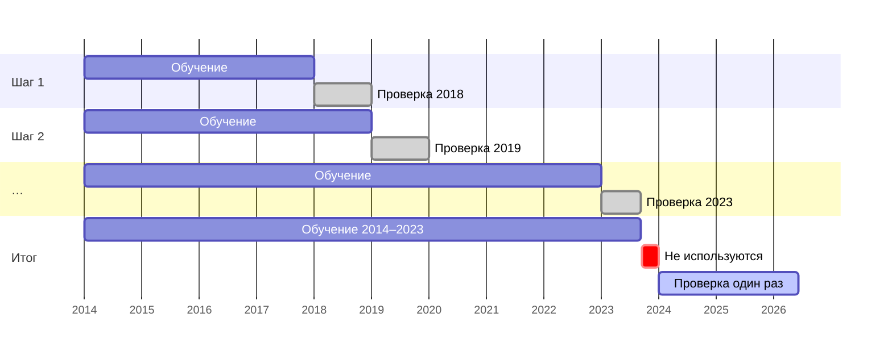

# 
Гипотезы и план проверки

<i>Черновик от 30.09.2026 
Это этап исследования №2: то, что здесь записано, фиксируется до расчётов этапов 3–5, для "чистоты эксперимента". 
Правки после расчётов, если таковые будут, записываются ниже с датой и причиной.</i>

<!-- Места, где нужно решить, помечены **[решить]**. -->

## 
Задачи

Каждый дефолт — это техдефолт, не исправленный за льготный срок (10 рабочих дней, если эмиссионные
документы не установили меньше).

<b>P(дефолт) = P(техдефолт) · P(дефолт | техдефолт)</b>

Исследование делится на две задачи:
- **Задача A — раннее предупреждение, найти P(техдефолт).** До неплатежа
  держатель решает, выходить из бумаги или нет. Предупреждение, помогает выйти без потерь и должно прийти до техдефолта. Это основная задача.
- **Задача B — выплатят ли техдефолт, найти P(дефолт | техдефолт).** После неплатежа держатель решает, продавать ли по упавшей цене или ждать выплаты. 

## 
Что сделано до этих записей

Две проверки сделаны раньше, чем записаны гипотезы (`JOURNAL.md`, 2026-09-19):
- срезы G-спреда на 2023-06-01 и 2024-12-20 — повлияли на выбор
  кандидатов в признаки П2–П3;
- Гипотеза А3 о скорости падения цены выведена из личного опыта, для примера был разобран один случай: МОНОП 1P04.
  о скорости падения цены.
Поэтому МОНОПОЛИЯ (`emitent_id` 15817) исключается из проверки A3
В остальных гипотезах она участвует как обычное событие. Срезы g-спреда — иллюстрация, в проверке гипотез
не используются.

## 
Задача A: раннее предупреждение

### Событие

**Новый кредитный техдефолт эмитента** — любой, а не только первый (решение 27.09.26). Кредитный — значит денег не было (просто нет средств, задержка от контрагентов, арест или блокировка счетов). Технические неплатежи не считаются.

День дефолта — плановая дата купона, по которому произошла невыплата. Дата формального дефолта (`default_date`) хранится отдельно и событием не считается. Цена бумаги обваливается после техдефолта, поэтому если бы событием стал конец срока, опережение оказалось бы завышено на две недели.

У эмитента, уже переживавшего техдефолт, новое неисполнение обязательств - это частый сценарий, но покупатель может о нём не знать или попросту не заметить эту информацию. Тем не менее, намного ценнее предсказание первого неплатежа.

В данных, которые у меня есть сейчас около 173 событий с 2014 по 2026
- 122 эпизода, закончившихся дефолтом (118 с переводом в «Д» и 4 с объявленным дефолтом без перевода);
- 28 выплаченных техдефолта у 22 эмитентов, которых в «Д» не переводили;
- 23 выплаченных техдефолта у 21 эмитента, который позже всё-таки допустил дефолт.

Дефолт и техдефолт - событие эмитента, а не одного выпуска. Так как часто неплатежи идут подряд по нескольким выпускам, цена падает на все выпуски и биржа переводит все выпуски в категорию "Д". 

### Признаки предстоящего техдефолта

Если по ходу исследования откроются ещё какие-либо признаки будет записано ниже с пометкой.

***Цена и доходность***
1. **Цена** - % номинала, средневзвешенная за неделю.
2. **G-спред** — доходность к погашению минус доходность ОФЗ на тот же срок по кривой бескупонной доходности (КБД) Мосбиржи. Оговорка: это разные величины, для длинных бумаг с высоким купоном ошибка заметна.
3. **Спред относительно рынка** — место G-спреда бумаги среди всех корпоративных облигаций, торговавшихся на той же неделе, в процентах (процентиль). Место в ряду, а не сам спред, потому что уровень спредов всего рынка меняется со ставкой. Процентиль в любой год выделяет одну и ту же долю самых рискованных бумаг. Минус: общий для всего рынка рост спредов на нём не отражается, поэтому он сравнивается с порогом относительно ключевой ставки (гипотеза A2).
4. **Доходность к погашению минус ключевая ставка**

***Скорость падения цены***

5. **Худшее недельное изменение цены за последние 13 недель** - самое сильное падение цены за одну неделю. После падения цена может отрасти, а риск остаётся, поэтому берётся худшая неделя, а не текущая. Цена этой недели сравнивается с ценой прошлой недели. Если на прошлой неделе сделок не было, то с последней неделей, когда они были. У неликвидной бумаги такое изменение может накопиться за несколько недель, поэтому резкое падение от постепенного отличают по обороту, так как при распродаже он резко растёт.
6. **Падение от максимума цены за 13 недель** - разница между самой высокой ценой за последние 13 недель и ценой текущей недели, в п.п. номинала. Признак 5 отражает резкое падение за одну неделю, а этот признак — постепенное снижение, при котором цена каждую неделю теряет понемногу, ни одно недельное падение не бросается в глаза, но за несколько месяцев потеря набирается большая.
7. **Всплеск оборота**: оборот недели к медиане оборота выпуска за .

***История эмитента***

8. **Кредитный техдефолт за последние 2 года** (да/нет) и количество недель с последнего.

***Структура долга и ликвидность***

9. **Недель до ближайшей оферты или погашения** — берётся из дневной истории торгов, а не из карточки выпуска, так как карточку после реструктуризации переписывают задним числом. 
<!-- Проверить в начале этапа 3, что в полной дневной истории ISS есть поля `OFFERDATE` и `MATDATE` на дату: кэш этапа 1 запрашивал только цену и оборот, а ISS 2026-09-27 не отвечал. Если полей нет — признак заменяется, и замена записывается здесь с датой. -->
10. **Доля недель со сделками за 13 недель** — чтобы отличать сигнал
    от молчания неликвидной бумаги.

**Одно число для одного эмитента** 
Признаки 1–7 и 9–10 считаются по каждому выпуску, а в таблице 1 запись для 1 эмитента. Если у эмитента пять выпусков нужно одно значение цены на неделю, а не пять. Правила выбора этого значения:
- для 1–7 берётся **худший выпуск** (самая низкая цена, самый широкий
  спред, самое сильное падение): трудности эмитента видны первыми в самой слабой бумаге;
- для 1–4 дополнительно — значение **самого ликвидного выпуска**:
  цена неликвидной бумаги скачет от одной сделки, и «худший» может
  оказаться шумом. Какой из двух вариантов лучше, решают данные;
- для 9 — ближайшая дата среди всех выпусков;
- для 10 — у самого ликвидного выпуска.

**Флоатеры.** У облигации с плавающим купоном ISS считает доходность по текущему купону, как будто он не изменится, — доходность и спред (признаки 2–4) нельзя сравнивать с бумагами с постоянным купоном. Поэтому у флоатеров признаки 2–4 не считаются, остаются цена, скорость и оборот. Спред эмитента берётся только из его бумаг с постоянным купоном; если у эмитента одни флоатеры — спреда у него нет, работают правила по цене. Тип купона берётся из описания выпуска.

### Правила

Правило - это один признак и его порог. Например: «есть риск неплатежа, если признак на неделе t перешёл значение x». X подбирается на обучающем периоде (2014–2023) так, чтобы FPR равнялся 10%.

| | Правило | Риск есть, если |
|---|---|---|
| П1 | высокая доходность | доходность выше ключевой ставки на X п.п. (признак 4) |
| П2 | G-спред | спред выше X п.п. (признак 2) |
| П3 | спред относительно рынка | спред выше X-го процентиля рынка той же недели (признак 3) |
| П4 | низкая цена | цена ниже X % номинала (признак 1) |
| П5 | резкое падение | за последние 13 недель была неделя, когда цена упала на X п.п. и больше, а оборот был в Y раз выше обычного (признаки 5, 7) |

### Понятия и обозначения

#### Наблюдения

Наблюдение — **состояние определённого эмитента в одну неделю**: у каждого эмитента, у которого на этой неделе в обращении есть облигации, одна запись в таблице на неделю. В ней содержаться независимые переменные, то есть признаки, известные к концу этой недели, и значение зависимой переменной, а именно ответ на вопрос: «будет ли у эмитента новый кредитный техдефолт в ближайшие 16 недель» и . Строки всех эмитентов за все недели с 2014 года — это и есть данные, на которых подбираются правила и модель.

Эмитенты — все эмитенты корпоративных рублёвых облигаций (`exchange_bond`, `corporate_bond`). Отбора по доходности или спреду нет.

**Банки и МФО** (решение 27.09.26)
Считаются вместе со всеми. Их среди событий около пяти (Татфондбанк, Пересвет, НОТА-Банк, Внешпромбанк, Домашние деньги). Дефолт банка обычно наступает после отзыва лицензии — решения регулятора, которое рынок может не предвидеть. Поэтому результат дополнительно будет посчитан без банков и после этого будет видно, создают ли они шум.

Не участвуют:
- реструктуризации без дефолта — эмитенты, договорившиеся с
  держателями, иначе они попадут в "нормальные". 
  
<!-- Списка пока нет — собрать до этапа 3 (кандидаты: smart-lab, сообщения Интерфакса
  о собраниях владельцев облигаций). -->

**В каких случаев запись по эмитенту не добавляется.** 
Запись имеет смысл, только если ответ на её вопрос известен.
- От неплатежа до исправления строк нет: техдефолт случился, цена упала. После исправления строки снова идут, эмитент может не заплатить ещё раз. После дефолта записи не ведутся.
- Эмитент погасил все выпуски и нет новых — после погашения записей нет, не по чему платить.
- Выпуски ушли с биржи без погашения (делистинг, выкуп всего объёма по оферте) — что было дальше, не известно. Строки, у которых 16 недель вперёд заходят за дату ухода с биржи не используются.
- То же в конце данных: данные кончаются 25.09.2026, недели после 05.06.2026 пока не используются.

#### Горизонт

- **16 недель** от недели t (решение 28.09.26; изначально было 26 недель).
  - Это значение выбрано мной на основе сугубо личного эмпирического ощущения того времени, за которое можно распознать невыплаты. 
  - За четыре месяца до неплатежа возможно принять решение, выйти из бумаги или держать.
  - Больше данных для проверки. Для последних 16 недель данных исход ещё неизвестен, при 26 неделях — для последних 26. А 2025–2026 годы — самые насыщенные событиями.
  - У рискованных эмитентов купоны обычно ежемесячные или квартальные: за 16 недель проходит несколько платежей.
  -  Ответы на горизонтах 8 и 26 недель посчитаю для проверки устойчивости. Горизонт выбран до расчётов
  и после них не меняется.

#### Критерии

- **Предсказанный техдефолт.** Техдефолт, перед которым было хотя бы одно предупреждение в течение 16 недель до неплатежа.
Отдельно следует посчитать долю техдефолтов, предсказанных только в последние 2 недели, чтобы понимать, сколько предупреждений приходит в последний момент. 

- **Полнота R.** Доля предсказанных техдефолтов среди всех техдефолтов данного периода. Индексы R₁ у П1, R₃ у П3, Rм у модели.
- **Опережение L.** Число недель от первого предупреждения до неплатежа.
- **Ложное срабатывание** — Предупреждением, после которого у эмитента в течение 16 недель не было техдефолта.
- **FPR** (false positive rate) — доля ложных срабатываний среди всех недель, после которых у эмитента в течение 16 недель не было техдефолта, то есть вероятность получить предупреждение по эмитенту, у которого техдефолта не будет. Это ошибка первого рода правила, аналог α. Правила и модель сравниваются при FPR = 10%. FPR считается только среди недель без техдефолта, поэтому почти не зависит от того, как часто случаются техдефолты, и порог, подобранный на 2014–2023, сохраняет смысл в 2024–2026.
- **Лучшее правило.** Правило с наибольшей полнотой при FPR = 10% на кросс-валидации внутри 2014–2023 годов (см. «Разделение по времени»). В A3 оно выбирается среди П1–П4, в A4 среди П1–П5. Выбор делается до того, как открывается проверочный период.
- **Разделение по времени.** Правила и модель подбираются на 2014–2023 годах, а проверяются на 2024–2026. Это отдельный рынок со ставкой до 21% и рекордным числом дефолтов ВДО, и именно в нём предстоит работать Jessica.
  - Внутри 2014–2023 варианты сравниваются кросс-валидацией с расширяющимся окном (схема ниже).
  - 2024–2026 проверяется один раз, для уже выбранной модели. Событий там около 48, поэтому при сравнении нескольких моделей на этом периоде лучшая могла бы оказаться лучшей случайно.
  - Записи с 11.09.2023 не используются, так как их 16 недель вперёд заходят в проверочный период.
  - Перемешивать недели разных лет или делить выборку по эмитентам нельзя. Записи одного эмитента за соседние недели почти одинаковы, неплатежи разных эмитентов зависят от общего состояния рынка, а у связанных эмитентов идут вместе. При таком делении обучающая и проверочная части пересекаются по времени, и качество модели завышается.
  - После проверки модель переучивается на всех годах, и с ней работает Jessica.

- **Доверительные интервалы** оцениваются bootstrap'ом по эмитентам, а не по записям, так как записи одного эмитента за соседние недели почти одинаковы, и если считать их независимыми, интервалы выйдут обманчиво узкими. Когда сравниваются два правила или правило и модель, оба оцениваются на одних и тех же событиях, поэтому разность считается внутри каждой bootstrap-выборки, а не из двух отдельных интервалов.
- **PR-AUC** считается для модели и для каждого правила как дополнительная метрика, так как показывает качество сразу на всех порогах, а не только при FPR = 10%. Главным остаётся сравнение при 10%, так как на этом уровне будет работать Jessica.

### Гипотезы

<b style="color: #DB95BD">A1.</b> **После неплатежа цена падает сильнее, чем при объявлении дефолта.** Данная гипотеза проверяется
первой: от неё зависит, какая из задач важнее. 

Проверка: берутся выпуски, закончившиеся дефолтом, у которых есть сделки в неделю до неплатежа, в неделю самого неплатежа и в неделю дефолта. <!--Эпизоды, где сообщение о дефолте вышло в ту же неделю, что и неплатёж, исключаются, так как два падения там не разделить.--> 
Для каждого эпизода считается Δн, изменение цены в неделю неплатежа, и Δд, изменение цены в неделю дефолта, обе величины в п.п. номинала. Разность d = Δн − Δд.

> **H₀:** Неплатёж и дефолт двигают цену одинаково, поэтому медиана d равна нулю.  
> **H₁:** После неплатежа цена падает сильнее, поэтому медиана d меньше нуля.

Применяется односторонний критерий знаковых рангов Уилкоксона для парных наблюдений, так как каждый эпизод даёт пару изменений, а распределение изменений цены далеко от нормального. H₀ отвергается на уровне значимости 0,05. Если H₀ не отвергается, значит, льготный срок несёт для рынка больше информации, чем кажется, и задача B получает больший вес.

<b style="color: #DB95BD">A2.</b> **Спред относительно рынка предсказывает больше техдефолтов, чем доходность выше ключевой ставки, при одинаковом FPR.** Уровень спредов всего рынка меняется вместе со ставкой, поэтому место бумаги среди других точнее показывает риск, чем разница с ключевой ставкой. По сути, этот признак обозначает высокую доходность.

Проверка: пороги П1 и П3 подбираются на 2014–2023 годах так, чтобы FPR у обоих равнялся 10%. На 2024–2026 для каждого правила считается полнота, R₁ для П1 и R₃ для П3. Разность d = R₃ − R₁.

> **H₀:** Оба правила предсказывают одинаковую долю техдефолтов, d = 0.  
> **H₁:** Правило 3 предсказывает больше, d > 0.

H₀ отвергается на уровне значимости 0,05, если 95%-ный доверительный интервал для d целиком лежит выше нуля. Интервал оценивается bootstrap'ом по эмитентам (см. «Понятия и обозначения»). Так как пороги подобраны на обучающем периоде, на 2024–2026 FPR у правил может разойтись, поэтому он приводится рядом.

<b style="color: #DB95BD">A3.</b> **Резкое падение цены предупреждает о техдефолте раньше, чем текущее значение цены или доходности.** 

Проверка: берутся П5 и лучшее правило из П1–П4 (см. «Понятия и обозначения»). Для обоих подбираются пороговые значения, при которых FPR на 2014–2023 годах равен 10%. На проверочном периоде (2024–2026) отбираются техдефолты, предсказанные обоими правилами. Для каждого из них считается опережение, то есть число недель от первого предупреждения до неплатежа: L₅ для П5 и Lу для выбранного правила из П1-П4. Проверяется разность d = L₅ − Lу.

> **H₀:** Оба правила предупреждают техдефолт одновременно, медиана d равна нулю.  
> **H₁:** П5 предупреждает раньше, медиана d больше нуля.

H₀ отвергается на уровне значимости 0,05, если 95%-ный доверительный интервал для медианы d (bootstrap по эмитентам) целиком лежит выше нуля. Раннее предупреждение бесполезно, если П5 предсказывает заметно меньше техдефолтов. Поэтому H₁ засчитывается, только если полнота П5 меньше, чем у выбранного правила из П1–П4, не больше чем на 10 п.п.

<b style="color: #DB95BD">A4.</b> **Модель предсказывает больше техдефолтов, чем лучшее из правил, при одинаковом FPR.** Каждый признак отражает свою сторону трудностей эмитента, поэтому сочетание признаков должно предсказывать техдефолты, которые не предсказывает ни один признак в отдельности.

Проверка: сравниваются модель и лучшее правило из П1–П5 (см. «Понятия и обозначения»). Для обоих подбираются пороги, при которых FPR на 2014–2023 годах равен 10%. На 2024–2026 считаются полнота модели Rм и полнота правила Rп и их разность d = Rм − Rп.

> **H₀:** Модель предсказывает столько же, сколько правило, d = 0.  
> **H₁:** Модель предсказывает больше, d > 0.

H₀ отвергается на уровне значимости 0,05, если 95%-ный доверительный интервал для d целиком лежит выше нуля. Если H₀ не отвергается, в Jessica идёт правило, так как оно проще и его логику видно.

## 
Задача B: выплатят ли техдефолт

### Событие

**Эпизод** — один неплатёж эмитента от плановой даты платежа до исхода. Исход эпизода двоякий. Если эмитент заплатил в льготный срок, это выплаченный техдефолт, если не заплатил, это дефолт.

Выплата после `default_date` не отменяет дефолт. Эмитент может заплатить после конца льготного срока (КИВИ Финанс, дефолт по оферте 11.04.2024, обязательства исполнены 31.05.2024), договориться с держателями о реструктуризации или вернуть бумаги в обычные торги («Пересвет», через 3,5 года). Во всех этих случаях эпизод остаётся дефолтом.

- **Дефолты.** 122 эпизода, в которых неплатёж перешёл в дефолт.
- **Выплаченные кредитные техдефолты.** Около 51 эпизода. Из них 28 у эмитентов, которых в «Д» не переводили, и 23 ранних у эмитентов, которые позже допустили дефолт.
- **Технические неплатежи.** 40 сообщений у 15 эмитентов, причина в реквизитах, ошибках в платёжках или сбое банка. В задаче A они не считаются событиями, а здесь нужны, так как Jessica в реальном времени получит о них такое же сообщение с причиной, как о кредитных.

<!-- Собрать до расчёта задачи B: дату фактической выплаты каждого выплаченного техдефолта. Источники: цепочки smart-lab («обязательства исполнены 24.06.2024») — есть у 31 записи из 63, только с 2024 года; сообщения Интерфакса типа 167 «Выплаченные доходы или иные выплаты» с датой фактической выплаты — поиск по названию эмитента в окне 60 дней после неплатежа, около 200 запросов. -->

### Признаки

Все признаки известны в момент неплатежа или в первые дни после него, поэтому Jessica сможет показать их держателю сразу. По причине неплатежа есть гипотеза B2, остальные признаки нужны, чтобы разбить эпизоды на группы и сравнить доли дефолтов между ними.

1. **Причина из сообщения эмитента.** Нет денег, задержка от контрагентов, арест или блокировка счетов, техническая причина (реквизиты, платёжка, банк).
2. **Вид обязательства.** Купон, амортизация, оферта, погашение номинала.
3. **Сумма неплатежа** относительно объёма выпуска в обращении.
4. **Сколько выпусков эмитента не выплачено** в первую неделю.
5. **Были ли у эмитента техдефолты раньше.**
6. **Как изменилась цена** за первые 1–3 торговых дня после неплатежа.

### Понятия и обозначения

#### Наблюдения

Отсчёт начинается в плановую дату платежа, которую эмитент пропустил (день 0). Дальше идут рабочие дни льготного срока k = 1, …, 10. Если в документах выпуска льготный срок короче (у ИНВЕСТПРО 6 рабочих дней, у РКК 3 дня), эпизод наблюдается только до его конца. Держателю в день k нужна величина

<b>f(k) = P(дефолт | к k-му дню ещё не выплатили)</b>

Посчитать сами значения f(k) и P(дефолт | техдефолт) по этим данным нельзя. Выплаченные техдефолты раскрываются хуже дефолтов, поэтому их в выборке меньше, чем было на самом деле, и доля дефолтов завышена на неизвестную величину. Поэтому гипотезы задачи B утверждают не значения вероятности, а различия между днями льготного срока и между причинами неплатежа.

Скорее всего, недоучтены прежде всего быстрые и технические неплатежи, которые исправили за день-два, не сообщив об этом. Если это так, недоучёт уменьшает различия, которые проверяют B1 и B2, поэтому отвергнутая H₀ остаётся надёжным результатом, а неотвергнутая может объясняться недоучётом.

#### Критерии

Задача B описательная. Выплаченных техдефолтов около 50, поэтому модели, которая предсказывает исход отдельного эпизода, здесь нет, и отложенного периода тоже нет, так как на 2024–2026 годы приходится около 19 выплат.

Результат задачи B складывается из трёх частей:
1. **Кривая f(k)** и гистограмма выплат по дням льготного срока.
2. **Доли дефолтов по группам** каждого признака из списка выше.
3. **Проверка B1 и B2.** Это два сравнения, заданные заранее, поэтому только для них H₀ проверяется на уровне значимости 0,05. Остальные различия между группами приводятся без проверки гипотез, так как при шести признаках и малом числе событий какое-нибудь различие найдётся случайно.

У всех долей и кривых указываются 95%-ные доверительные интервалы, оценённые bootstrap'ом по эмитентам. Из-за недоучёта выплаченных техдефолтов сами доли завышены (см. «Наблюдения»), поэтому сравнивать можно группы между собой, а не отдельную долю с реальной вероятностью.

### Гипотезы

<b style="color: #DB95BD">B1.</b> **Чем дольше эмитент не платит после неплатежа, тем меньше шанс, что он заплатит.** Каждый день без выплаты говорит о том, что денег у эмитента нет, поэтому шанс выплаты со временем снижается, а риск дефолта растёт.

Проверка. Для каждого рабочего дня льготного срока k (k = 1, …, 10) считается h(k), доля эмитентов, заплативших в этот день, среди тех, кто к нему ещё не заплатил. Дефолты входят в расчёт как неплатежи, которые так и не выплатили. Через десять значений h(k) проводится прямая. Вес каждого дня равен числу эмитентов, которые к нему ещё не заплатили, так как доля по 150 эмитентам точнее доли по 20. Наклон этой прямой обозначается b.

> **H₀:** Время не имеет значения, поэтому шанс выплаты одинаков во все дни льготного срока, b = 0.  
> **H₁:** Шанс выплаты снижается от первых дней к последним, b < 0.

H₀ отвергается на уровне значимости 0,05, если 95%-ный доверительный интервал для b целиком лежит ниже нуля. Интервал оценивается bootstrap'ом по эмитентам (см. «Критерии» задачи A). Прямая отражает только изменение в одну сторону. Если много платят в первые дни и в последний день перед концом срока, наклон может выйти около нуля, хотя время имеет значение, поэтому к проверке прилагаются гистограмма выплат по дням и кривая f(k).

<b style="color: #DB95BD">B2.</b> **Причина неплатежа связана с исходом.** Технические неплатежи эмитенты выплачивают почти всегда, потому что деньги у них есть. При причинах «нет денег» и «арест или блокировка счетов» платить нечем, поэтому выплаты редки.

Проверка. Для каждой группы по причине неплатежа считается доля дефолтов, то есть доля эпизодов, которые не выплатили до конца льготного срока. Эпизоды без указанной причины идут в отдельную группу и в проверку не входят.

> **H₀:** Причина не имеет значения, поэтому доля дефолтов у технических неплатежей такая же, как у неплатежей из-за нехватки денег или ареста счетов.  
> **H₁:** Доля дефолтов у технических неплатежей ниже.

Проверяется разность долей d = p(нет денег, арест) − p(технические). H₀ означает d = 0, а H₁ означает d > 0. H₀ отвергается на уровне значимости 0,05, если 95%-ный доверительный интервал для d целиком лежит выше нуля. Доверительный интервал, как и в B1, оценивается bootstrap'ом по эмитентам. Одна разность с направленной H₁ выбрана вместо хи-квадрата по всем группам, так как направление эффекта известно заранее, а в группах технических неплатежей и задержек от контрагентов будет по несколько эпизодов.

## 
Вводные данные для телеграм-бота

- **Порог предупреждения в Jessica.** 
  Я для себя решила, что хочу, чтобы Jessica присылала мне предупреждение, когда   вероятность неплатежа ≥ 10%. Кажется, что это низкий порог, но на самом деле, в силу редкости такого события как техдефолт (в среднем он случается примерно у 1% эмитентов за 16 недель). Вероятность 10% — это риск в десять раз выше обычного, и такие бумаги встречаются нечасто.
- **Вероятность, а не только предупреждение.** Jessica сообщает оценку
  вероятности техдефолта в ближайшие 16 недель — например, «в прошлом при таком сигнале техдефолт случался в 20% случаев». 
  *Для правила это частота техдефолтов среди предупреждений с похожей силой сигнала на обучающем периоде, для модели — её прогноз. Проверяется на отложенном периоде: если Jessica говорит «20%», то среди таких предупреждений техдефолтов должно быть около 20% (калибровка, Brier score).*
- **Критерий успеха** — спрогнозировать не меньше половины техдефолтов
  с опережением от 2 недель при FPR = 10%.

### Ручная проверка после предупреждения

Часть признаков будущего неисполнения обязательств по нашим данным не проверить. Jessica их не оценивает, а показывает вместе с предупреждением, прикладывая соответствующие ссылки:
- **долговая нагрузка** — долг к EBITDA, к активам (отчётность);
- **свободный денежный поток** — отрицательный или падающий;
- **налоги** — недоимка по открытым данным ФНС;
- **суды** — иски кредиторов, заявления о банкротстве;
- **рейтинг** — снижение или отзыв;
- **раскрытие** — не прекратились ли отчёты и сообщения;
- **новые займы под растущий процент** — купон и объём последних выпусков по сравнению с предыдущими.

## 
Известные ограничения

- **Небольшая выборка.** В задаче A около 173 событий, поэтому модель ограничена небольшим числом признаков, а оценки на проверочном периоде имеют широкие доверительные интервалы.
- **Перекос выборки в задаче B.** Дефолты собраны почти полностью через режим «Д», а выплаченные техдефолты — только те, о которых эмитенты сообщили через Интерфакс или которые попали в списки smart-lab. О выплаченных техдефолтах сообщают реже, поэтому их в выборке меньше, чем было на самом деле, и оценка P(дефолт | техдефолт) ≈ 0,7 завышена. Тот же перекос есть в задаче A. Сравнение причин и видов обязательства между собой от этого страдает меньше.
- **Нет истории рейтингов.** «Высокую доходность для своего рейтинга» приходится сравнивать с КС и с рынком, а не с бумагами того же рейтинга.
- **2022 год.** С 2022-го часть отчётности и раскрытия скрыта, поэтому в проверочном периоде признаков систематически меньше, чем в обучающем.
- **Неликвидные бумаги.** В случайный день сделки бывают у 30–45% облигаций, у части эмитентов рыночных признаков не будет. Их долю посчитаю отдельно.
- **Смена рыночных режимов** (2014, 2020, 2022, 2024–2025): порог, выбранный на данных до 2024 года, может не подойти для нового рынка. Это и проверяет отложенный период.
