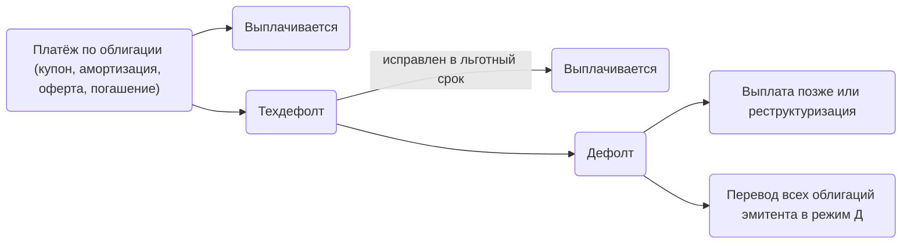

# 
Поиск предикторов дефолтов по облигациям российских эмитентов

*
Исследование на данных московской биржи для разработки функции личного телеграм бота Jessica, служащего для мониторинга облигационного портфеля
*

**Цель** - Jessica оповещает меня о высокой вероятности технического дефолта и дефолта по облигациям в составе моего портфеля, и регулярно проверяет их на дефолтный риск, по запросу проверяет действующие биржевые облигации, которые я намереваюсь купить.  

**Задачи:**
1. Найти источники данных и оценить, насколько глубоко можно исследовать проблему. Собрать список событий — техдефолтов и дефолтов с датами неплатежа — и сверить его с независимыми источниками.
2. Сформулировать гипотезы и зафиксировать до расчётов: признаки, правила, горизонт, приемлемый для меня уровень ложных срабатываний (уровень значимости) и критерий успеха.
3. Собрать данные, которых требуют гипотезы: историю торгов всех корпоративных облигаций по неделям, кривую доходности ОФЗ, ключевую ставку, а для задачи B — даты исправления техдефолтов.
4. Проверить гипотезы задачи A: где главный обвал цены, за сколько недель до неплатежа срабатывает каждое правило, ошибки 1 и 2 рода, уровень против скорости. Выбрать правила, которые работают на отложенном периоде.
5. Составить простую модель, то есть присвоить признакам коэффициенты. Оценить её свойства (PR-AUC, Brier score, доля пойманных техдефолтов, точность оценок вероятности) и сравнить с лучшим правилом при одном и том же уровне ложных срабатываний.
    5.1) Разделение на train/test и кросс-валидация на временных рядах с расширяющимся окном. Доверительные интервалы бутстрепом по эмитентам.
6. Проверить гипотезы задачи B: как растёт риск дефолта со временем после неплатежа и предсказывает ли исход его причина.
7. Перенести правила или модель в Jessica: оценка вероятности техдефолта, тревога выше порога, список ручных проверок.
8. Раз в 7 дней обновлять данные для пересчёта признаков; раз в полгода дообучать модель на новых событиях.
---

*Я выделила 3 источника предикторов дефолта:   
    *1. состояние на бирже конкретного выпуска облигаций*   
    *2. отчётность и события эмитента*  
    *3. события в отрасли эмитента*  

## 
Что я хочу получить от этого исследования

- Возможность распределения инвестиций в высокодоходные облигации в соответствии с риском дефолта
- Опережение рынка по предчувствию дефолта на несколько недель, чтобы успеть выйти из бумаги с минимальными потерями
- Экономия времени на просмотре новостей и отчётностей

 Покупая облигации, инвесторы обычно проверяют предпосылки дефолта, обычно это:    
- высокая доходность для своего рейтинга;    
- наличие техдефолтов в анамнезе;   
- большая долговая нагрузка;     
- постоянный заём новых денег под больший % и уменьшение объёма выпуска;    
- отрицательный или падающий fcf;    
- проблемы с судами и налогами;       
- снижение стоимости облигации;      
- сокращение раскрываемой информации.        
Целью исследования является автоматизация этого процесса, и для этого нужно проанализировать, какие веса имеют эти "общепринятые" признаки на российском рынке.  
Не все из них можно проверить по биржевым данным, поэтому они делятся на две группы. 
Jessica оценивает сама: высокую доходность, снижение цены облигации, техдефолты в анамнезе. 
После сообщения бот предлагает проверить вручную: долговую нагрузку, свободный денежный поток, суды и налоги, сокращение раскрытия, новые займы под растущий процент.

### Контекст
Цена ошибок несимметрична, ложная тревога стоит времени на проверку новостей, а пропущенный техдефолт, а тем более дефолт стоит реальных денег.  
Мой портфель включает 2 брокерских счёта, с облигациями суммарно 24 эмитентов. Около трети составляют надежные эмитенты АА-ААА, по ним невыплаты маловероятны, но я бы хотела в будущем приобретать бумаги с большей доходностью.  
Исходя из этого я определила долю ложных срабатываний на уровне 10%. Это до 8 ложных тревог в год на 24 эмитента; у надёжных эмитентов тревоги почти не загораются, поэтому на деле их будет меньше.

## 
Целевое событие

Поздняя выплата дефолт не отменяет: эмитент может заплатить после льготного срока или договориться с держателями о новом графике, но дефолт уже случился.

    P(дефолт) = P(техдефолт) · P(дефолт | техдефолт)
То есть событие «дефолт» вложено в событие «техдефолт».  
Эти два множителя решают 2 разные задачи: до неплатежа держатель решает, выходить ли из бумаги, и ему нужна P(техдефолт). После неплатежа он решает, продавать ли по обвалившейся цене или ждать, и ему нужна P(дефолт|техдефолт). 

Следовательно, исследование делится на 2 задачи:

```mermaid
graph TD
    A(задачи)
    A -->|найти| B("P(техдефолт)")
    A -->|найти| C("P(дефолт&#124;техдефолт)")
    B -->|около 173 событий, горизонт 16 недель| D(гипотезы A1 - A4)
    C -->|122 дефолта и около 51 вылеченного техдефолта, 10 рабочих дней льготного срока| E(гипотезы B1 - B2)
```

## Гипотезы

**Задача A — раннее предупреждение о техдефолте**
- **A1** Главный обвал цены происходит после неплатежа, а не после дефолта.
- **A2** Сравнение доходности с рынком даёт более сильный сигнал, чем сравнение с ключевой ставкой.
- **A3** Резкое падение цены облигации предупреждает о возможном неплатеже раньше, чем уровень доходности или g-спреда.
- **A4** Модель, собранная из нескольких признаков работает лучше любого отдельного признака.

**Задача B — выплатят ли техдефолт**
- **B1** Со временем после неплатежа риск дефолта растёт непропорционально.
- **B2** Причина неплатежа из сообщения эмитента предсказывает исход.

Подробно гипотезы описаны — в [HYPOTHESES.md](HYPOTHESES.md).

## Ограничения

- Один из главных рисков - **утечка из будущего**. Каждый признак на неделе t должен строиться только из данных, известных до t. Проверяется тестом: если отрезать историю после t, признак не меняется.
- Во избежании **ошибки выжившего** — нужно брать снятые и погашенные выпуски.  
- В выборке только облигации, которые торгуются на бирже. Выводы относятся только к ним.
- Для облигаций с большей ликвидностью выводы будут точнее. По неликвидным бумагам скорее всего будет недоставать данных.
- К счастью, дефолт по облигациям - довольно редкое событие (до недавних пор), для построения сложной модели не хватит данных
- Выплаченные техдефолты раскрываются хуже дефолтов, поэтому их в выборке меньше, чем было на самом деле, и абсолютная вероятность дефолта после техдефолта будет завышена.

## Данные 

Все источники открытые и бесплатные. Подробный разбор каждого в [DATA.md](DATA.md).

| Что | Откуда | Годы | Зачем |
|---|---|---|---|
| История торгов облигациями, карточки выпусков, режимы торгов, график купонов и оферт | ISS Московской биржи | с 2011 | цена, доходность, оборот, даты дефолтов, платежи |
| Кривая доходности ОФЗ | ISS Московской биржи | с 2014 | G-спред |
| Ключевая ставка | ЦБ РФ | с 2013 | стоимость денег, режим рынка |
| Просроченная задолженность по кредитам по отраслям | ЦБ РФ | с 2009 | стресс в отрасли |
| Бухгалтерская отчётность компаний (RFSD) | Росстат и ФНС, сборка Института проблем правоприменения | 2011–2025 | долг, выручка, прибыль, капитал |
| Налоговая задолженность, численность работников | открытые данные ФНС | с 2018 | признак стресса, отличие живого бизнеса от «прокладки» |
| Сообщения о неисполнении обязательств | сервер раскрытия Интерфакса | 2014–2026 | даты неплатежа, причины, техдефолт или дефолт |
| Списки дефолтов и техдефолтов | smart-lab | с 2024 | даты неплатежа для сверки |
| Рейтинговые действия, раскрытие эмитентов | АКРА, Эксперт РА, НКР, НРА, агентства раскрытия | не проверено | события эмитента |

**Чего в данных нет**
- **Даты неплатежа.** 
день дефолта = дата неплатежа по запланированному купону, а не дата перевода в режим «Д». Но биржа публикует именно дату перевода в режим «Д» — в среднем на 18 дней позже неплатежа. Поэтому даты неплатежа собраны из сообщений эмитентов о неисполнении обязательств на сервере Интерфакса (У 99 из 122, у остальных в списках smart-lab, т к они перестали раскрывать информацию). Дата формального дефолта хранится отдельно.
- **Ликвидности у части бумаг.** В случайный день сделки есть у 30–45% облигаций. Для неликвидных выпусков рыночные признаки посчитать не из чего.
- **Готовой истории кредитных рейтингов.** Собирается по пресс-релизам агентств.

**Не используется**
- **Cbonds и RusBonds** — полные базы дефолтов и рейтингов, но платные (200 тыс. рублей)
<!-- 
Где лежат данные. Скачанное хранится вне репозитория, в `~/Documents/Tracking/Invest/research/`: сырые ответы в `raw/`, готовые таблицы в `out/`. Каждый ответ кэшируется, поэтому сбор можно прерывать и продолжать.
-->

## Ключевые детали исследования

- **Состояние рынка.** 2014, 2020, 2022, 2024–2025 — это разные рынки. Поэтому обучение и проверка разделяются по времени - кросс-валидация с расширяющимся окном.
- **Горизонт предсказания** — 16 недель: за это время ещё можно выйти из бумаги, а попадание засчитывается строже, чем при полугодовом горизонте. Для проверки устойчивости считаются 8 и 26 недель.
- **Техдефолты.** Техдефолт — первая ступень любого дефолта. Раннее предупреждение (задача A) ищет новый кредитный техдефолт, а задача B оценивает, дойдёт ли он до дефолта.
- **Дефолт = дефолт эмитента**, а не выпуска. Биржа переводит в «Д» все выпуски сразу, дата у них одна. В режиме «Д» 389 выпусков у 177 эмитентов, из них с 2014 года 118 дефолтов; ещё 4 эмитента объявили дефолт сами, без перевода в «Д». Признаки при этом считаются по каждому выпуску.
- **Выборка = весь рынок корпоративных рублёвых облигаций**. Высокодоходные не отбираются заранее.
- Главный рыночный признак заранее не выбран. Сравниваются четыре кандидата — доходность выше ключевой ставки, цена, спред к ОФЗ и спред относительно рынка — плюс скорость падения цены.
- Гипотезы и уровень ложных срабатываний фиксируются до расчётов. Иначе можно невольно подогнать порог под желаемый результат.
- Модель принимается, только если обыгрывает лучший простой признак при одном и том же уровне ложных срабатываний. Иначе бот просто получает признак.
- Признаки берутся из дневной истории торгов, а не из карточки выпуска. У бумаг после реструктуризации карточку переписывают задним числом, и это была бы утечка из будущего.
