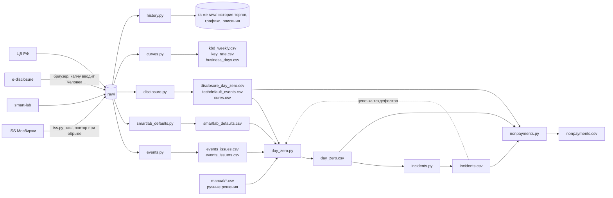
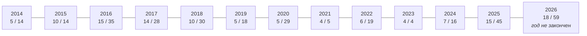

# Данные для исследования предикторов дефолта

Вопрос исследования: по каким признакам можно предсказать техдефолт и дефолт по облигациям
эмитента и за сколько недель. Ниже каждый источник: откуда он взят, что в нём,
зачем он нужен. Данные из источников 1–8 и 13 собраны,
по источникам 9–12 записана только проверка доступа.

<!-- Доступ к источникам проверен 18.09.2026 запросами к ним; сбор этапов 1 и 3 закончен 16.10.2026. -->

Сводка:

| # | Данные | Источник | Роль | Статус |
|---|--------|----------|------|--------|
| 1 | Список всех облигаций | ISS Мосбиржи | список всех облигаций исследования, контрольная группа | собрано |
| 2 | Режимы торгов выпуска | ISS Мосбиржи | **список дефолтов**, дата перевода в «Д» | собрано |
| 3 | Дневная история торгов | ISS Мосбиржи | цена, доходность, объём — основные признаки | собрано |
| 4 | Купоны, оферты, амортизации | ISS Мосбиржи | график платежей, недели до оферты или погашения | собрано |
| 5 | Кривая доходности ОФЗ | ISS Мосбиржи | G-спред | собрано |
| 6 | Ключевая ставка | ЦБ РФ | доходность минус ключевая ставка, режим рынка | собрано |
| 7 | Годовые списки дефолтов | smart-lab | нераскрытые техдефолты, сверка | собрано |
| 8 | Описание выпуска | ISS Мосбиржи | тип купона, структурные облигации, флаги дефолта | собрано |
| 9 | Новости Мосбиржи | moex.com | сверка дат | не собрано |
| 10 | Бухгалтерская отчётность | RFSD (Росстат + ФНС), ГИР БО | долговая нагрузка в предупреждении, этап 6 | не собрано |
| 10а | Налоговая задолженность, численность | открытые данные ФНС | признак стресса | найдено, не проверено |
| 11 | Агрегаты рейтинговых агентств и NUS-CRI | Эксперт РА, НРА, АКРА, NUS | внешний ориентир | второстепенно |
| 12 | События эмитентов, отраслевая статистика | агентства раскрытия, рейтинги, ЕГРЮЛ, ЦБ | события и отрасль | поиск сделан, структура не проверена |
| 13 | Сообщения эмитентов | сервер раскрытия Интерфакса | **дата неплатежа**, техдефолты, причина, выплата, реструктуризации | собрано |

---

## 1. Список всех облигаций

**Откуда.** `iss.moex.com/iss/securities.json?group_by=group&group_by_filter=stock_bonds`,
отдельно с `is_trading=1` (торгуются) и `is_trading=0` (сняты с торгов, погашены).

**Состав данных.** Код, ISIN, название, эмитент (номер, название, ИНН), тип
бумаги, основной режим торгов. В справочнике 15 813 бумаг на 161 странице,
из них 14 753 корпоративные облигации (типы `exchange_bond` 8 556 и
`corporate_bond` 6 197): 3 864 торгуются, 10 889 сняты с торгов или погашены.

**Зачем.** Это знаменатель. Чтобы сказать «признак срабатывает у дефолтных
бумаг», надо знать, как часто он срабатывает у всех остальных. Из этого же
списка берётся контрольная группа.

**Оговорки.**
- Снятые выпуски также попадают в выборку вместе с торгующимися, так как иначе получилась бы
  ошибка выжившего: погашенные и дефолтные бумаги пропали бы, и выборка
  состояла бы из тех, у кого всё хорошо.
- Кроме корпоративных облигаций в справочнике есть субфедеральные (448),
  внебиржевые (213), ОФЗ (210), облигации ЦБ (95), муниципальные (67)
  и международных организаций (27). В исследование идут только типы
  **`exchange_bond` и `corporate_bond`** с номиналом в рублях.
  Из 389 выпусков, побывавших в «Д», у 253 тип `exchange_bond`, у 135
  `corporate_bond`.
  <!-- Ошибка найдена на ревью 22.09.2026; у МОНОП 1P04 (`RU000A10B396`) тип `exchange_bond`, «Биржевая облигация». Выпуск без строки в справочнике — РТК-Лизинг БО-02 (`RU000A0JTUG0`, эмитент 654, «Дыры в графике платежей»), в карточке у него тип `public_ppif`. -->
- **Список собран полным перебором справочника**, так как поиск по
  названию находит не всё: выпуски ОР Групп по запросам «ОР Групп»
  и «Обувь» не находятся.
- **ИНН эмитента пуст у 962 выпусков из 14 753 (6,5%)**, номер и название
  эмитента — у 716.

## 2. Режимы торгов выпуска — дата дефолта

**Откуда.** Тот же `iss.moex.com/iss/securities/{код}.json`, блок `boards`: по
каждому режиму торгов даты `listed_from` / `listed_till` и `history_from` /
`history_till`. Плюс история режима целиком:
`iss.moex.com/iss/history/engines/stock/markets/bonds/boards/{режим}/securities.json?date=…`.

**Почему по режиму «Д» видны дефолты**. По правилам листинга (moex.com/s28) не позднее 2 торговых дней после дефолта биржа переводит облигации эмитента в режим «Облигации Д» и исключает их из первого и второго уровня. Дефолт — просрочка платежа больше 10 рабочих дней, поэтому перевод приходит примерно через 2,5 календарные недели после неплатежа. На реальных 118 событиях с известной датой неплатежа медиана разрыва составила как раз 18 дней, у половины случаев 16–20 дней. Дата перевода — это дата, когда биржа "признала" дефолт, а не дата неплатежа (см. оговорки ниже).

**Что означают даты режима.** listed_from — дата включения бумаги в режим, календарная, поэтому может выпасть на выходной. history_from — первый день торгов в новом режиме. Датой перевода берём listed_from, первым торговым днём — history_from.

**Режимы «Д»:**
- `TQRD` «Т+: Облигации Д» — примерно с 2020 года;
- `EQDB` «Основной режим: Облигации Д» (Т0) — до 2020 года;
- `TQUD`, `TQED` — то же для облигаций в долларах и евро;
- `PSDB`, `PTDB` — внебиржевые сделки (РПС) по бумагам «Д».

Осторожно: `TQOD` — это обычные облигации в долларах, к дефолту отношения не имеет.

**Состав данных.** С 20.07.2009 по 18.09.2026 через режимы «Д» прошли
389 выпусков 177 эмитентов (`events_issues.csv`, `events_issuers.csv`),
распределение по годам — в разделе «Список событий и даты неплатежа», шаг 4. С 2014 года событий
с датой неплатежа 118 (`day_zero.csv`). 55 событий раньше 2014 года
и 4 события вне выборки (3 эмитента только с валютными выпусками
и Пересвет Кэпитал по ручной проверке) в расчёты не входят.

**Оговорки.**
- **Дата перевода позже реального события.** Дефолт по правилам — это
  просрочка больше 10 рабочих дней, перевод — ещё до 2 торговых дней. То есть
  купон не пришёл примерно на две недели раньше даты перевода. Рынок
  узнаёт о неплатёже в день, когда платёж должен был быть, и цена падает
  уже тогда. Если считать днём ноль дату перевода, признаки последних двух
  недель будут содержать сам дефолт. Решение: время события — дата неплатежа.

  **Дата неплатежа не вычисляется от даты перевода в «Д»**, потому что
  срок от неплатежа до перевода у эмитентов разный.
  <!-- Проверено 24.09.2026. Раньше здесь стояло правило «перевод минус 14 рабочих дней», потом «минус 19 дней, для декабря минус 26». --> Дата неплатежа берётся из сообщения эмитента о неисполнении
  обязательств. Если такого сообщения нет, берётся плановый платёж из
  графика биржи, после которого обвалилась цена, а если подходят
  несколько платежей одного эпизода — самый ранний из них. Способ выбора
  записан в колонке `source` файла `day_zero.csv`. Из 118 событий у 101
  дата взята из сообщений эмитентов, у 1 из списка smart-lab и у 16
  выбрана по графику.
  <!-- Числа на 23.10.2026, после сопоставления сообщений по ИНН и строгого сопоставления имён smart-lab. -->
  Так даты, выбранные по правилу, можно перепроверить отдельно. Событие,
  для которого не подходит ни один способ, остаётся с пустой датой и
  пометкой «нужна ручная проверка».

- **Перевод идёт по всем выпускам эмитента сразу.** Дефолт — событие
  эмитента, у всех его выпусков одна дата. Дата дефолта эмитента =
  самый ранний перевод в «Д» среди его выпусков.  

- **Техдефолты сюда не попадают.** Если эмитент заплатил с опозданием,
  но в пределах 10 рабочих дней, это техдефолт, и в режим «Д» бумаги не
  переводят. Техдефолт — целевое событие задачи A, поэтому режим «Д» даёт
  только те из событий, что закончились дефолтом. Остальные техдефолты
  берутся из сообщений эмитентов о неисполнении обязательств на сервере
  раскрытия Интерфакса (п. 13): ранние неплатежи эмитентов «Д» и эпизоды
  эмитентов, которых в «Д» не переводили («Список событий и даты неплатежа», шаг 7). Если эмитент
  неплатёж не раскрыл, техдефолт берётся из списков smart-lab (п. 7).
- **Видны только дефолты по биржевым бумагам.** Эмитенты, у которых
  облигации к моменту дефолта уже сняты с торгов, и дефолты по кредитам
  без облигаций сюда не попадают.
- **Реструктуризация без дефолта.** Это решение общего собрания
  владельцев облигаций или соглашение о новации либо отступном, которое
  меняет условия в пользу эмитента, пока неплатежа ещё не было. Решение
  может перенести погашение или оферту, отсрочить купон или номинал,
  снизить купон. В режим «Д» бумаги при этом не уходят. Событием задачи A
  реструктуризация не считается, так как у неё нет даты неплатежа. Но и
  обычной такую неделю считать нельзя, потому что у эмитента был
  кредитный стресс и сигнал перед ним засчитался бы как ложная тревога.
  Поэтому 16 недель перед решением не используются ни в подборе порогов,
  ни в оценке. После решения строки эмитента снова идут в выборку.
  Решения, принятые меньше чем за 16 недель до события эмитента или
  после него, не учитываются, так как эти недели уже размечены событием.
  Список решений — `manual/manual_restructuring.csv`, в нём 67 решений
  у 32 эмитентов. Как он собран — ниже, «Реструктуризации без дефолта:
  решения ОСВО».

## 3. Дневная история торгов

**Откуда.** `iss.moex.com/iss/history/engines/stock/markets/bonds/securities/{код}.json`.
Биржа отдаёт историю частями по 100 торговых дней, следующая часть запрашивается параметром start (0, 100, 200…)
Скачана история с 2014 года всех 14 753 корпоративных выпусков
(`history.py history`): 5,7 млн строк, торги были у 8 360 выпусков,
у 7 737 из них номинал в рублях.

**Состав данных.** Одна строка — один выпуск в один день в одном режиме
торгов. Цена закрытия и средневзвешенная (`CLOSE`, `WAPRICE`,
в % номинала), доходность (`YIELDCLOSE`), оборот в рублях (`VALUE`), число
сделок (`NUMTRADES`), накопленный купонный доход, текущий номинал и его
валюта, дюрация, последний день приёма заявок на ближайшую оферту
(`BUYBACKDATE`, с 2018 года). Поле даты оферты (`OFFERDATE`) пустое
во все годы.

**Зачем.** Из дневной истории считаются признаки: цена, G-спред, доходность относительно
ключевой ставки, скорость падения цены, всплеск оборота и доля недель со сделками
(HYPOTHESES, признаки 1–7 и 10).

**Оговорки.**
- **Если бумаги торгуются редко.** У медианного выпуска сделки были в 29% от всех его
  дней на бирже. У 31% выпусков сделки бывают реже чем в 5% дней, у 1 574
  не было ни одной сделки, а у 35% сделки идут больше чем в 75% дней.
  <!-- Посчитано в out/знакомство_с_данными.ipynb по 8 360 выпускам с историей после 2014 года. --> То есть в обычный день цены нет больше чем у половины выпусков, и признаки считаются по неделям, так как за неделю сделка находится чаще, чем за один день. Доля недель со сделками тоже признак (HYPOTHESES, признак 10).
- **Цена по одной-двум сделкам шумная.** Одна мелкая сделка может дать
  цену заметно ниже рынка. Поэтому цена недели — средневзвешенная
  за неделю (HYPOTHESES, признак 1), а у эмитента берётся самый
  ликвидный выпуск.
- **Режимы торгов менялись.** До 2019 года корпоративные облигации
  торговались в режиме `EQOB` (Т0), потом в `TQCB` (Т+), облигации
  сектора повышенного инвестиционного риска — в `TQIR`. Запрос по коду
  бумаги без указания режима отдаёт все режимы, поэтому в 1,9% дней один
  день выпуска приходит несколькими строками, по строке на режим. Сделки
  при этом почти всегда идут в одном режиме: у рублёвых выпусков сделки
  в двух режимах в один день были один раз за 2014–2026 годы, у юаневых
  (56 выпусков, `TQCB` и `TQOY`) — в 20 488 дней. При сборке недельной
  таблицы строки одного дня складываются в одну.
- **Поле типа облигации (`BONDTYPE`) в истории пустое во все годы**,
  поэтому флоатеры и бумаги с фиксированным купоном различаются по
  описанию выпуска (п. 8) и графику купонов (п. 4). Это важно: доходность
  флоатера ISS считает по текущему купону, и его спред нельзя сравнивать
  со спредом бумаги с фиксированным купоном.
- **Ставка купона (`COUPONPERCENT`) в истории есть только с мая 2020 года**,
  за ранние годы она берётся из графика купонов (п. 4).
  <!-- Посчитано 26.10.2026 по всей истории: в днях со сделками поле заполнено в 2020 году у 58% строк, в 2021–2023 у 98–99%, в 2024 у 94%, в 2025 у 86%, в 2026 у 82%. -->
- **Поле Z-спреда (`ZSPREAD`) пустое** у всех торговавшихся
  корпоративных облигаций в срезах 2014–2024 годов, поэтому готовый
  спред ISS не используется, G-спред считается по КБД (п. 5).
- **В качестве признака цены используется % от номинала.** У
  амортизируемых облигаций номинал уменьшается, а цена в процентах от
  этого не падает, чтобы амортизация не казалась падением цены.

**Недельная доходность и дюрация — решение автора 05.11.2026.**
Используется последний день календарной недели со сделками, включая
рабочую субботу, если сделки были в неё. Пара берётся из согласованных
полей одной даты и режима, рассчитанных по одной цене и к одному сроку.
Если в выбранный день необходимых значений нет, остаётся пропуск;
более ранний день вместо него не подставляется. Средневзвешенная цена
недели при этом рассчитывается отдельно по принятой формуле из оборота.

**Проверка полей ISS 05.11.2026:** в доступных официальных описаниях
`YIELDCLOSE` относится к цене последней сделки, `YIELDATWAP` —
к средневзвешенной цене, а однозначной связи исторического `DURATION`
с одним из этих полей не найдено. Описание пары доходность/дюрация
на [странице Мосбиржи](https://www.moex.com/ru/bondization/durations)
такой связи тоже не устанавливает. Поэтому конкретное поле доходности
для G-спреда пока не выбрано. Загрузка методики с `fs.moex.com/files/6908/`
не удалась: веб-инструмент получил ошибку, локальные клиенты — ошибку
проверки сертификата. Проверка пары остаётся открытой; считать её
выполненной только по совпадению строк нельзя.

**Контрольный расчёт 05.11.2026:** проверка локального кэша поддерживает
пару `YIELDATWAP` + `DURATION`. Скрипт `scripts/check_duration.py`
отобрал 2 122 строки по 828 выпускам с постоянными купонами, одним
платежом номинала и без оферт в доступном графике. На каждый год
выпуска взята строка с наибольшим различием двух доходностей.
Для содержательного сравнения оставлены 266 строк по 166 выпускам
за 2014–2026 годы: график объясняет обе исходные цены с отклонением
не больше 1 рубля при номинале 1 000 рублей, а рассчитанные дюрации
различаются хотя бы на 5 дней.

В контроле дюрация рассчитана как средний срок платежей с весами,
равными их дисконтированной стоимости. Знаменатель — сумма этих
стоимостей; при точной доходности она равна цене с НКД из формулы (27).
Использован базис 365 дней. Для каждой из двух доходностей одинаково
проверены сдвиги даты расчёта на 0–3 календарных дня: это проверка
устойчивости вывода, а не восстановленный биржевой календарь расчётов.
При `YIELDATWAP` наименьшая ошибка не превышает 0,6 дня во всех
266 случаях; медиана ошибки — 0,26 дня. При `YIELDCLOSE` ни одна
ошибка не укладывается в 0,6 дня; медиана — 7,54 дня.

Это эмпирическое основание для выбора `YIELDATWAP`, а не доказательство
единого правила для всех облигаций. Выпуски с офертами, переменными
купонами и особыми условиями этим контролем не проверены. Нынешний
график использован только для проверки расчёта: переносить его сведения
в исторические признаки нельзя. Конкретная пара полей пока не внесена
в утверждённый каркас; таблицы признаков не собирались.

**Методика предоставлена автором 05.11.2026.** Прочитан PDF
«Методика расчета НКД и доходности 220626.pdf» из папки Downloads,
редакция действует с 22.06.2026. В разделе 3.5, формула (27),
определена дюрация Маколея в годах по цене с НКД и дисконтированным
платежам с эффективной доходностью к погашению или ближайшей оферте.
Формула (31) задаёт G-спред в базисных пунктах как
`100 × (Y − r(D))`, где `D` — дюрация Маколея в годах,
а `Y` и `r(D)` — доходности в процентах. Это подтверждает выбранный
вид формулы G-спреда; в наших признаках результат хранится в п.п.,
поэтому множитель 100 не нужен.

Название раздела 3.5 относится к калькулятору на сайте. Имена полей
`YIELDCLOSE`, `YIELDATWAP` и `DURATION` в документе не приведены,
поэтому соответствие исторических полей этим расчётам по нему не
установлено. Примечание раздела 3.4 о цене последней сделки за 31 день
относится к описанному там показателю доходности к оферте, а не доказывает
выбор цены для любого поля дюрации ISS. Применимость редакции 2026 года
ко всему периоду с 2014 года тоже не подтверждена.

**Примеры расчётов предоставлены автором 05.11.2026.** PDF
«Примеры расчетов с изменениями.pdf» — презентация планируемых изменений
в декабре 2025 года. Примеров дюрации и соответствия полям ISS в ней нет.
Зато показаны изменения определения доходности при одной и той же цене:
для дисконтного выпуска Сбербанк 001Р-SBERD2 простая доходность 18,45%
заменяется эффективной 14,82% (слайд 3); у РусГидро БО-П07 в последнем
купоне — 17,79% на 19,21% (слайд 4). Для корпоративного флоатера
Россельхозбанка показан переход от постоянного будущего купона к прогнозу
по форвардной кривой, доходность меняется с 20,58% на 16,51% (слайд 5).
Это примеры изменения методики, а не наблюдаемого движения рынка.

При проверке исторических полей нужно учитывать смену методики:
одинаковое имя поля не гарантирует одинаковое определение доходности
во все годы. Презентация описывает планы и сама по себе не устанавливает
фактическую дату внедрения. Описанный на слайде 8 новый классификатор
с подвидами «до оферты (call)» и «до оферты (put)» не доказывает наличие
этих сведений в нашем кэше или их доступность на прошлые даты.

## 4. Купоны, оферты, амортизации

**Откуда.** `iss.moex.com/iss/statistics/engines/stock/markets/bonds/bondization/{код}.json`.
Скачан для всех корпоративных выпусков с `limit=unlimited` (`history.py
bondization`).

**Состав данных.** Даты и суммы купонов, даты оферт (дата, окно предъявления,
цена), даты и суммы амортизации.

**Зачем.**
- По графику считается признак «число недель до ближайшей оферты или
  погашения» (HYPOTHESES, признак 9). К этим датам
  эмитенту нужно найти деньги на выкуп или погашение выпуска и часто неплатежи случаются именно здесь.
- По графику выбирается дата неплатежа, если сообщения эмитента нет:
  ею становится плановый платёж, после которого обвалилась цена (п. 2).

**Оговорки.**
- Это график на день скачивания. Будущие купоны флоатеров в нём
  не объявлены, сумма пустая.
- **В графике отсутствует часть оферт.** Из 763 оферт, которые биржа показывала
  в `BUYBACKDATE` у 200 случайных выпусков, в графике нет 215 (28%),
  а у части старых выпусков блок оферт пуст совсем (РТК-Лизинг БО-02).
  Поэтому с 2018 года оферты берутся и из поля `BUYBACKDATE` дневной
  истории (ниже, «Даты оферт: график против BUYBACKDATE»).
- Оферту могут назначить или отменить уже после размещения, а график
  показывает её сегодняшнее состояние. Поэтому признак 9 видит оферту
  только с даты прошлой оферты или размещения, а с 2018 года — по полю
  `BUYBACKDATE` (HYPOTHESES, признак 9; ниже, «Даты оферт: график
  против BUYBACKDATE»). Если оферте предшествовало решение собрания
  владельцев об изменении условий, она считается известной с даты
  решения, а с 2018 года — с появления в `BUYBACKDATE`, если поле её
  показывало. Не закрыт случай
  до 2018 года, когда оферту назначили в середине срока без решения
  собрания: правило считает её известной с размещения или прошлой
  оферты.

## 5. Кривая доходности ОФЗ

**Откуда.** `iss.moex.com/iss/engines/stock/zcyc.json?date=…` — кривая
бескупонной доходности (КБД) Мосбиржи, есть с 06.01.2014. Запрос истории КБД history/engines/stock/zcyc отдаёт кривую только за сегодняшний день, поэтому кривая запрашивается на каждую пятницу
(`curves.py kbd` → `out/kbd_weekly.csv`).

**Состав данных.** 663 недели с 10.01.2014 по 09.10.2026, 1 строка для 1 недели. В ней записаны параметры кривой (модель
Нельсона — Сигеля — Свенссона, B1–B3, T1, G1–G9) и доходности ОФЗ на
сроках 0,25; 0,5; 0,75; 1; 2; 3; 5; 7; 10; 15 и 20 лет.

**Зачем.** Доходность облигации растёт и когда растут все ставки, и когда
растёт кредитный риск эмитента, а предсказать нужно второе. G-спред (HYPOTHESES,
признак 2) — доходность облигации минус доходность ОФЗ того же срока —
убирает влияние ключевой ставки. Однако в период неопределённости спреды расширяются у всего
рынка. Например, между 01.06.2023 и 20.12.2024 медианный спред ликвидных
корпоративных облигаций вырос с 1,9 до 8,9 п.п. <!-- Проверка 19.09.2026, подробно в JOURNAL. -->
Поэтому считается также процентильный ранг G-спреда облигации среди всех корпоративных облигаций, то есть его место среди спредов всего рынка на той же неделе (признак 3).

**Оговорки.**
- Срок облигации берётся из дюрации в истории торгов (п. 3), а
  доходность ОФЗ на этот срок считается по параметрам кривой той же
  недели, по формуле Мосбиржи: G(t) = B1 + (B2 + B3)·(T1/t)·(1 − e^(−t/T1)) −
  B3·e^(−t/T1) + Σ Gᵢ·e^(−(t − aᵢ)²/bᵢ²), в базисных пунктах, доходность
  в процентах — (e^(G/10000) − 1)·100. Постоянные Мосбиржи: a₁ = 0,
  a₂ = 0,6, aᵢ₊₁ = aᵢ + 0,6·1,6^(i−1); b₁ = 0,6, bᵢ₊₁ = 1,6·bᵢ.
  <!-- Формула проверена 22.10.2026 на неделе 10.01.2014: на сроках 0,25; 1; 5; 10 и 20 лет совпадает с доходностями ISS до четвёртого знака. -->
- У облигаций с офертой ISS считает доходность к оферте, поэтому и срок
  для кривой берётся до оферты.
- Доходность в истории есть только в дни со сделками (п. 3), поэтому
  G-спред есть только в недели со сделками.
- G-спред вычитает друг из друга разные величины: доходность купонной
  облигации и бескупонную доходность ОФЗ. У длинных облигаций с высоким
  купоном ошибка заметна (HYPOTHESES, признак 2).
- В качестве обозначения недели используется пятница, кривая
  берётся на пятницу или, если в пятницу торгов не было, на предыдущий
  торговый день той же недели. В данных отсутствуют 4 недели: 03.01.2014, так как кривая начинается 06.01.2014, и 04.03, 11.03 и 18.03.2022, когда торги ОФЗ не шли. У 22 недель с праздничной пятницей используется кривая за предыдущий торговый день.

## 6. Ключевая ставка ЦБ

**Откуда.** `cbr.ru/hd_base/KeyRate/` — таблица ЦБ по дням с 13.09.2013
(`curves.py keyrate` → `out/key_rate.csv`), сырой ответ лежит
в `raw/cbr_keyrate_<дата>.html`.

**Состав данных.** Значение ключевой ставки на каждый рабочий день: 3 205 дней
с 09.01.2014 по 15.10.2026, 65 изменений, от 4,25 до 21%.

**Зачем.**
- Получить признак 4 «доходность минус ключевая ставка» и правило П1
  на нём (HYPOTHESES), так как по превышению доходности над ключевой
  ставкой видно, насколько дороже рынка эмитенту обходятся деньги.
- Проверить гипотезу A2, в которой правило П1 сравнивается со спредом
  относительно рынка.

**Оговорки.** Ставка меняется скачками по решениям совета директоров ЦБ,
поэтому берётся её значение на пятницу недели или на предыдущий рабочий
день (HYPOTHESES, «Неделя»), а не среднее за неделю.

## 7. Годовые списки дефолтов smart-lab

**Откуда.** Финансовый словарь smart-lab:
`smart-lab.ru/finansoviy-slovar/defaults-2024`, `…/defaults-2025`,
`…/defaults-2026` (`smartlab_defaults.py` → `out/smartlab_defaults.csv`).
Страниц за 2018–2023 годы нет, на них сайт отвечает 404.
<!-- Сводная страница …/russian-bonds-defaults открыта 23.10.2026: одна фраза «не менее 365 дефолтных выпусков до 2023 года» без источника и разбивки по годам, 18 названий эмитентов (в основном кризис 2008–2009) и таблица рейтингового агентства по рейтингуемым объектам. Дат неплатежа нет, поэтому в сбор не входит. Число 365 считается с 1990-х и с выборкой ISS с 2012 года не сравнивается. -->

**Состав данных.** Это не таблица, а текстовый список по эмитентам. Пример записи
2025 года: «ООО «Феррони» (техдефолт по части номинала с 13.01.2025, …,
техдефолт с 03.06.2025, с 20.06.2025 дефолт)». Разобрано 63 записи
с датами: 13 за 2024 год, 22 за 2025 и 28 за 2026.

**Зачем.**
- Чтобы узнать о техдефолтах, которых нет в данных Мосбиржи о режиме «Д» (п. 2).
- Получить дату неплатежа, которая раньше даты перевода.
- Сверка списка, построенного по ISS мосбиржи.

**Оговорки.**
- Список написан людьми текстом. 230 нераспознанных строк — заголовки
  и пояснения, дат в них нет. У одной записи вместо названия эмитента
  попала цитата, и она осталась несопоставленной.
- ISIN в списке нет, поэтому записи сопоставляются с эмитентами ISS
  по названию без формы собственности и кавычек: целиком или по началу,
  так как smart-lab сокращает названия. Два сокращения,
  которые не раскрыть с помощью регулярного выражения («Завод КЭС», «ФПК»), записаны
  в `day_zero.py`. 43 записи сопоставлены с 38 эмитентами, переведёнными
  в «Д». Остальных 20 записей в ISS в режиме «Д» нет: 15 найдены среди
  неплатежей вне «Д» с датой в пределах 3 дней, в том числе ЖКХ Саха
  (2 записи), Фабрикс и 5 неплатежей с заявленной технической причиной
  (Петербургснаб, Брусника, Остров машин, Самолёт, КЛВЗ Кристалл,
  «Список событий и даты неплатежа», шаг 7), у ХК Эволюции и Пром Гаранта
  облигаций нет в справочнике Мосбиржи, Доминион неплатёж на e-disclosure
  не раскрывал, у «Восток-ойла» и записи без названия причину не разбирала.
  <!-- Пересчитано 27.10.2026 по nonpayments.csv: после сопоставления сообщений по ИНН у ЖКХ Саха и Фабрикса нашлись сообщения о неплатеже. Самолёт, КЛВЗ Кристалл и ЖКХ Саха сопоставлены по дате, так как их названия в smart-lab и ISS расходятся. -->
  <!-- Пересчитано 26.10.2026 по сопоставлению имён из day_zero.py. Раньше в сверке эпизодов вне «Д» было 19 записей: Росгео, Завод КЭС и Гарант-Инвест не узнавались среди эмитентов «Д», а «Восток-ойл» ложно с ними совпадал. -->
- Дата из smart-lab найдена у 36 событий, но в дату неплатежа попала
  один раз, у Завода КриалЭнергоСтрой, где сообщения эмитента нет.
  У остальных 35 есть дата из раскрытия, а она главнее. У 19 событий
  даты совпадают, у 11 smart-lab позже на день, так как пишет начало
  техдефолта, у 6 расходится от −46 до +14 дней.
  <!-- Числа на 23.10.2026, после строгого сопоставления имён. -->

## 8. Описание выпуска

**Откуда.** `iss.moex.com/iss/securities/{код}.json`, блок `description`.
Скачано для всех 14 753 корпоративных выпусков (`history.py describe`).

**Состав данных.** Дата размещения и погашения, объём выпуска, номинал,
частота купона, текущая ставка купона, уровень листинга, признак «только для
квалифицированных инвесторов», вид облигации (фиксированный купон, флоатер),
код эмитента, флаги `HASDEFAULT` (допущен дефолт) и `HASTECHNICALDEFAULT`
(допущен технический дефолт).

**Зачем.** Получить список всех рублёвых корпоративных облигаций, определить тип
купона (флоатер или постоянный), найти структурные облигации и сверить список
дефолтов с флагами `HASDEFAULT` и `HASTECHNICALDEFAULT`.

**Оговорки.**
- **Это снимок на день скачивания, истории значений нет, поэтому все поля
  здесь считаются изменяемыми.** <!-- Уточнено на ревью 22.09.2026: раньше здесь было записано, что объём, даты, частота купона и признак для квалов не меняются. Описания скачаны 16.10.2026. -->
У бумаг, прошедших реструктуризацию, график платежей и дата погашения переписываются, а признак «для квалов» и уровень листинга меняются по решению биржи. Именно у дефолтнувших выпусков такие правки обычно и случаются. Поэтому в их строках возникает утечка из будущего, то есть в них оказываются значения, записанные после реструктуризации, которых на неделе прогноза ещё не было. Но по этим строкам модель учится находить дефолт и по ним же проверяется. Проверка, при которой признаки недели t считаются только по данным до этой недели, такую утечку не обнаруживает, так как в описании выпуска уже записано новое значение поля.
  Из-за этого признаки берутся из дневной истории торгов (п. 3), где значение
  зафиксировано в день торгов. Поля описания используются для списка
  всех облигаций, отбора рублёвых выпусков, определения типа купона, поиска
  структурных облигаций и сверки флагов дефолта.
- **Флаги дефолта неполны, поэтому список по ним не строится.** Флаг
  `HASDEFAULT` стоит только у 21% выпусков, переведённых в «Д» (проверка — в разделе «Список событий и даты неплатежа», шаг 4).
- **Тип облигации (`BOND_TYPE`) пуст у 4 246 из 7 737 рублёвых выпусков**
  с историей, в основном у старых, а одно и то же значение записано
  по-разному («Флоатер» и «Облигация с плавающим купоном»). Поэтому тип
  купона определяется по графику купонов (ниже, «Тип купона: описание
  и график купонов»).
- **Рубль в описании и справочнике записан как `SUR`**, в дневной
  истории как `RUB`, а до 2018 года как `RUR`. У старых выпусков валюта
  в справочнике пуста (РТК-Лизинг БО-02), поэтому валюта берётся
  из дневной истории (п. 3), где поле заполнено во все годы.

## 9. Новости Мосбиржи

**Откуда.** `www.moex.com/export/news.aspx` — Jessica уже читает этот экспорт.

**Зачем.** Сверка дат перевода в режим «Д» на случаях, где ISS и smart-lab
расходятся.


## 10. Бухгалтерская отчётность

**Откуда.** RFSD — открытая база бухгалтерской отчётности Института
проблем правоприменения (`tochno.st/datasets/rfsd`, зеркало `irlspbru/RFSD`
на Hugging Face): данные Росстата и ФНС за 2011–2025 годы, 223 показателя,
есть ИНН, лицензия CC BY 4.0. Отчётность отдельной компании есть в ГИР БО
ФНС (`bo.nalog.gov.ru`): на сайте она бесплатна, выгрузка всей базы стоит
200 000 ₽ в год и доступна юридическим лицам.
<!-- RFSD найдена на ревью 22.09.2026, доступ к ГИР БО проверен 19.09.2026. Подробные условия доступа, план сбора через сайт и оговорки (опоздание годовой отчётности до 1 апреля, скрытие отчётности с 2022 года по ПП № 1624, СПВ с нулевой выручкой) — в коммите f9369ca. Сокращено 23.10.2026. -->

**Зачем.**
- Показать долговую нагрузку эмитента (долг к EBITDA, к активам) вместе
  с предупреждением Jessica (HYPOTHESES, «Ручная проверка после
  предупреждения»). Для этого достаточно ссылки на страницу эмитента
  в ГИР БО.
- Проверить на этапе 6, добавляет ли отчётность сигнал к рыночным
  признакам, так как цена и доходность отражают то, что рынку уже
  известно, а отчётность показывает причину: долг к выручке, покрытие
  процентов, отрицательный капитал.

**Данные из этого источника не получены.** Этап 6 начинается после модели на рыночных признаках.
Как в RFSD закодированы показатели и насколько полно в ней покрыты
небольшие эмитенты, не проверено.

## 10а. Открытые данные ФНС о налогах
<!-- найдено 22.09.2026 -->

**Откуда.** `nalog.gov.ru/opendata` — наборы в CSV и XML, бесплатно,
по ИНН. Нужные наборы: суммы задолженности по налогам и взносам
(набор `7707329152-debtam`), сведения о налоговых правонарушениях
и штрафах, среднесписочная численность работников, уплаченные налоги.

**Зачем.** Налоговая недоимка — прямой признак того, что у компании
кончились деньги, и появляется он раньше неплатежа по облигациям.
Численность работников показывает, живой ли это бизнес или пустая
финансовая «прокладка».

**Оговорки.**
- **Не проверено**, с какого года лежат наборы, как часто обновляются
  (по описанию — задолженность ежеквартально, налоги и нарушения
  ежегодно), какова задержка публикации. Задержка критична: признак
  на неделю t считаем только по наборам, опубликованным до t.
- Данные раскрываются по правилам ст. 102 НК (сведения, не
  составляющие налоговую тайну). Часть компаний может отсутствовать.
- Сопоставление с эмитентом — по ИНН из справочника биржи.

## 11. Внешние источники — второстепенный ориентир

Открытых микроданных по облигациям с ценами и дефолтами нет, поэтому внешние данные слудат лишь ориентиром для сверки.

- **Матрица дефолтов Эксперт РА** (`raexpert.ru/ratings/managing/matrix/`)
  и **исторические уровни дефолтов НРА** (`ra-national.ru`) — частота
  дефолтов по рейтинговым категориям с 2010 года. Нужно сверить, похожа ли
  доля дефолтов в нашей выборке по годам на их цифры.
- **Исследование АКРА «Дефолты 2025»** (`acra-ratings.ru/research/2834/`) —
  сверка числа дефолтов за год.
- **NUS-CRI** (Сингапур, `nuscri.org`) — бесплатные вероятности дефолта
  по 90 тыс. публичных компаний мира, Россия в том числе. Без подтверждения
  профессиональной квалификации доступ к 3 000 компаний. Эмитенты ВДО почти
  все непубличные, поэтому пригодится только для крупных эмитентов.
  Регистрацию и реальное покрытие не проверяла.
<!-- STOPPED HERE -->
## 12. События эмитентов и отраслевые данные
<!-- поиск 19.09.2026 -->

### События эмитента

| Источник | Информация в источнике | Доступ | Статус |
|---|---|---|---|
| Раскрытие существенных фактов: Интерфакс (`e-disclosure.ru`) | неплатежи, смена руководства, сделки, решения собраний — официально и с датой | 403, капча | неплатежи, выплаты и решения собраний используются с 25.09.2026 (п. 13), капчу проходит человек |
| Раскрытие: Прайм (`disclosure.1prime.ru`), Азипи (`e-disclosure.azipi.ru`), СКРИН (`disclosure.skrin.ru`), AK&M (`disclosure.ru`) | то же у эмитентов, которые раскрываются через эти агентства | 200, 200, 200, 302 | Азипи, СКРИН и AK&M проверены 24.10.2026 по 17 событиям без даты из раскрытия, дат не добавили; Прайм не проверен, так как поиск работает только в браузере |
| Рейтинговые агентства: АКРА, Эксперт РА, НКР, НРА | понижения, прогнозы, «на пересмотре», отзывы рейтинга — с датами | все 200 | кандидат, сильный |
| ЕГРЮЛ (`egrul.nalog.ru`), «Прозрачный бизнес» (`pb.nalog.ru`) | дата смены руководителя и учредителей, реорганизация | 307, 200 | кандидат |
| Федресурс / ЕФРСБ (`fedresurs.ru`) | намерение кредитора подать на банкротство (публикуется не менее чем за 15 дней до суда), процедуры банкротства | 401 для скриптов, защита Qrator с капчей | не собирали |
| Картотека арбитражных дел (`kad.arbitr.ru`) | иски к эмитенту | 200, но известна защитой от ботов | не проверено; капчу не обходить |
| Новости smart-lab | корпоративные новости, Jessica уже классифицирует их по категориям | RSS — только свежее | глубина архива не проверена |
| GDELT | мировая база новостей, есть русскоязычные СМИ | 429 (лимит запросов); API статей — только последние месяцы, полный архив — через BigQuery | низкий приоритет |

Оговорки:
- **Агентств раскрытия пять**, все аккредитованы ЦБ: 
1. AK&M   
2. Азипи  
3. Интерфакс    
4. Прайм  
5. СКРИН  
Эмитент раскрывается через одно из них.
  **В исследовании используется только Интерфакс**, так как по его сообщениям
  выбрана дата неплатежа у 101 из 118 событий с переводом в «Д» (п. 2).
  *В Азипи, СКРИНе и AK&M ни у одного из остальных 17 эмитентов нет сообщения о неплатеже, по которому выбрана дата, поэтому эти агентства дат не добавили. Прайм не проверен, так как поиск по ИНН у него работает только в браузере.*
  <!-- Проверено 24.10.2026 по ИНН. Фабрикс, ЖКХ Саха и Доминион не проверялись. -->
- **С 2022 года часть эмитентов вправе раскрывать сведения в ограниченном
  объёме.** Это эмитенты под санкциями, организации ОПК и компании из новых
  регионов. Не раскрывать они могут сведения о сделках, о контрагентах под
  санкциями и об оборонной продукции (ПП РФ от 04.07.2023 № 1102).
  На сообщения о неплатеже это не повлияло: дата неплатежа из раскрытия
  есть у 57 из 68 событий 2014–2021 годов (84%) и у 44 из 50 событий
  2022–2026 годов (88%). 
  <!-- Проверено 24.10.2026: текст ПП № 1102 на legalacts.ru, сообщения типа 178 по годам из raw/edisclosure/sevents_*.json, доли по day_zero.csv. Акт, действовавший в 2022 году до ПП № 1102, не найден. -->

- **Рейтинг есть не у всех выпусков.** Отсутствие рейтинга само по себе является 
  признаком высокого риска. Отзыв рейтинга по инициативе эмитента — возможно, сильный
  сигнал.
- **Смена гендиректора в ЕГРЮЛ** видна с датой внесения записи. В раскрытии она
  может появиться на недели позже фактического решения.
- **Федресурс** публикует намерение кредитора подать на банкротство
  не позже чем за 15 дней до суда. Сайт закрыт защитой Qrator,
  скрипт получает код 401 и страницу с капчей, поэтому автоматически его не прочитать.
  <!-- Проверено 24.10.2026. -->

### Отрасль и экономика

| Источник | Данные в источнике | Статус |
|---|---|---|
| Собственные данные исследования | медианный спред отрасли и скорость его изменения, число дефолтов в отрасли за полгода | внешних данных не нужно |
| ЦБ, таблица 302-09 | просроченная задолженность юрлиц по кредитам в рублях по отраслям (строительство, недвижимость, торговля, обрабатывающие и др.), помесячно, Excel | проверено: апрель 2009 — январь 2019 |
| ЦБ, данные после 2019 | то же, помесячно с 01.02.2019 по 01.09.2026, отрасли те же, что в 302-09 (`cbr.ru`, «Сведения о размещённых и привлечённых средствах», файл `01_02_A_Debt_corp_by_activity.xlsx`, лист «в т.ч. просроч. в рублях») | проверено |
| Росстат | индексы производства по видам деятельности ОКВЭД2, помесячно с января 2015 по декабрь 2025 года (`ind_baza_2018_12-2025.xlsx`); индексы по строительству не найдены | промышленность проверена, строительство нет |

Оговорки:
- **Разрыв ряда ЦБ в 2019 году.** Старые данные написаны по ОКВЭД, новые —
  по ОКВЭД2. Отрасли придётся сопоставлять вручную, и сопоставление
  будет неточным.
- **Статистика ЦБ выходит с задержкой около месяца.** Поэтому обучать будем только на данных, опубликованных до конкретной недели.
- **Для финансовой деятельности (лизинг, МФО)** в таблице ЦБ нет отдельной строки. Для этих отраслей остаются только собственные данные.

## 13. Сообщения эмитентов на сервере раскрытия Интерфакса

**Откуда.** `e-disclosure.ru`. Поиск по сообщениям — POST
`/api/search/sevents`, отдаёт JSON: дата, номер и краткое имя компании,
номер сообщения. Текст сообщения — страница
`portal/event.aspx?EventId=…`.

**Состав данных.** Сообщения эмитентов, нужные исследованию, по типам:
- 178 «`Неисполнение обязательств эмитента перед владельцами его эмиссионных ценных бумаг`» — 4402 сообщения с 2014 года от 465 компаний.
  В сообщении плановая дата платежа, выпуск, вид платежа (купон, номинал,
  оферта), статус «`технический дефолт`» или «`дефолт`» и причина
  неисполнения;
- 167 «Выплаченные доходы или иные выплаты» — фактическая выплата,
  в том числе после неплатежа;
- 253 «`Решения, принятые общим собранием владельцев облигаций`» — 723
  сообщения с 2015 года, и 311 «`Заключение соглашения о новации или предоставлении отступного`» — 11 сообщений.

**Зачем.**
- Получить дату неплатежа из первоисточника, так как от неё отсчитываются
  горизонт 16 недель и опережение сигнала, а перевод в режим «Д» случается позже
  неплатежа, по медиане на 18 дней. Из 101 даты, выбранной по сообщениям
  (п. 2), 76 выбраны автоматически и 25 при ручной проверке
  (`day_zero.csv`, колонка `source`).
- Найти техдефолты, которых нет в режиме «Д» в iss мосбиржи, так как задача A предсказывает
  техдефолт, а в «Д» биржа переводит только при дефолте.
- Отделить неплатёж эмитента от неплатежа держателям без реквизитов, так как
  второй о деньгах эмитента ничего не говорит, и отметить неплатежи
  с заявленной технической причиной, так как проверить её по тексту нельзя.
- Узнать дату выплаты после техдефолта для задачи B, в которой сравнивается,
  когда техдефолт доходит до дефолта, а когда выплачивается.
- Найти реструктуризации без дефолта, так как недели перед решением
  общего собрания исключаются из подбора порогов и оценки (п. 2).

**Оговорки.**
- **Видны только эмитенты, которые раскрываются через Интерфакс.**
  У 17 событий без даты из сообщений другие агентства раскрытия дат
  не добавили (п. 12).
- **Шаблон формы перечисляет оба исхода** («технический дефолт,
  дефолт»), а сбоку страницы стоит лента новостей. Поэтому статус
  ищется только в теле сообщения, после удаления шаблона.
- **Не каждый неплатёж раскрыт.** Мосрегионлифт и Финансовые системы
  о дефолте не сообщали, их даты взяты из ручной проверки. Доминион
  о неплатеже не сообщал вовсе, его техдефолт известен только
  по smart-lab (п. 7) и в таблицу неплатежей не входит.

## Порядок этапов и какие данные нужны на каждом

Сначала собираются данные, без которых нельзя получить первую оценку:
список событий, рыночные признаки, правила и модель с проверкой на годах,
на которых она не обучалась (этапы 1–5). Отчётность, отрасль и события
эмитента добавляются потом, по одному блоку, и каждый блок проверяется
на то, улучшает ли он результат по сравнению с рыночными признаками.
<!-- Порядок пересобран 22.09.2026 после ревью: прежний начинался с отрасли, так как её данные собрать проще всего, хотя ожидаемый вклад у неё самый слабый. -->

Каждый этап заканчивается проверкой, и следующий этап начинается, только если она пройдена.

| Этап | Задача | Источники | Проверка |
|---|---|---|---|
| 1 | Составить список дефолтов и техдефолтов с 2014 года и найти дату неплатежа для каждого события | [1](#1-список-всех-облигаций), [2](#2-режимы-торгов-выпуска--дата-дефолта), [7](#7-годовые-списки-дефолтов-smart-lab), [8](#8-описание-выпуска), [13](#13-сообщения-эмитентов-на-сервере-раскрытия-интерфакса) | Список сверяется с fin-plan, smart-lab, ОР Групп и флагами `HASDEFAULT`: для каждого дефолта из этих списков либо найдено событие у нас, либо записано, почему его нет. Число эмитентов и выпусков посчитано по годам, измерено, сколько дней проходит от неплатежа до перевода в «Д» |
| 2 | Записать в `HYPOTHESES.md` гипотезы, признаки, горизонт и критерии успеха до любых расчётов, чтобы результат нельзя было подогнать под данные | — | 10 признаков, 5 пороговых правил, горизонт 16 недель и критерий успеха записаны раньше первого расчёта на данных этапа 3 |
| 3 | Собрать таблицу, где у каждого эмитента на каждую неделю одна строка с рыночными признаками: ценой, спредами, оборотом. Признаки считаются сначала по выпускам, затем сводятся к эмитенту | [1](#1-список-всех-облигаций), [3](#3-дневная-история-торгов), [4](#4-купоны-оферты-амортизации), [5](#5-кривая-доходности-офз), [6](#6-ключевая-ставка-цб), [8](#8-описание-выпуска) | Тест на утечку из будущего: признаки недели t пересчитываются по истории, обрезанной на конце недели t, и сравниваются с признаками из полной таблицы, они должны совпасть. Для каждого эмитента посчитана доля недель со сделками. Флоатеры отмечены отдельно, так как их доходность следует за ставкой, а не только за риском эмитента |
| 4 | Проверить пороговые правила П1–П5 из `HYPOTHESES.md`: для каждого признака подобрать порог, при котором Jessica присылает предупреждение, и описать, как признаки меняются в недели перед неплатежом | таблица этапа 3 | Для каждого правила посчитаны опережение и доля ложных срабатываний. Последние 16 недель данных в расчёт не входят, так как их исход ещё неизвестен |
| 5 | Построить модель выживаемости на рыночных признаках, которая оценивает вероятность техдефолта эмитента в ближайшие 16 недель | таблица этапа 3 | Модель обучается на 2014–2023 годах и проверяется на 2024–2026 годах, которые она не видела; записи с 11.09.2023 в обучение не входят, так как их исход приходится на проверочные годы. На проверочных годах полнота модели при FPR 3% сравнивается с полнотой лучшего правила этапа 4 |
| 6 | Добавить к рыночным признакам показатели отчётности и налоговой задолженности и выяснить, улучшают ли они предсказание | [10](#10-бухгалтерская-отчётность), [10а](#10а-открытые-данные-фнс-о-налогах) | Каждый показатель берётся на дату публикации отчётности, а не на отчётную дату, чтобы в признак не попали сведения, которых на неделе t ещё не было. Отчётность пяти эмитентов сверена с ГИР БО вручную. Полнота модели с отчётностью сравнивается с полнотой модели этапа 5 |
| 7 | Добавить отраслевые и макроэкономические показатели и выяснить, улучшают ли они предсказание | [12](#отрасль-и-экономика) | Отраслевая медиана считается без самого эмитента, чтобы его собственные трудности не попали в признак отрасли. Полнота модели сравнивается с полнотой модели этапа 6 |
| 8 | Добавить события эмитента: изменения рейтингов, записи ЕГРЮЛ, сообщения в раскрытии. Этап выполняется, только если на этапах 4–7 предсказано меньше трети техдефолтов | [12](#события-эмитента) | Полнота модели с событиями эмитента сравнивается с полнотой модели этапа 7 |
| 9 | Записать в `findings.md` ответы на гипотезы, полученные числа и ограничения исследования | — | Каждое число в `findings.md` сверено с ноутбуком, где оно посчитано. Каждая оговорка из «Общих оговорок к исследованию» либо снята, либо перечислена среди ограничений |

Правило остановки: если этап 1 не сойдётся по сверке, остальные этапы
не начинаются. Список событий — фундамент, ошибка в нём делает
бессмысленным всё остальное.

## Обработанные данные

Здесь описаны таблицы, по которым подбираются правила и обучается модель.
Остальные таблицы `out/` перечислены в «Устройстве сбора».

| Таблица | Строка таблицы | Содержание таблицы | Состояние |
|---|---|---|---|
| `bonds.csv` | Выпуск | Все корпоративные выпуски с историей с 2014 года: валюта, отметка структурного выпуска с причиной, первый и последний день на бирже, дата погашения. Выпуски исследования отмечены в `in_study` | Таблица собрана 29.10.2026 |
| `bonds_events.csv` | Событие выпуска или версия наблюдения источника; неподтверждённые сведения сохранены с пропусками | Даты погашения из истории, исходные сведения об офертах, источники и даты доступности. Put/call и размещение требуют подтверждения | Первый срез: 32 695 строк по 5 717 выпускам; с 05.11.2026 дополняется сообщениями e-disclosure |
| `nonpayments.csv` | Эмитент и плановая дата платежа | Все неплатежи с причиной, исходом, датой исправления и отметкой первого неплатежа эмитента. Из неё строятся метка и признак 8 | Таблица собрана 27.10.2026 |
| `labels.csv` | Эмитент и неделя | Метка y, число недель до ближайшего неплатежа и отметка, используется ли строка | Таблица собрана 29.10.2026 |
| `issuers_features.csv` | Эмитент и неделя | Признаки 1–10, сведённые к эмитенту, и справочные колонки | Таблица не собрана |
| `bonds_features.csv` | Выпуск и неделя | Признаки по каждому выпуску, из которых собираются признаки эмитента | Таблица не собрана |
| `issuer_weekly.csv` | Эмитент и неделя | Соединение `issuers_features.csv` и `labels.csv` по `emitent_id` и `week`: признаки, метка y, число недель до ближайшего неплатежа, флаг использования строки и причина исключения. Итоговая таблица для подбора правил, обучения и оценки модели | Таблица не собрана |

- **Неделя** длится с понедельника по воскресенье и обозначается датой
  своей пятницы, как в HYPOTHESES («Наблюдения»). Строки идут с недели
  03.01.2014 по неделю 09.10.2026, последнюю полную неделю с ценами
  (цены в кэше есть по 14.10.2026). Используются строки по неделю
  29.05.2026, так как сообщения о неплатежах собраны по 23.09.2026
  и у более поздних недель исход за 16 недель неизвестен.
- **Строки эмитента есть**, пока у него в обращении хотя бы один выпуск
  исследования из `bonds.csv` (`bonds.py`): корпоративный, рублёвый
  и не структурный. Выпуск в обращении с первого по последний день
  в дневной истории, так как биржа пишет строку на каждый торговый день
  и без сделок. Из 8 361 выпуска с историей рублёвых 7 738, структурных
  среди них 2 021, в исследовании 5 717 выпусков у 989 эмитентов.
  Структурных выпусков у эмитентов с неплатежами нет.
- **Метка и признаки лежат в разных таблицах**, так как метка смотрит
  на 16 недель вперёд, а признаки только назад. Скрипт признаков не читает
  будущие неплатежи, и тест на утечку из этапа 3 сравнивает одни признаки.
  Метку можно пересчитать при новом горизонте или новом списке
  неплатежей, не трогая признаки. Признак 8 тоже берётся
  из `nonpayments.csv`, но только по неплатежам до недели t, поэтому
  в тесте на утечку он проверяется отдельно.
- **Итоговая таблица `issuer_weekly.csv`** получается соединением
  `issuers_features.csv` и `labels.csv` по `emitent_id` и `week`
  после расчёта и проверки признаков. При соединении
  проверяется, что у каждой строки признаков нашлась строка метки
  и число строк не изменилось.

#### Таблица меток

| Колонка | Содержание колонки |
|---|---|
| `emitent_id`, `week` | Идентификатор эмитента и дата пятницы каждой недели |
| `label` | Метка y: 1, если у эмитента будет неплатёж по `nonpayments.csv` в одну из недель с t+1 по t+16, иначе 0. Считается любой следующий неплатёж, а не только первый. Неплатёж недели t в метку строки t не входит, так как признаки этой недели его уже видят |
| `weeks_to_event` | Число недель до ближайшего неплатежа, по нему считается опережение в гипотезе A3 |
| `use` | 1, если строка используется при подборе порогов, обучении и оценке, иначе 0 |
| `skip_reason` | Причина, по которой строка не используется |

Строки с `use = 0` остаются в таблице, так как по `skip_reason` видно,
сколько строк и по какой причине выпало. Строка не используется:
- между неплатежом и исправлением, так как техдефолт уже идёт;
- после дефолта, так как дальше записи не ведутся;
- если на ближайшие 16 недель приходится решение собрания владельцев
  облигаций о реструктуризации, так как такую неделю нельзя считать
  ни событием, ни нормальной неделей;
- если выпуски эмитента ушли с биржи без погашения в ближайшие 16 недель,
  так как неизвестно, что было с эмитентом дальше. Ушедшим без погашения
  считается выпуск, у которого последний день в истории раньше даты
  погашения больше чем на 30 дней, и только если после него у эмитента
  не осталось выпусков в обращении;
- после недели 29.05.2026, так как исход ещё неизвестен.

Зазор в 16 недель перед проверочным периодом зависит от разбиения
на обучение и проверку, поэтому он задаётся при расчёте, а не колонкой
`use`. Строк нет вовсе у эмитента, который погасил все выпуски, и у
эмитента без рублёвых выпусков, кроме структурных, так как наблюдать
у него нечего.

- **Строк 240 127 у 989 эмитентов**, используются 219 804, из них
  с `label = 1` 3 028 (1,38%). Не используются: конец данных 8 320,
  после дефолта 7 812, уход с биржи 3 331 (у 210 эмитентов), реструктуризация
  682, между неплатежом и исправлением 178.
- **Из 249 неплатежей с 2014 года с известным исходом в выборке видны
  241**, то есть перед ними есть хотя бы одна используемая строка
  с `label = 1`. Не видны 8. У четырёх нет строк эмитента: у ТелеХауса
  (3 неплатежа) нет истории торгов с 2014 года, а единственный выпуск
  ФинСтандарта долларовый. У трёх 16 недель перед неплатежом
  не используются, так как выпуски ушли с биржи за 1–2 месяца
  до неплатежа (СТП, Металлэнергомонтаж, ТТБ Инвест Продакшн).
  У Южуралзолота к неплатежу 19.03.2026 рублёвый выпуск уже погашен
  и в обращении остались только валютные.

#### Таблица признаков эмитента

| Колонка | Содержание колонки |
|---|---|
| `emitent_id`, `week` | Идентификатор эмитента и дата пятницы каждой недели |
| `f1_price` | Цена, % номинала, средневзвешенная за неделю (признак 1) |
| `f2_gspread` | Доходность минус КБД на тот же срок (признак 2), у флоатеров пусто |
| `f3_spread_pct` | Процентиль G-спреда среди корпоративных облигаций той же недели (признак 3) |
| `f4_ytm_minus_key` | Доходность минус ключевая ставка (признак 4) |
| `f5_worst_week` | Худшее недельное изменение цены за 13 недель (признак 5) |
| `f6_drawdown` | Падение от максимума цены за 13 недель, п.п. номинала (признак 6) |
| `f7_volume_spike` | Оборот недели к медиане оборота выпуска за квартал (признак 7) |
| `f8_td_2y`, `f8_weeks_since_td` | Был ли техдефолт за 2 года и сколько недель прошло с последнего (признак 8) |
| `f9_weeks_to_offer_or_maturity` | Число недель до ближайшей оферты или погашения среди всех выпусков (признак 9) |
| `f10_trade_share` | Доля недель со сделками за 13 недель (признак 10) |
| `main_secid` | Самый ликвидный выпуск, по которому взяты признаки 1–7 и 10 |
| `n_issues` | Число выпусков в обращении, по нему FPR считается для эмитентов с 1, 2–3 и 4 и более выпусками |
| `floater_only` | Отметка, что у эмитента одни флоатеры и спреда у него нет |
| `is_bank` | Отметка банка или МФО для расчёта без них |
| `f1w_` … `f7w_` | Признаки 1–7 по худшему выпуску, альтернатива самому ликвидному |

#### Таблица признаков выпуска

В строке выпуска на неделю t лежат признаки 1–7 и 10 по этому выпуску,
тип купона на неделю t, дата погашения и ближайшая оферта на неделю t,
оборот и число дней со сделками. По этой таблице проверяется открытая
гипотеза, проявляется ли сигнал на всех выпусках эмитента или только
на том, по которому подходит платёж.

#### Рыночный процентиль спреда

**Решение автора 05.11.2026:** одинаковым спредам присваивается середина
между долей строго меньших и долей меньших или равных значений:

```text
f3_spread_pct = 100 × (число меньших спредов + 0,5 × число равных)
               / число допустимых спредов недели
```

Сам выпуск входит в число равных. Сравниваются исходные значения
до округления для вывода. В `spread_market_n` сохраняется число
участвовавших выпусков, целое число. При отсутствии допустимого спреда
самого выпуска его процентиль остаётся пустым.

**Минимум, утверждённый автором 05.11.2026: 50 выпусков**
с допустимым спредом на неделю. При `spread_market_n >= 50`
процентиль рассчитывается; при меньшем числе остаётся пустым.
Само число выпусков сохраняется и при пропуске процентиля.

Проверка `scripts/check_spread_coverage.py` по локальному кэшу
05.11.2026 охватила 662 недели с торгами и доступной КБД за 2014–2026
годы. Минимум выпусков с парой `YIELDATWAP` и положительной `DURATION`
в последний день недели со сделками — 144. После предварительного
отбора по прошедшим купонам минимум — 111 (08.01.2016). В отборе
нужны хотя бы две известные ставки; доля изменений между ними должна
быть меньше половины. Недели с числом выпусков ниже 30, 50 или 100
в этой предварительной группе не встретились.

Это оценка покрытия исходных полей, а не число окончательно допустимых
спредов. Сегодняшние описания выпусков не использованы. Сам график
купонов взят из нынешнего кэша: даты купонов ограничены концом недели,
но историческая доступность значений отдельно не подтверждена.
При нескольких режимах выпуск считается один раз, если хотя бы одна
строка последнего дня содержит пару; правило выбора режима ещё
предстоит определить. Дополнительные ограничения для особых условий
выпусков могут уменьшить число спредов. Недели без сделок не входят
в эту сводку, неполная последняя неделя с отсутствующей КБД исключена
из сравнения порогов. Спреды и процентили не рассчитывались.

Автор утвердила минимум 50 допустимых выпусков на неделю. Это рабочий
порог, а не установленная статистическая граница надёжности.
Окончательное покрытие проверяется после отбора допустимых спредов.

#### Таблица событий выпусков

*Решение автора 04.11.2026. Название — `bonds_events.csv`.*

Таблица хранит события выпусков: размещение, put, call и погашение.
Одна строка соответствует событию выпуска. Несколько оферт записываются
отдельными строками, а не списком дат в одной ячейке.

| Колонка | Тип данных | Содержание ячейки |
|---|---|---|
| `event_id` | Строка | Идентификатор события или цепочки наблюдений одного источника |
| `version` | Целое число | Номер версии внутри `event_id`, начиная с 1 |
| `secid`, `emitent_id` | Строка | Идентификаторы выпуска и эмитента |
| `shortname` | Строка | Краткое название выпуска для просмотра |
| `event_type` | Строка | Тип события: `placement`, `maturity`, `unknown`; после подтверждения сообщением — `put` или `call_announced`. Возможный call не приравнивается к объявленному |
| `event_date` | Дата | Подтверждённая по смыслу дата события; для погашения — дата платежа. Формат `YYYY-MM-DD` |
| `date_kind` | Строка | `payment` — дата платежа, `placement` — начало размещения, `unconfirmed` — смысл даты не подтверждён либо дата неизвестна |
| `offer_start`, `offer_end` | Дата | Начало и окончание окна из исходного графика; наличие окна само по себе не подтверждает put |
| `status` | Строка | `scheduled` — в истории указана дата погашения; `unknown` — статус не установлен. Плановая дата не доказывает факт выплаты |
| `known_from` | Дата | Дата подтверждённой доступности этой версии; пустая, если установить её нельзя |
| `known_from_basis` | Строка | `historical_observation` — первое наблюдение версии в дневной истории; `publication` — публикация сообщения. Первое наблюдение не приравнивается к публикации |
| `source_kind` | Строка | `history`, `buyback_history`, `description`, `schedule` или `e_disclosure` |
| `source` | Строка | Точный URL запроса ISS или сообщения e-disclosure |
| `source_field` | Строка | Исходное поле или блок ISS |
| `cache_file` | Строка | Путь относительно `raw/`, по которому воспроизводится запись |
| `source_row` | Целое число | Номер строки блока ISS, начиная с 1; заголовок не считается. Для HTML сообщения — пропуск |
| `source_value` | Строка | Исходная дата; для дневной истории — JSON-список различных непустых дат одного дня. Пустой список означает отсутствие даты. Для e-disclosure — JSON с точным временем публикации и фрагментом текста |
| `source_status` | Строка | Текст статуса из текущего графика; историческая доступность не подтверждена, в признаки не переносится |
| `note` | Строка | Ограничения и причина пропусков |

Ключ строки — `event_id + version`. Идентификаторы разных источников
не означают разные экономические события: связь между записью графика
и историческим `BUYBACKDATE` без подтверждения не устанавливается.
Поэтому число строк нельзя трактовать как число отдельных оферт.

CSV хранит даты и числа текстом; неизвестные значения — пустые ячейки,
а не нули. Для исторических полей сохраняется смена наблюдаемых значений,
включая исчезновение даты и конфликты между режимами. Пустое поле не
объявляется отменой. Сначала выбирается последняя версия, доступная
к концу недели, затем проверяются тип, смысл даты и статус. Нельзя
просто взять минимальную дату среди всех версий.

При добавлении сообщений об объявлении call, переносах и отменах
сохраняются отдельные версии с датами публикации, без перезаписи старых
сведений. Первая сборка не восстанавливает такие сообщения из текущих
статусов графика. Дата скачивания файла датой публикации не считается.

Дата размещения отличается от первого дня истории в нашем кэше:
выпуск мог обращаться до начала исследования. Условие о возможности
call отличается от опубликованного решения эмитента им воспользоваться;
эти сведения сохраняются раздельно. Put и call различаются только
при подтверждении источником; иначе тип события остаётся неизвестным.

`bonds_events.csv` будет использоваться для расчёта
`f9_weeks_to_offer_or_maturity` в `bonds_features.csv`.

**Уточнение автора 05.11.2026 — даты платежей и доступность сведений.**
Для put в признак входит дата выплаты за выкупленные облигации.
Окончание приёма заявок сохраняется отдельно: это срок для действий
держателя, а не дата платежа. Для call возможная дата из условий выпуска
сохраняется отдельно от объявленного досрочного погашения. В признак
call входит только после публикации решения эмитента, с указанной
в решении датой платежа. Ближайшая будущая дата выбирается среди put,
объявленного call и обычного погашения.

На конец каждой недели используются только версии сведений с
`known_from` не позже конца этой недели. Перенос и отмена меняют расчёт
только после публикации соответствующего сообщения; позднее сообщение
не меняет прошлые значения. Текущий статус события нельзя переносить
на всю историю. Дата скачивания документа не заменяет дату его
исторической доступности.

`event_date` для put и объявленного call означает дату платежа;
дата окончания приёма заявок put хранится отдельно. Для возможного
call сохраняется предусмотренная условиями дата, если она установлена,
и явное отличие от объявленного погашения. Точные имена дополнительных
колонок и статусов предстоит определить до сборки. Если тип события,
дата платежа или историческая доступность необходимых сведений
не подтверждены, соответствующее значение остаётся пустым.
`BUYBACKDATE` служит источником для проверки; без установления смысла
даты и типа события оно не подставляется вместо даты платежа. Эти
правила заменяют предположение о доступности оферты с прошлой оферты
или размещения, если подтверждения публикацией либо историческим
источником нет.
Обзорную таблицу с одной строкой на выпуск и его датами можно получить
из подробной таблицы событий.

#### Первая сборка событий выпусков — 05.11.2026

`scripts/bonds_events.py` читает только локальный кэш ISS и выпуски
с `in_study=True` из `bonds.csv`. Результат —
`~/Documents/Tracking/Invest/research/out/bonds_events.csv`:
32 695 строк по всем 5 717 выпускам исследования.

| Источник | Число строк | Результат |
|---|---:|---|
| Исторический `MATDATE` | 5 717 | У 5 689 выпусков есть дата погашения и первое наблюдение в истории; у 28 дата отсутствует |
| Исторический `BUYBACKDATE` | 15 911 | Версии поля, включая пустые; 10 343 строки с исходной датой. Тип put/call и дата выплаты не подтверждены, `event_date` пустая |
| Текущий график оферт | 5 350 | Сведения по 2 512 выпускам; 4 821 исходная дата корректна, 529 дат пустые или нулевые. Историческая доступность, тип и смысл даты платежа не установлены |
| Место для даты размещения | 5 717 | Подтверждённых дат нет. `ISSUEDATE` подписано «Дата начала торгов» и не перенесено в `event_date` |

Поле `event_date` заполнено только у 5 689 записей погашения.
`known_from` для исторического поля означает первое наблюдение данной
версии в источнике, а не восстановленную дату публикации условий.
У сведений из текущей карточки и графика `known_from` остаётся пустым.
Имена `put` или `call` не присвоены ни одной неразмеченной оферте;
наличие окна приёма заявок и флаг `EARLYREPAYMENT` не использованы
как доказательство типа. Исторические записи и текущие статусы
не смешиваются. Пока оферты не подтверждены, таблица не обеспечивает
полный расчёт признака 9 по всем возможным платежам.

Сборка останавливается при отсутствии обязательного кэша или неполной
странице. Существующий итоговый файл не перезаписывается. Проверены
уникальность ключей, покрытие всех выпусков, корректность дат и ссылки
на 24 529 файлов кэша для всех строк. Восемь тестов проверяют смену
дат, конфликты режимов, пропуски, отсутствие подмены put/call,
неперенос текущей отмены в прошлое и остановку при неполном кэше.
Таблицы признаков не собирались.

#### Дополнение из e-disclosure — сбор начат 05.11.2026

По команде автора запущен `scripts/disclosure_bond_events.py collect`.
Он использует сохранённый профиль браузера из `disclosure.py`; капчу
при необходимости проходит автор. Сначала собираются списки сообщений
за год, затем тексты кандидатов по эмитентам исследования. Годы идут
от 2026 к 2014. Архивы размещений до 2014 года этим запуском пока
не охвачены; даты размещения старых выпусков потребуют отдельного поиска.

Включены категории 304, 228, 16, 17, 157, 237, 238 и 358, а также
поиск в общей категории 226 по словам «досрочн», «оферт», «приобретен».
Покрытие поиска по словам ещё предстоит проверить: нулевая выдача
не означает отсутствия событий. Выдача, превышающая лимит либо
содержащая меньше сообщений, чем сообщает сервер, делится по датам.
Сохранённые списки и тексты повторно не скачиваются.

Сырые данные — `raw/edisclosure/bond_events/lists/` и `texts/`;
`parsed.json` содержит разобранные записи, `review.json` — причины,
по которым сообщение не включено автоматически. `status.json`
показывает этап работы и время последнего сохранения. Автоматические
записи добавляются в `out/bonds_events.csv` после каждых 25 текстов
и по завершении годовой подборки. Первый результат сохранён отдельно
в `out/bonds_events.before_disclosure.csv`; прежние строки не удаляются.

Автоматически принимаются только сообщения с одним явно указанным ISIN,
который входит в исследование, явной датой и однозначным типом события.
Для put нужна формулировка о требованиях владельцев и дата из пункта
о сроке оплаты. Для размещения нужна явная дата начала; дополнительный
выпуск не подменяет размещение основного. Для объявленного call нужны
явное решение эмитента, полное погашение и дата позже публикации.
Состоявшееся досрочное погашение из категорий 237/238 не превращается
в предварительное объявление. Неоднозначные форматы, несколько выпусков,
отмены и исправления остаются на разбор; полнота цепочек изменений
пока не установлена, поэтому сбор ещё не даёт готового признака 9.

`known_from` берётся из `pubDate`, а не из `eventDate`; точное время
публикации сохраняется в `source_value`. В начале сбора добавлены две
подтверждённые put-оферты: RU000A10DK98 с выплатой 25.11.2026
(публикация 03.11.2026) и RU000A102EE4 с выплатой 24.11.2026
(публикация 02.11.2026). Это промежуточный результат. Десять новых
тестов разбора прошли; сбор сообщений продолжается.

#### Доступность признаков новых выпусков

*Согласовано 04.11.2026, до расчёта таблиц признаков.*

| Когда можно рассчитать | Признаки |
|---|---|
| После первой недели со сделками, если есть необходимые данные | Цена, доходность, спреды; ограничения для флоатеров сохраняются |
| Когда известны соответствующие сведения | Число недель до оферты или погашения |
| После 13 календарных недель наблюдения | Падение от максимума, всплеск оборота, доля недель со сделками |
| После накопления необходимых недельных изменений | Худшее недельное падение за 13 недель |

До накопления необходимой истории соответствующие признаки остаются
пустыми. Окно измеряется календарными неделями, а не неделями со сделками.
Текущая неделя входит в медиану оборота. Точное число доступных цен,
необходимое для расчёта худшего недельного падения при пропусках,
предстоит определить до реализации.

Если состояние источника на прошлую неделю восстановить нельзя,
соответствующее значение остаётся пустым. Предположительным значением
его не заменяют: сегодняшняя карточка или график могли измениться
после недели прогноза, и обрезка дневной истории этого не исправляет.

У нового выпуска сохраняется история эмитента: сведения о его прошлых
неплатежах и признаки других выпусков, доступные на дату прогноза.
Размещение нового выпуска эту историю не обнуляет. До начала торгов
новым выпуском его рыночных признаков нет; если у эмитента нет других
выпусков с подходящими данными, отсутствие оценки не означает низкий риск.

## Как данные собирались на практике

Разделы 1–13 описывают, какие данные получены. Этот раздел объясняет,
как они получены и почему правила разбора устроены именно так. 
<!-- Записи сгруппированы по темам, внутри группы идут по датам. Новая запись добавляется в конец своей группы. -->

### Устройство сбора



Что лежит в файлах схемы:

| Файл | Содержание файла |
|---|---|
| `raw/` | Сырые ответы источников в том виде, в каком они пришли: ответы ISS, страницы smart-lab и ЦБ, сообщения e-disclosure. Скрипты читают их отсюда и повторно не скачивают |
| `events_issues.csv` | Все 389 выпусков, которые биржа переводила в режим «Д», с датой перевода и описанием выпуска |
| `events_issuers.csv` | Те же события, сведённые к 177 эмитентам: дата перевода, число выпусков в «Д» и плановые платежи, среди которых ищется дата неплатежа |
| `smartlab_defaults.csv` | 63 записи из годовых списков дефолтов smart-lab с датой начала техдефолта и видом события |
| `disclosure_day_zero.csv` | Дата неплатежа по сообщениям эмитентов на сервере раскрытия для 102 эмитентов, со ссылкой на сообщение |
| `techdefault_events.csv` | 57 эпизодов техдефолта у эмитентов, которых в «Д» не переводили, и ранние эпизоды эмитентов «Д», с причиной неплатежа по тексту сообщения |
| `cures.csv` | Техдефолты и даты, когда эмитент всё же выплатил долг, если такая дата нашлась в раскрытии; нужны для задачи B |
| `kbd_weekly.csv` | Кривая доходности ОФЗ на каждую пятницу с 2014 года: параметры кривой и доходности на сроках от 3 месяцев до 20 лет |
| `key_rate.csv` | Ключевая ставка ЦБ на каждый день с 2014 года |
| `business_days.csv` | Рабочие дни по производственному календарю, чтобы считать сроки в рабочих днях |
| `manual/*.csv` | Решения, которые человек принял вручную по текстам раскрытия: даты неплатежа, исключённые эпизоды, реструктуризации. Они главнее любой автоматической оценки |
| `day_zero.csv` | Итоговая дата неплатежа для каждого из 177 эмитентов с указанием источника даты; дата есть у 118 |
| `incidents.csv` | Все неплатежи каждого из 118 эмитентов до дефолта: первый техдефолт, были ли выплаты и сколько дней прошло до дефолта. По первому техдефолту обрезаются признаки, чтобы модель не училась на периоде, когда эмитент уже открыто не платил |
| `nonpayments.csv` | Все неплатежи эмитентов с 2014 года, по строке на эмитента и плановую дату платежа: причина, исход (дефолт или исправлен), дата исправления и отметка первого неплатежа эмитента. По этой таблице размечаются недели |

- **Данные лежат вне репозитория**, как и всё у Jessica. Сырые ответы
  хранятся в `~/Documents/Tracking/Invest/research/raw/`, таблицы
  результатов в `.../research/out/`, в репозитории остаются только ручные
  таблицы `manual/`. Повторный запуск ничего не скачивает заново, поэтому
  сбор можно прерывать.
- **Пауза между запросами к ISS 0,2 с**, таймаут 25 с. Если источник не
  ответил после повторных запросов, сбор останавливается с ошибкой.
  Сетевой сбой не считается концом таблицы. При постраничной загрузке
  проверяются структура таблицы и полнота страницы, если известен `TOTAL`.
  Уже скачанные страницы сохраняются; повторный запуск использует кэш.
  Правило исправлено 09.11.2026: прежний порог в 10 отказов позволял
  одиночному сбою завершить загрузку неполной таблицей без ошибки.

### Список событий и даты неплатежа

#### Шаг 1: поиск выпусков в режиме «Д»

*(запущен 22.09.2026)*

`events.py discover` проходит недельными срезами с 03.01.2011 по режимам
`TQRD`, `EQDB`, `TQUD`, `TQED` и собирает коды выпусков, которые там побывали.
- **Недельный шаг на точность даты не влияет**, так как точная дата
  перевода берётся из карточки выпуска (`boards.listed_from`). Выпуск,
  пробывший в режиме меньше недели, в срез может не попасть, поэтому
  у найденных эмитентов проверяются все выпуски.
- **Недельные срезы нашли на 58 выпусков больше, чем месячные**, так как
  часть бумаг уходит из режима меньше чем за месяц.

#### Шаг 2: кандидаты в дату неплатежа

Для каждого эмитента берутся плановые платежи (купоны, амортизации,
оферты) по всем его выпускам и отбираются те, что попали в окно от 2
до 60 дней до перевода в «Д».
- **Нижняя граница 2 дня**, так как биржа вправе признать дефолт сразу
  после отказа эмитента платить, и самый короткий измеренный срок
  от неплатежа до перевода составил 3 дня.
- **Верхняя граница 60 дней** с запасом на новогодние каникулы и на
  задержку перевода биржей.
- **Платежи берутся по всем выпускам эмитента**, так как у МОНОП неплатёж
  случился на погашении выпуска 1P02, который в тот же день ушёл с торгов
  и в «Д» не попал.
- **Если кандидатов несколько или ни одного**, событие помечается «нужна
  ручная проверка».

#### Шаг 3: списки дефолтов smart-lab

*(сделано 22.09.2026)*

`smartlab_defaults.py` разбирает годовые страницы smart-lab и записывает
63 записи с датами (п. 7) в `smartlab_defaults.csv`.
- **Год у дат без года** (`04.02` на странице 2026 года) берётся из адреса
  страницы.
- **Из цепочки дат** («техдефолт с 16.02, 18.02 обязательства исполнены,
  26.08 техдефолт по части номинала, 08.09 дефолт») берётся первая дата
  настоящего неплатежа, а не первая попавшаяся.

#### Шаг 4: результаты сбора событий

*(23.09.2026)*

`events.py build` нашёл 389 выпусков 177 эмитентов (п. 2).

#### Число эмитентов, допустивших дефолт по облигациям, по году неплатежа с 2014 года: всего 118 эмитентов и 316 выпусков



В каждом блоке указаны год неплатежа, число эмитентов и через косую
черту число их выпусков, переведённых в «Д». Ещё 55 событий раньше
2014 года и 4 события вне выборки в расчёты не входят (п. 2).

- **Флаг `HASDEFAULT` стоит только у 21% выпусков, переведённых в «Д»**,
  то есть пропускает четыре дефолта из пяти, поэтому список событий
  строится по режиму «Д».
- **Справочник бумаг при первом прогоне выгружался не полностью**,
  200 строк вместо тысяч, так как код опирался на счётчик `TOTAL`,
  которого у `/iss/securities.json` нет. Теперь выгрузка заканчивается
  на пустой странице.
- **Строки графика платежей с датой `0000-00-00` пропускаются**, так как
  при первом прогоне сбор на них останавливался с ошибкой.

#### Шаг 5: выбор даты неплатежа

*(`day_zero.py`, 23.09.2026)*

Если сообщения эмитента нет («Сообщения e-disclosure вместо ручной
проверки»), дата неплатежа выбирается среди кандидатов в таком порядке.
Сколько дат выбрано каждым способом, сказано в п. 2.
1. **Дата из списков smart-lab**, если имя эмитента совпало и дата попадает
   в окно 70 дней до перевода.
2. **Обвал цены после планового платежа**, то есть падение на 7% и больше
   от медианной цены за 10 торговых дней до платежа к минимуму за 10 дней
   после. Порог выше обычных дневных колебаний ликвидной бумаги (3–4%).
   Из подтверждённых берётся самый ранний платёж. Цена измеряется
   по самому ликвидному выпуску эмитента, так как неплатёж по одному
   выпуску роняет цену всех.
3. **Самый ранний платёж эпизода**, если цену измерить не удалось, а все
   кандидаты укладываются в две недели, например купон и через несколько
   дней оферта.
4. **Единственный кандидат**, если цену измерить не удалось, так как
   у неликвидных бумаг сделок в окне может не быть.

#### Шаг 6: проверка на выходе

*(`check_stage1.py`, 26.09.2026)*

- Пропущенных дефолтов биржевых облигаций с переводом в «Д»
  при сопоставлении не нашлось.
- **fin-plan.** Из 124 ISIN списка 99 есть среди наших выпусков.
  Остальные 25 ни разу не попадали в «Д», так как это техдефолты.
- **smart-lab.** У 38 из 43 сопоставленных записей (п. 7) дата неплатежа
  или первого техдефолта отличается от даты smart-lab не больше чем
  на 3 дня, так как smart-lab пишет начало техдефолта, обычно день после
  платежа.
  <!-- Пересчитано 26.10.2026: check_stage1.py переведён на сопоставление имён из day_zero.py. Прежнее сопоставление давало 40 найденных, ложно связывало «Восток-ойл» с Магнум Ойлом и не узнавало Росгео, Завод КЭС и Гарант-Инвест. -->
- **Обратное сопоставление с флагами `HASDEFAULT` не сделано**, так как
  флага в справочнике нет.
- **Срок от неплатежа до перевода в «Д»** на 118 событиях составил
  по медиане 18 дней, от 9 до 48. По источнику даты медиана такая:
  сообщение эмитента 17 дней, ручная проверка 19, график платежей
  с подтверждением падением цены 18, график платежей без подтверждения
  ценой 20,5 (6 событий, сделок вокруг платежа не было).
- **У 22 событий из 118 дефолту предшествовал более ранний техдефолт**:
  эмитент уже не платил в срок, но дефолт тогда не наступил.

#### Шаг 7: техдефолты вне режима «Д» iss мосбиржи

*(`disclosure.py extra`, 26.09.2026)*

Было принято решение расширить выборку эмитентами, у которых не было дефолта,
но был техдефолт. Для них известно только второе целевое событие, первый
техдефолт, поэтому они записаны в отдельную таблицу `techdefault_events.csv`,
а в `day_zero.csv` остаются события с переводом в «Д».

Отбор из сообщений о неисполнении обязательств (п. 13):
- **Компания сопоставляется с эмитентом ISS по ИНН**, так как в выдаче
  поиска есть только номер компании и краткое имя, а по имени сходятся
  не все. ИНН берётся из текста сообщения и найден у 455 компаний из 465,
  остальные 10 сопоставлены по имени. Эмитентов корпоративных облигаций
  среди них 197.
- **Берутся эмитенты, которых нет среди событий «Д», и ранние сообщения
  эмитентов «Д»**, вышедшие раньше чем за 450 дней до перевода. Ранний
  эпизод эмитента «Д» считается только техдефолтом, даже если в сообщении
  написано «дефолт», так как дефолт этого эмитента уже записан по переводу.
- **Остаются 116 сообщений про облигации**, в которых указан ИНН эмитента
  или ISIN выпуска.
- **Статус «дефолт» ищется только в теле сообщения**, так как сбоку
  страницы стоит лента новостей Интерфакса, где тоже встречается это слово.
- **Неплатежи держателям в эпизоды не входят.** Так называется неплатёж,
  при котором эмитент заплатил, но часть денег не дошла до держателей без
  банковских реквизитов или данных в реестре (Мечел, Акрон, Транснефть).
  Таких 17 неплатежей (25 сообщений) у 4 эмитентов.
- **Неплатежи с заявленной технической причиной входят в эпизоды**
  с пометкой в колонке `cause_class`. Это ошибка в платёжном поручении,
  обработка платежа в банке или «технические сложности». Проверить такую
  причину по тексту сообщения нельзя, а у Еврофинансов-Недвижимости и ФСИ
  «технические сложности» 06.05.2020 закончились дефолтом в октябре 2020 года.
- **Кредитным считается** неплатёж из-за нехватки денег, ареста или
  блокировки счетов, новации вместо платежа, а также любой объявленный дефолт.
- **Санкционных причин среди отобранных сообщений нет**, так как они
  встречаются у эмитентов акций и еврооблигаций, отсеянных раньше.
- **Эпизодом считаются неплатежи одного эмитента с разрывом не больше
  200 дней**, так как полугодовые купоны идут через 181–184 дня.
<!-- 26.10.2026: неплатежи с заявленной технической причиной включены в эпизоды решением автора (HYPOTHESES, «Событие»). До этого они не входили в эпизоды вместе с неплатежами держателям: 41 эпизод у 35 эмитентов, первый техдефолт у 144 эмитентов. -->

**Результат: 57 эпизодов у 51 эмитента**, из них 39 с кредитной причиной
и 18 с заявленной технической:
- **дефолт** у 5 эмитентов, которые объявили дефолт сами, без перевода
  в «Д» (Еврофинансы-Недвижимость, КИСТОЧКИ Финанс, Кириллица,
  Стройжилинвест, ФСИ);
- **только техдефолт**: 52 эпизода у 46 эмитентов, из них 4 ранних у эмитентов
  «Д» (Соломенский лесозавод, Вейл Финанс, ИНВЕСТ-ДЕВЕЛОПМЕНТ, Кузина).
  В цели «дефолт» они не участвуют, так как их судьба после неплатежа
  неизвестна;
- **кредитными по ручному решению** считаются ГЕОТЕК (реструктуризация
  решением собрания) и Фабрикс (выплата пришла только на 10-й рабочий
  день льготного срока);
- **в расчёт идут все эпизоды эмитента**, а первый отмечен в колонке
  `first_for_issuer`.

Итого событий с 2014 года: дефолт у 123 эмитентов (118 с переводом в «Д»
и 5 объявивших дефолт сами), первый техдефолт у 165 эмитентов (123 и ещё 42
только с техдефолтом, из них у 17 причина заявлена технической).

### Дата неплатежа и техдефолты

#### Льготный срок бывает короче 10 рабочих дней (24.09.2026)

Разбор ИНВЕСТПРО по раскрытию (проверка автора) показал цепочку:
17.10.2017 техдефолт по купону → 20.10.2017 техдефолт по оферте
(4,495 млрд руб., в 15 раз больше купона) → 25.10.2017 признан дефолт
по тому же купону → 26.10.2017 перевод в «Д».

Дефолт наступил через **6 рабочих дней**, а не через 10. Причина —
в самом правиле биржи: «просрочка более 10 рабочих дней, **если меньший
срок не предусмотрен эмиссионными документами**». Эмитент вправе прописать
более короткий льготный срок в решении о выпуске.

Следствия:
- единого срока нет, есть типичный, а разброс разрыва «неплатёж →
  перевод» (шаг 6) отражает разные льготные сроки;
- решение опустить нижнюю границу окна поиска до 2 дней подтверждено;
- второе неисполнение внутри эпизода (оферта через 3 дня после купона)
  днём ноль не становится: день ноль — первый неплатёж. Но сам факт
  «после купона не исполнена и оферта» — кандидат в признаки.

#### Ежеквартальный отчёт эмитента — источник дат неплатежа (24.09.2026)

У «Концессий теплоснабжения» сообщений о неисполнении на сервере
раскрытия нет, зато есть ежеквартальные отчёты. В разделе 8.7.2
(«Сведения о начисленных и выплаченных доходах по облигациям») по
каждому купону указаны срок выплаты, сколько выплачено, доля в процентах
и **причина невыплаты**. В отчёте за 4 квартал 2020 прямо написано:
выпуск БО-01, купон со сроком 09.12.2020, выплачено 0 руб., причина —
«Дефолт», а купон 28.10.2020 по другой серии выплачен полностью.

Это надёжнее реакции цены для неликвидных бумаг, где сделок в окне нет.
Оговорки: отчёты бывают сканами без текстового слоя (этот — 57 страниц
сканов, `pdftotext` не берёт, читается только просмотром), и выходят они
раз в квартал, то есть дата известна с задержкой.

**Обе эвристики выбора кандидата промахиваются, и в разные стороны.**
У ИНВЕСТПРО верной оказалась средняя дата из трёх, у «Концессий» —
самая поздняя (ранние платежи были исполнены). Объединяет случаи то,
что бумаги неликвидны и проверка ценой не работает. Вывод для выводов
исследования: дата, выбранная автоматикой без подтверждения обвалом
цены, — слабое место, и такие случаи надо помечать отдельно.

#### smart-lab даёт начало техдефолта, а не дату платежа (25.09.2026)

Вторая партия ручных проверок по раскрытию (9 эмитентов) показала: дата
из списков smart-lab — это день, с которого считается техдефолт, обычно
на день позже планового платежа (Кузина 17.03 → 18.03, Антерра 18.08 →
19.08, Оил Ресурс 20.08 → 21.08). Хуже при цепочках: у Нэппи Клаба
smart-lab дал 26.02.2026, а дефолт случился по купону 13.04.2026 после
четырёх техдефолтов подряд; у РКК первый неплатёж был 21.12.2023, за
год с лишним до дефолта. Для таких цепочек в `manual_day_zero.csv`
заведена колонка `tech_first`.

Домашние деньги: автоматика взяла купон 24.04.2018 с обвалом −50%, но
купон выплачен, а неисполнена оферта 26.04. Обвал цены указывает
на эпизод, а не на конкретный платёж.

ТД «Мясничий» и «ОбъединениеАгроЭлита»: раскрытие обрывается в октябре
2023, до неплатежа; проверить по раскрытию нельзя, остаются на автоматике.

#### Сообщения e-disclosure вместо ручной проверки (25.09.2026)

22.09.2026 массовый сбор дат из раскрытия был отменён, так как выгрузка
сообщений у Интерфакса платная (проверено автором). Поиск по сообщениям
на сайте при этом бесплатный и отдаёт JSON (п. 13), размер
страницы «Все» до 1200 записей, поэтому сообщения запрашиваются
по году на запрос. Капчу проходит автор в окне браузера (`disclosure.py`),
за ~620 страниц она появилась дважды. Автор сняла запрет на
e-disclosure в CLAUDE.md 25.09.2026.

Сопоставление: в выдаче нет ИНН, только краткое имя («ООО ТК
"Нафтатранс плюс"», «ЗАО «ИА Кама»»), поэтому кандидаты — по имени
в кавычках и окну 450 дней до перевода, а принадлежность проверяется
по ИНН или ISIN дефолтного выпуска в тексте. ISIN нужен для
реорганизаций: Нэппи Клаб до перехода в АО подписывался прежним ИНН.
Из 598 кандидатов чужих 8 (банки цепляли друг друга).

Разбор текста, на чём обжигались:
- шаблон формы перечисляет исходы: «(технический дефолт, дефолт)»,
  в старой форме «по его вине (дефолт):» — без их удаления любое
  сообщение выглядит дефолтом;
- в сообщении о дефолте «дата окончания срока» бывает концом льготного
  периода («с 27.11.2020 по 10.12.2020 — технический дефолт»), поэтому
  день ноль — самый ранний неплатёж по тому же выпуску в 25 днях до неё;
- повторное сообщение о том же платеже через 10+ дней — это дефолт,
  даже без слова (МОНОПОЛИЯ: номинал 04.12.2025, сообщение 18.12);
- даты словами в старых сообщениях («23 января 2017 года», «29» июля 2016 г.), значение
  строкой ниже подписи; опечатки в годе (РЖД-Развитие вокзалов:
  «25.07.2013» при купонном периоде до 25.07.2014) — даты дальше
  120 дней от публикации не берутся.

Проверка на ручных датах автора: 19 из 25 эмитентов есть
у Интерфакса, у 15 дата совпала до дня. Расхождения: Концессии
теплоснабжения — раскрытие даёт 26.11.2020 по серии 02, раньше ручных
09.12 по БО-01; Роял Капитал — дефолт объявлен по выпуску с платежом
03.05, ручная 29.04 — более ранний неплатёж другого выпуска;
Мосрегионлифт и Финансовые системы — о дефолте не сообщали.

Автоматика ошибалась на 2–6 недель у Калиты, ЕвроТранса,
СЕЛЛЕРа, С-Принта, ОР, Гарант-Инвеста, ЭБИСа, Уралсиб-лизинга:
обвал цены приходится на эпизод, а не на конкретный платёж.

**После сопоставления по ИНН (22.10.2026).** Поиск сообщений эмитентов
из «Д» шёл только по имени, а в выдаче имена сокращены («АО "РТК"»,
«ООО "ПСН ПМ"», «ООО «ГТС»»). С ИНН из `_cid_inns` нашлись сообщения
ещё у 10 эмитентов. У 5 дата прежде была выбрана по графику (РТК, ТКК,
ПСН ПМ, ГазТрансСнаб, Внешпромбанк), у четырёх она совпала с
сообщением, у Внешпромбанка сдвинулась на 2 дня (16.12 → 18.12.2015).
У ГазТрансСнаба и Строй Системы Механизации нашёлся более ранний
неплатёж (29.07.2025 и 20.03.2025). В сообщении Строй Системы
Механизации плановая дата записана как «Дата начала купонного периода:
19.12.2024. Дата окончания купонного периода: 20.03.2025», и разбор брал
первую из них. Теперь дата начала периода пропускается, из 654 сообщений
это изменило одну дату.

У ИА «Кама» неплатёж по купону 15.12.2017 и дефолт по нему, а перевод
в «Д» только 03.07.2018 — вне окна 70 дней, дата оставлена автоматике
(15.06.2018) по решению автора.

#### Производственный календарь и даты выплат техдефолтов (21.10.2026)

Нужны для задачи B: день льготного срока k — это число рабочих дней
от плановой даты платежа до выплаты.

- **Календарь** — `curves.py calendar` → `out/business_days.csv`,
  3 212 рабочих дней с 09.01.2014 по 30.12.2026. Источник —
  `xmlcalendar.ru/data/ru/<год>/calendar.json` (сырые ответы в
  `raw/xmlcalendar_<год>.json`, текущий год перекачивается). Сайт
  отвечает только запросу с заголовком `User-Agent`. Сокращённый
  предпраздничный день считается рабочим. Нерабочие дни по указам
  президента (30.03–30.04.2020, 06–08.05.2020, 04–07.05.2021,
  01–03.11.2021 и 05.11.2021) считаются рабочими, так как биржа и
  платёжная система в эти дни работали и льготный срок шёл. Выходные
  24.06.2020 (парад) и 01.07.2020 (голосование) остаются нерабочими.
- **Даты выплат** — `disclosure.py cures` → `out/cures.csv`. Выплата
  засчитывается по сообщению типа 167 о том же выпуске, где плановая дата
  совпадает с датой неплатежа и сказано о полном исполнении. Дата
  выплаты — дата исполнения из текста, а без неё дата сообщения, если она
  позже плановой даты. k — рабочие дни после плановой даты до выплаты
  включительно.
- Неплатежей 141: 82 техдефолта вне «Д» и 59 ранних неплатежей эмитентов,
  потом переведённых в «Д». Выплаты искали у 126 из них. У остальных 15
  не искали, так как для этого нужен поиск на e-disclosure с капчей
  (`disclosure.py cures-texts`): 13 ранних неплатежей эмитентов «Д»
  появились после сопоставления сообщений по ИНН, 2 неплатежа
  Вторресурсов после их включения.
  Дата выплаты найдена у 49 (24 и 25), у 45 из
  них — по дате сообщения, у 4 — из текста. Распределение k: 1 — 13
  неплатежей, 2 — 5, 3 — 4, 4 — 4, 5 — 4, 6 — 2, 7 — 3, 8 — 2, 9 — 6,
  10 — 6.
- Без даты выплаты 77. До 2019 года их 33: 21 технический (у держателей
  нет реквизитов или они не пришли в кассу, платёж ушёл не по тем
  реквизитам, выплаты по ним не ждут), у 3 есть только сообщение о
  частичной выплате в плановую дату, у 8 нет ни одного сообщения типа
  167 (возможно, они подавались как тип 9 «Сроки исполнения
  обязательств», не проверено), у Вейл Финанс купон заменён новацией.
  У 44 неплатежей с 2019 года причины поштучно не разобраны. 19 из них —
  ранние неплатежи эмитентов, потом ушедших в дефолт, выплаты у них
  могло не быть вовсе.
  Четыре неплатежа августа — сентября 2026 года (Кириллица, Л-Старт,
  Эффективные технологии, Альфа Дон Транс) надо перепроверить позже, так
  как сообщение о выплате могло ещё не выйти.

#### Сопоставление имён smart-lab (23.10.2026)

Имена сравнивались вхождением одной строки в другую в двух местах:
дата smart-lab в `day_zero.py` и цепочки техдефолтов в `incidents.py`.
Короткое «ОР» находилось в названиях шести чужих записей, «НИКА» —
в «Бруснике», а «Концессии водоснабжения — Саратов» доставались
и «Концессиям водоснабжения». Даты это не испортило, так как дата
smart-lab берётся только в 70 днях до перевода, а переводы этих эмитентов
были в 2020–2022 годах.

Теперь название из smart-lab должно совпасть с названием ISS целиком или
быть его началом не короче 6 букв (`_same_company`). В `_normalize`
добавлены полные формы «непубличное», «закрытое» и «открытое акционерное
общество» и опечатка «ОО», а сокращения, которые правилом не раскрыть, —
в `ABBREVIATIONS` («ФПК», «Завод КЭС»). Нашлись два эмитента, которых
сопоставление раньше не узнавало: Гарант-Инвест (дата smart-lab
14.03.2025 совпала с раскрытием) и Завод КриалЭнергоСтрой, у которого
сообщения эмитента нет, и дата 14.06.2024 теперь взята из smart-lab,
а не по графику.

#### Все неплатежи одной таблицей

*(`nonpayments.py`, 27.10.2026)*

`nonpayments.py` собирает в `nonpayments.csv` все неплатежи эмитентов,
так как событием задачи A считается каждый техдефолт (HYPOTHESES,
«Событие»). Одна строка соответствует эмитенту и плановой дате платежа,
сколько бы выпусков и сообщений на неё ни приходилось.
- **Неплатежи берутся** из дат неплатежа и первого техдефолта
  в `day_zero.csv`, сообщений эмитентов «Д» в `disclosure_defaults.csv`,
  цепочек smart-lab в `incidents.csv`, сообщений эмитентов вне «Д»
  в `techdefault_messages.csv` и ручной таблицы. Дата из цепочки
  smart-lab в 3 днях после даты из сообщения считается тем же неплатежом,
  так как smart-lab пишет начало техдефолта.
- **Неплатежи держателям не входят**, а ручные решения главнее разбора
  причины.
- **Неплатёж закончился дефолтом**, если после него эмитента перевели
  в «Д» или эмитент объявил дефолт, либо дефолт наступил в его льготный
  срок. Иначе неплатёж исправлен: по сообщению о выплате, а без него
  через 10 рабочих дней.
- **С 2014 года 250 неплатежей у 165 эмитентов.** 128 закончились
  дефолтом (у 123 эмитентов), 122 исправлены, из них 48 по сообщению
  о выплате и 74 по концу льготного срока. Причина кредитная у 201
  неплатежа, заявлена техническая у 27, неясна у 15, а у 7 неизвестна,
  так как дата взята из smart-lab или ручной проверки. У 126 эмитентов
  один неплатёж, у 39 два и больше, первый отмечен в `first_for_issuer`.
- **Не вошли техдефолты, известные только по smart-lab**, у эмитентов
  вне «Д» без сообщений: Доминион и «Восток-ойл».


### Границы выборки

#### Решение: период исследования — с 2014 года (23.09.2026)

События до 2014 года исключаются. Причины:
- кривой доходности ОФЗ (п. 5) для них нет — она начинается в 2014-м,
  а без неё не посчитать спред;
- графика платежей в ISS для тех лет почти нет, отсюда и 35 эмитентов
  без кандидатов;
- там же скопилась почти вся ручная работа.

С 2014 года дата неплатежа есть у 118 событий (п. 2).

#### Реструктуризации без дефолта: решения ОСВО (20.10.2026)

Источник — сервер раскрытия Интерфакса, типы сообщений из справочника
`/api/data/sevent-types`: 253 «Решения, принятые общим собранием
владельцев облигаций эмитента», 311 «Заключение эмитентом соглашения о
новации или предоставлении отступного», 338 и 339 (списание
субординированных облигаций банка и отказ от купона по ним).
`disclosure.py restruct-list` выгружает список по годам (тип за запрос:
несколько типов через запятую сайт не принимает), `restruct-texts` —
тексты, `restruct` — разбор в `out/restruct_decisions.csv` (строка на
сообщение: эмитент, состоялось ли собрание, что меняли) и сверка
`manual_restructuring.csv` с событиями. Сверка печатает решения, которые
оказались ближе 16 недель к событию эмитента или после него, так как
события добавляются и такое решение надо убрать из ручной таблицы.
Под типом 338 встречается и обычное извещение о выплате купона (ТД РКС,
20.02.2024), поэтому такие сообщения без слов о прекращении обязательств
в кандидаты не идут.

- Сообщений типа 253 — 723 за 2015–2026 годы, в 2014 году ни одного:
  общие собрания владельцев облигаций появились в законе с 2015 года.
  Типа 311 — 11 (2025–2026), 338 — 1 (2024), 339 — ни одного.
- В выдаче название компании сокращено («ПАО "ДВМП"», «ООО "СЖИ"»), по
  названию с эмитентами справочника совпадают 547 сообщений из 735.
  Поэтому качаются все тексты, а эмитент определяется по ИНН в тексте.
- В пункте 2.3 сообщения — повестка, в 2.4 — формулировки решений или
  «Решение не принято». В конце 2015 года много формальных собраний:
  эмитенты приводили решения о выпуске в соответствие с новым законом о
  представителе владельцев облигаций. Слова «досрочное погашение» есть и
  в таких поправках, поэтому кандидаты из разбора по ключевым словам
  проверяются вручную.

Правило разметки (20.10.2026) записано в п. 2 и в HYPOTHESES,
«Реструктуризации без дефолта».

**Разбор текстов (21.10.2026).** Скачаны все 735 текстов, страниц с
капчей среди них нет. Эмитент определяется по ISIN или регистрационному
номеру выпуска из текста, а если их нет — по ИНН из шапки сообщения;
без эмитента остались 28 сообщений. По каждому сообщению определяется:
- **собрание не состоялось или решение не принято** (157 сообщений):
  слова «не принято», «нет кворума» или число голосов участников меньше
  числа, нужного для решения. Последнее нужно, так как часть сообщений
  приводит только голоса без итоговой фразы;
- **только избрание представителя владельцев** (77) и **собрания
  акционеров**, ошибочно поданные с типом 253 (16) — не реструктуризации;
- **изменение условий** (262) — в повестке и решениях есть срок
  погашения, купон, амортизация, оферта, отказ от досрочного погашения,
  новация, отступное или обеспечение;
- **изменения без описания** (215) — «согласие на изменения в решение о
  выпуске» без сути изменений: она в приложениях, которых в сообщении нет.

Последние две группы дают 152 эмитента. Слово «срок погашения» стоит и в
описании самого выпуска, поэтому категории по ключевым словам — только
подсказка, и решения 88 эмитентов с описанием изменений я прочитала.
Таблица на проверку автору — `ручные_проверки/restructuring_review.csv`,
по строке на эмитента, с предложением:
- **реструктуризация** (17) — продление срока погашения, снижение купона,
  новация или отступное у эмитента без дефолта в ближайшие 16 недель;
- **проверить** (36) — отказ от права досрочного погашения или от
  оснований выкупа, изменения оферт, изменения без описания у
  небольших эмитентов;
- **часть события** (5) — решение меньше чем за 16 недель до перевода в
  «Д» или до техдефолта; такие недели уже размечены событием;
- **после дефолта** (15) — первое решение после перевода в «Д» или после
  техдефолта, эмитент к этому времени из выборки вышел;
- **техническое** (79) — ипотечные агенты и специализированные
  финансовые общества, банки (изменения субординированных выпусков),
  госкомпании и крупные эмитенты.

На проверке только первые две группы (53 строки). Остальные 99 вынесены в
`ручные_проверки/restructuring_dropped.csv`, чтобы было видно, кто и
почему отброшен.

**Итог проверки (21.10.2026).** 17 строк «реструктуризация» проверила
автор. 36 строк «проверить» я разобрала по документам эмитентов на
e-disclosure: в разделе «Файлы» сравнивала старую и новую редакции
решения о выпуске. Нужны они потому, что в сообщении о собрании суть
изменений часто только в приложении. Всего «да» у 35 эмитентов и «нет»
у 18. Реструктуризацией считается решение, после которого владельцы
получают деньги позже или меньше, чем по прежним условиям: продление
срока погашения, отсрочка купона или номинала, снижение купона, отмена
оферты, новация, отступное. Не реструктуризация — досрочное погашение,
новое поручительство или право на выкуп, ослабленный ковенант,
технические правки, отказ от выкупа при смене собственника или
аудитора, изменения при единственном владельце.

В `manual_restructuring.csv` — по строке на собрание: ИНН, номер
эмитента ISS, название, дата решения, примечание с источником. Берутся
даты, названные в примечании, иначе все решения эмитента об условиях.
Решения ближе 16 недель к событию эмитента или после него отброшены
по правилу п. 2. Событие здесь — самая ранняя из дат: неплатёж, первый
техдефолт, перевод в «Д», техдефолт вне «Д». Так отброшено
12 решений: Открытие Холдинг 26.12.2019 и 13.01.2020, Прайм
Финанс 02.11.2017, Татфондбанк 26.08.2016, О1 Пропертиз 01.10.2020, ДВМП
29.12.2016, РЕГИОН-ИНВЕСТ 30.03.2021, а после сопоставления эпизодов по
ИНН ещё Вейл Финанс 14.03.2018, Соломенский лесозавод 24.06.2016,
Стройжилинвест 27.04.2020 и 03.07.2020, ИНВЕСТ-ДЕВЕЛОПМЕНТ 21.01.2020.
Неплатежи Вейл Финанс и Стройжилинвеста, которые упоминались в решениях
собраний, нашлись в сообщениях Интерфакса и стали событиями.

### График платежей, оферты и тип купона

#### Совместимость WAPRICE и VOLUME (04.11.2026)

Перед расчётом недельной цены проверена предложенная формула
`сумма(WAPRICE × VOLUME) / сумма(VOLUME)`. Проверка —
`scripts/check_waprice.py`: читает только локальный кэш `history.py`
по 5 717 выпускам исследования, в сеть не обращается и таблицы не пишет.

В кэше 4 117 627 строк этих выпусков с 2014 года, из них 2 138 140
со сделками. Для 2 137 988 строк есть положительные `WAPRICE`, `VOLUME`,
`FACEVALUE` и `VALUE`. В них `WAPRICE` сравнивается с ценой
`VALUE / VOLUME / FACEVALUE × 100` — ценой в процентах от номинала,
восстановленной из оборота строки. В 37 930 строках (1,77%) разность
по модулю больше 0,1001 п.п. номинала. Порог здесь описывает размер
расхождения, а не задаёт фильтр для признаков. Все расхождения нельзя
автоматически приписать одной причине: возможны различия состава сделок,
особенности номинала и ошибки данных.

Простой контрпример — РСХБ-7 (`RU000A0JPTE5`), режим `EQOB`, 01.04.2016:
одна сделка, `VOLUME = 1`, `VALUE = 1010`, `FACEVALUE = 1000`,
`CLOSE = 101`, а `WAPRICE = 100,4`. Цена единственной сделки из оборота
совпадает с `CLOSE`, но не с `WAPRICE`. Поэтому `WAPRICE × VOLUME`
не всегда представляет сумму цен сделок этой строки.

В [документе Мосбиржи об изменении расчёта средневзвешенной цены](https://www.moex.com/files/4kt4p3htfyqvdx6f4se7wqq7wm)
описана единая цена по нескольким режимам, включая часть переговорных
сделок. Документ относится к публикации `WAPRICE` в торговой системе;
точный состав сделок каждой исторической строки он не устанавливает.
Результат сверки согласуется с возможным различием наборов сделок,
но не доказывает причину каждого расхождения.

**Вывод проверки:** соответствие дневных `WAPRICE` и `VOLUME` одному
набору сделок не выполняется для всех строк. Предложенную формулу пока
нельзя считать восстановлением точной недельной средневзвешенной цены
сделок. Замена дневной цены на цену из оборота тоже требует проверки,
особенно при изменении номинала. После этой проверки автор выбрала
формулу недельной цены, записанную ниже.

**Решение автора 04.11.2026:**

```text
цена_недели = сумма(VALUE) / сумма(VOLUME) / номинал × 100
```

Оборот `VALUE` и количество облигаций `VOLUME` суммируются за неделю
по одним и тем же строкам истории. Номинал берётся из исторического
`FACEVALUE`, а не из сегодняшней карточки выпуска. Эта запись формулы
применима при неизменном номинале.

**Уточнение автора 05.11.2026 — амортизация внутри недели:**

```text
цена_недели = сумма(VALUE / FACEVALUE по дневным строкам недели)
             / сумма(VOLUME по тем же строкам) × 100
```

Оборот каждой строки сначала делится на номинал этой строки, затем
результаты суммируются. Так сделки до и после частичного погашения
учитываются в процентах от соответствующего номинала. Это средняя цена
с весами по количеству облигаций. При неизменном номинале формула
совпадает с решением от 04.11.2026. Если в строке со сделками неизвестен
или неположителен необходимый номинал, цена недели остаётся пустой;
такую строку нельзя молча исключить из одной из сумм.
При отсутствии сделок или необходимых исходных данных тоже остаётся
пропуск. Дневная `WAPRICE` в расчёте недельной цены не используется.
Выбор формулы не означает, что проверка согласованности `VALUE`,
`VOLUME` и `FACEVALUE` уже выполнена для всех строк.

#### Дыры в графике платежей: оферт может не быть вовсе (24.09.2026)

РТК-Лизинг: дефолт 11.06.2014 случился по оферте на 896,7 млн руб.,
а в `bondization` у выпуска `RU000A0JTUG0` блок `offers` пустой —
только купоны и амортизации. Автоматика подставила ближайший купон
06.06.2014 и ошиблась на 5 дней, причём этот купон был исполнен
(обвал цены -14% относился к ожиданию оферты).

Следствия:
- **график платежей ISS неполон по офертам**, особенно у старых выпусков;
- дефолты «по оферте» автоматически датируются хуже, чем по купонам;
- обвал цены подтверждает беду у эмитента, но не доказывает, что
  не исполнен именно этот платёж.

Там же найдена ошибка в коде: кандидаты собирались только по выпускам
эмитента из справочника, а сам дефолтный выпуск в справочник попадает
не всегда (у эмитента 654 в справочнике три выпуска, дефолтного БО-02
среди них нет). Теперь платежи берутся по объединению: дефолтные выпуски
плюс выпуски из справочника.

#### Поля дневной истории ISS и даты оферт (15.10.2026)

Проверено на срезах `TQCB` 2020, 2021, 2023, 2024 и `EQOB` 2014, 2016, 2018
(режим корпоративных облигаций до 2019 года — `EQOB`, после — `TQCB`,
собирать оба):
- `WAPRICE`, `YIELDCLOSE`, `YIELDATWAP`, `DURATION`, `MATDATE`, `FACEVALUE`,
  `FACEUNIT` заполнены почти у всех бумаг со сделками во все годы;
- пустые и неполные поля (`OFFERDATE`, `BONDTYPE`, `COUPONPERCENT`)
  перечислены в п. 3;
- `BUYBACKDATE` показывает последний день приёма заявок на оферту,
  на 3–5 дней раньше самой оферты
  (RU000A100UT2: `BUYBACKDATE` 18.03.2025, оферта 21.03.2025, заявки
  12–18.03). У части бумаг равен дате погашения (RU000A1065R7), у части —
  дата, которой нет в графике оферт (RU000A0JX3M0, возможно колл-опцион,
  не проверено).

Пустой `BUYBACKDATE` против графика `bondization` (по 40 случайных бумаг):
на 15.03.2024 ни у одной из 40 будущей оферты в графике нет; на 15.03.2018
у 8 из 40 оферта в графике есть. Значит, в ранние годы поле неполное.

Первое решение по признаку 9 (погашение из истории, оферты из графика,
известной на неделе t считается ближайшая оферта после последней
прошедшей) уточнено 20.10.2026, см. следующий раздел.

`bondization` с `limit=100` обрезает купоны на сотом: у RU000A0ZYDH0
140 купонов, приходило 100 (последний — 2042 год). В кэше этапа 1 так
обрезаны 15 из 718 графиков, у всех обрезанная часть начинается не раньше
ноября 2029 года, поэтому на день ноль это не повлияло. `history.py` берёт `limit=unlimited` — один
запрос, все строки.

Скорость полного сбора (`history.py`, пробный прогон 15.10.2026): 40
случайных выпусков — 66 с, 173 запроса, торги после 2014 года у 23 из 40.
Оценка на 14 753 выпуска — около 7 часов для истории.

#### Даты оферт: график против BUYBACKDATE (20.10.2026)

**Различие put, call и погашения — проверка 04.11.2026.** Проверены
сохранённые графики всех 5 717 выпусков исследования, по одному графику
с `limit=unlimited` на выпуск. В блоке `offers` 4 821 запись с ненулевой
датой. Значения `offertype`:

| Значение offertype | Число записей с датой |
|---|---:|
| Оферта | 2 766 |
| Оферта/Погашение | 1 063 |
| Оферта (состоялось) | 762 |
| Оферта (отменено) | 194 |
| Оферта (дефолт) | 28 |
| Оферта (технический дефолт) | 5 |
| Оферта/Погашение (отменено) | 3 |

Явного типа put или call в этих записях нет. У 2 990 записей есть хотя бы
одна граница периода предъявления (`offerdatestart`, `offerdateend`),
у 1 831 обе границы пустые. Наличие окна может помочь при проверке
конкретного события, но его отсутствие само по себе не доказывает call.

В описаниях выпусков найдены `MATDATE` (5 688 выпусков), `EARLYREPAYMENT`
(2 644) и `BUYBACKDATE` (649). `EARLYREPAYMENT` — логический флаг
«Возможен досрочный выкуп», а не тип конкретной оферты.
Полей с отдельными датами put и call в проверенном блоке `description`
не найдено. В скачанной дневной истории сохранялись `MATDATE`,
а отдельным запросом — `BUYBACKDATE`; тип корпоративного действия
в этих запросах не сохранялся.

**Уточнение значения BUYBACKDATE.** В
[сообщении Мосбиржи от 24.06.2025](https://www.moex.com/n91370)
указано, что для расчёта доходности используются ближайшие оферты
с типами `BPUT` / `MCAL`, а дата записывается в `BUYBACKDATE`.
Поэтому поле нельзя считать исключительно put-офертой или на всём
периоде трактовать как последний день приёма заявок. Описание поля
в записях проверок 15–20.10.2026 ниже отражает отдельные наблюдавшиеся
случаи, а не единое значение поля во все годы.

**Вывод:** известную плановую дату погашения можно получить из
исторического `MATDATE`. Разделить все оферты на put и call по скачанным
структурированным полям нельзя. Для подтверждения типа нужны условия
выпуска или сообщения о конкретном корпоративном действии с датой
доступности сведений. При отсутствии подтверждения тип остаётся
неизвестным. Совпадение даты оферты с `MATDATE` не устанавливает её тип.
Статусы «состоялось», «отменено», «дефолт» из сегодняшнего графика
не используются для восстановления того, что было известно раньше:
так в признаки могли бы попасть будущие сведения.

Проверка допущения признака 9 («следующая оферта известна с прошлой
оферты»). Выборка — 200 случайных рублёвых неструктурных выпусков, у
которых в графике `bondization` не меньше двух оферт и хотя бы одна в
сентябре 2018 — сентябре 2026 года (из 652 таких, seed 20261020). Для
каждого скачан `BUYBACKDATE` из дневной истории с 2018 года: это
ближайшая оферта в том виде, как её знала биржа в день торгов.
Скрипт проверки лежал во временной папке, в репозиторий не вошёл.

- **Допущение верно.** Пар «прошлая оферта → следующая», видимых в поле,
  571 у 169 выпусков (даты одной оферты, отстоящие не больше чем на 10
  дней, склеены: после 23.06.2025 поле то показывает конец приёма
  заявок, то саму оферту). Следующая оферта появляется в поле за 0–30
  дней до прошлой в 507 парах (89%), через 1–14 дней после неё в 14 (2%),
  позже — в 37 (6%), раньше чем за 30 дней — в 13 (2%). Медиана — за 3
  дня до прошлой оферты, квартили — за 6 и за 1 день.
- **Поздние появления — запаздывание биржи.** Почти все 37 приходятся на
  общие даты, когда поле заполнилось у многих выпусков разом: 10.12.2024,
  11.08.2025, 09.12.2025, 08.04.2026, 08.10.2026. 23.06.2025 поле пусто у
  всех выпусков, после этого заполняется с опозданием.
- **График теряет оферты.** 215 оферт из 763 (п. 4) потеряны у 81
  выпуска из 200, даты у погашения при этом не считались. До 2022 года
  потеряна 121 оферта, с 2022 года 94. Примеры: Держава
  БО-01 — оферты каждый квартал в 2018–2020 годах, в графике ни одной;
  Полипласт БО-03 — нет 11.2018, 05.2019, 11.2020; Элемент Лизинг БО-04 —
  нет 04.2019.
- **В графике есть оферты, которых нет в поле.** Из 584 оферт графика
  внутри периода с историей биржа показала 468 (80%). Остальные, судя по
  примерам, — колл-оферты (право эмитента погасить досрочно, бессрочный
  МКБ П02) и отменённые.

**Решение (20.10.2026).** С 2018 года ближайшая оферта на неделе t —
ближайшая из двух дат: `BUYBACKDATE` последнего дня торгов недели и
оферта из графика по правилу «известна с прошлой оферты». Поле
закрывает пропуски графика, график — запаздывание поля после июня 2025
года и его неполноту в 2018 году (выше: 8 из 40 бумаг с пустым полем
при оферте в графике). До 2018 года — только график и правило; график
там теряет часть оферт, и признак в эти годы местами завышен (оферта
не видна — берётся погашение).

`BUYBACKDATE` не входил в столбцы истории этапа 3, поэтому качается
отдельно: `history.py buyback`, только `TRADEDATE` и `BUYBACKDATE` с
2018 года, по выпускам с торгами после 2018 года (старый кэш истории не
трогается).

**Оферты после решений собраний (22.10.2026).** Проверка 20.10.2026 брала
пары «прошлая оферта → следующая» и не касалась оферт, назначенных в
середине срока. Для них взяты решения об изменении условий из
`restruct_decisions.csv` (виды «изменение условий» и «изменения без
описания»), графики 237 выпусков из кэша и оферты, перед которыми было
решение позже прошлой оферты или размещения, — 167 оферт:
- 42 появились в `BUYBACKDATE` после решения, а правило видело их
  с прошлой оферты или размещения, на 12–430 недель раньше биржи,
  медиана 146 недель. 13 из них — у Открытие Холдинга, события «Д»,
  остальные у ипотечных агентов, специализированных финансовых обществ,
  ЕАБР, ГМК и ПСБ;
- 54 биржа в поле не показывала вовсе, судя по прежней проверке это
  колл-оферты и отменённые;
- 39 оферт до 2018 года и 18 видных с первого дня поля проверить нельзя;
- 14 были видны до решения, утечки у них нет.

Не проверено, что оферту назначило именно это решение: иногда между
решением и появлением оферты проходят годы. Для признака это не важно,
так как правило в любом случае видело оферту раньше рынка. Скрипт
проверки лежал во временной папке, в репозиторий не вошёл.

**Решение (22.10.2026)** для оферт после решений собраний записано в п. 4
и в HYPOTHESES, признак 9.

#### Тип купона: описание и график купонов (20.10.2026)

Полный сбор этапа 3 (`history.py history`, `bondization`, `describe`)
закончен 16.10.2026. Скачан весь рынок, а не только выпуски
с неплатежами, так как FPR измеряется на эмитентах без событий.

- **Валютных выпусков с историей 623** (USD 474, CNY 94, EUR 48, прочие 7),
  в расчёты они не входят (HYPOTHESES, «Валютные выпуски»). Как записан
  рубль в разных источниках, сказано в п. 8.
- **Один тип в поле `BOND_TYPE` записан по-разному** (п. 8). Кроме
  «Флоатер» и «Облигация с плавающим купоном» это «Фикс с известным
  купоном» и «Облигация с фиксированным (известным) купоном»,
  «Амортизируемая облигация» и «Амортизируемые облигации».
- **Тип по графику купонов.** В `bondization` у флоатеров будущие ставки
  не объявлены, а прошлые меняются почти каждый период; у бумаг с
  офертами ставка меняется блоками раз в год. Правило: флоатер, если в
  графике нет ни одной известной ставки или ставка менялась хотя бы в
  половине периодов. Проверено на выпусках с известным типом, разделённых
  по эмитентам пополам (seed 20261020): на проверочной половине найдено
  82,5% флоатеров (255 из 309), за флоатер принято 4,1% бумаг с
  постоянным купоном (21 из 507). Проверка — без структурных облигаций
  (по последней версии правила, 2 008 выпусков): с ними в эталоне
  «постоянного купона» было 971 выпуск и ошибка 2,3%, так как ноты
  Сбербанка ИОС и ВТБ Б-1 записаны в описании как фиксированный купон.
  Из 3 369 рублёвых выпусков без типа (без структурных) правило называет
  флоатерами 249 (33 без ставок). Ещё у 756 в графике известны только
  1–2 ставки, долю смен не посчитать, и они считаются бумагами с
  постоянным купоном.
- **Тип купона определяется на каждую неделю t по купонам с датой
  не позже t**, так как по всему графику тип у эмитентов с событием
  зависит от изменений после события. Тип по всему графику и по купонам
  до события расходится у 43 из 565 выпусков эмитентов с событием (7,6%),
  а у 1 500 выпусков без событий, обрезанных на случайном прошедшем
  купоне, у 3,8%. После дефолта купон снижают несколько раз подряд, и
  выпуск с постоянным купоном выглядит флоатером (ДВМП: 16 → 15 → 14,75%),
  или купон 0,01% повторяется десятки периодов, и флоатер выглядит
  постоянным (Открытие Холдинг). Правило символического купона ни один
  выпуск эмитента с событием не задевает.
  <!-- Проверено 26.10.2026, скрипт во временной папке, в репозиторий не вошёл. События — дефолты с переводом в «Д» и эпизоды вне «Д» с 2014 года, дата события — самая ранняя из дат первого техдефолта и неплатежа. -->
- **Отвергнуто: «4 и больше разных ставок».** На подборе ошибка 3,4%, на
  проверочной половине 8,4% (посчитано до расширения правила структурных). Ручная проверка 10 выпусков без типа, которых
  оно назвало флоатерами (ставка купона против ключевой ставки на ту же
  дату): явный флоатер один (ПСБ БО-01 — ключевая плюс 0,2–0,5 п.п. каждый
  квартал), шесть — оферты раз в год (Держава БО-01, ХКФ Банк 06, СОЮЗ
  Банк 06, ДОМ.РФ А24), «лесенка» (Группа Продовольствие 001P-02) и
  снижение до 0,1% (Финанс-менеджмент 01), три неясных — ставка новая
  каждые полгода (РЕГИОН Капитал БО-02, РЕГИОН-ИНВЕСТ БО-05, Связь-Банк
  БО-03). Новое правило из этих десяти оставляет флоатерами ПСБ и три
  неясных, ошибается на СОЮЗ Банке (доля смен 0,56).
- **Пустой НКД — повод проверить выпуск.** С 2019 года `ACCINT`
  пуст в 20–39% строк истории, но пропуски сосредоточены в отдельных
  выпусках: биржа не считает НКД, если купон зависит от базового актива.
  У флоатеров НКД есть (пуст в 1% строк, ни у одного из 653 выпусков
  не пуст почти всегда), так как ставка текущего периода у них известна.
  У 385 из 1 395 выпусков, записанных в описании как «постоянный купон»,
  НКД пуст почти всегда — это структурные ноты (Сбербанк ИОС, ВТБ Б-1 и
  др.); по последней версии правила таких осталось 10 из 1 178. НКД пуст
  в среднем в 84% строк у структурных и в 3% у остальных; у нот с
  символическим купоном биржа НКД считает, он просто копеечный.
- **Ручной разбор 274 выпусков с пустым НКД без меток** (НКД пуст больше
  чем в 90% строк с 2019 года): структурных 181 — купон 0,01–0,1% (ВТБ
  серии Б-1 130, ГПБ 002P, МКБ П12–П23, Райффайзенбанк БРО, Россельхозбанк
  RIB, ПСБ EQ-FIX) и индексируемые ноты ТБанка ИО-1 (первый купон 0,01%,
  второй 605,9%). Обычный долг 93: ипотечные облигации 38 (ДОМ.РФ 29, ИА
  Титан, ТБ, Абсолют, СФО ГПБ-СПК — купон зависит от платежей по пулу и
  заранее неизвестен), эмитенты событий 27 у 14 эмитентов (история с 2019
  года начинается уже после дефолта: Диджитал Инвест 8, РЕГИОН-ИНВЕСТ 6,
  ЕвроТранс, Пересвет, ИА Кама и др.), бескупонные облигации 18 (Сбербанк
  SBERD, ГПБ 006Р, Альфа-Банк Б1Р14–Б1Р17 — цена растёт к номиналу,
  доходность 14–23%), прочие 10
  (флоатеры Альфа-Банк Б1Р07 и ВЭБ ПБО, РГ Лизинг, ТрансФин-М и др.).
  Отсюда правило: пустой НКД выпуск не исключает, а символический купон
  исключает. Разбор с примечаниями — `ручные_проверки/nkd_review.csv`.
- **Символический купон.** Структурной считается облигация, у которой
  первый купон в графике известен, все известные ставки не выше 0,1%, а
  номинал гасится одной выплатой. Правило нашло 477 выпусков среди
  неструктурных по меткам, 298 из них с НКД (копеечным). По эмитентам: ВТБ 278,
  ГПБ 74, Альфа-Банк 36, Совкомбанк БО-И 15, «Инвестиционные облигации» 12,
  Росбанк 10, МКБ 10, БКС Банк 9, ВТБ Капитал Финанс 8 и др. Эмитентов
  событий среди них нет. Без условия про первый купон правило задевало
  КИВИ Финанс 001P-02: после неплатежа купон снижен до 0,1%, прошлые
  ставки в графике пустые. Финанс-Авиа 02 (купон 0,01%, техдефолт) не
  задевает, так как номинал гасится частями.
  МФК Т-Финанс 001P-02 (номинал 122,79 руб., только для
  квалифицированных инвесторов) по открытым данным не определить, но
  сделок по нему не было ни одной, поэтому на признаки он не влияет.
- **Структурные облигации исключаются** (HYPOTHESES, «Структурные
  облигации»), всего 2 008 рублёвых выпусков с историей. Метки в названии:
  «ИОС» (747, ни один не помечен в описании как структурный), «SP Plc»
  (60), «Инвест. Продукты» (3), серии «СО-» (10), «БО-ИО» (12) и «ИО-»
  ТБанка (3); символический купон — 477. Ниже —
  первая версия правила. С пометкой «Структурная облигация» 623 рублёвых выпуска
  с историей у 13 эмитентов: Сбербанк КИБ 459, ВТБ 102 (96 из них серии
  С-1, краткое имя `ВТБС…`), около 60 у специализированных обществ («БКС
  Структурные Ноты», «Румберг Структурные Продукты», «Теллуриум» и др.),
  ТБанк 1. Без пометки находятся по названию ещё 58: 55 со словом
  «структур» в названии выпуска или эмитента либо у Сбербанк КИБ (у него
  все 505 выпусков структурные, 46 без пометки) и 3 выпуска ВТБ серии
  С-1. Обратная проверка: у 112 помеченных выпусков (в основном ВТБ серии С-1) слова
  «структур» в названии нет, поэтому одного названия мало. Событий у
  этих 13 эмитентов нет; сделки по структурным нотам бывают в 14% дней,
  в среднем 4 сделки в такой день (60 случайных выпусков).
- **НКД не отличает выплату от неплатежа.** В дату купона `ACCINT`
  обнуляется и дальше растёт по графику и у выплаченного, и у
  дефолтного выпуска (проверено на С-Принте, Кузине и двух дефолтах).
  Дату выплаты техдефолта по истории торгов не определить.

## Что не используем и почему

- **Cbonds, RusBonds** — полные базы с датами дефолтов и рейтингами,
  но платные.
- **e-disclosure.ru, массовая выгрузка** — платная. Поиск по сообщениям
  используется (см. «Сообщения e-disclosure вместо ручной проверки»).
- **fin-plan.org** — список дефолтных бумаг с ISIN, но без дат дефолта.
  Бумаги из него либо есть среди выпусков «Д», либо относятся
  к техдефолтам без перевода в «Д» («Список событий и даты неплатежа»,
  шаг 6), поэтому сверх ISS и сообщений эмитентов список ничего
  не добавляет.
- **История кредитных рейтингов эмитентов** — открытого структурированного
  источника не нашла. Пресс-релизы агентств есть, но собирать историю
  по каждому эмитенту долго. Отложено.

## Общие оговорки к исследованию

- **Утечка из будущего** — главный риск. Каждый признак на неделе t
  строится только из данных, известных до t. Проверяется тестом:
  если отрезать историю после t, признак не меняется.
- **Ошибка выжившего** — снятые и погашенные выпуски взяты в список (п. 1).
- **Смещение отбора** — в выборке только эмитенты, которые вышли на
  биржу. Выводы относятся только к ним.
- **Смена режимов рынка** — 2014, 2020, 2022 и высокие ставки 2024–2025.
  Проверка обученного на другом периоде (обучение до 2024, проверка
  2024–2026) покажет, переносится ли результат.
- **Мало событий** — с 2014 года 123 дефолта и 165 эмитентов с первым
  техдефолтом («Список событий и даты неплатежа», шаг 7). Для описательного анализа и анализа
  выживаемости этого хватит, для сложных моделей нет.

<!--
Структура файла на 26.10.2026:

DATA.md
├── 1. Список всех облигаций
├── 2. Режимы торгов выпуска — дата дефолта
├── 3. Дневная история торгов
├── 4. Купоны, оферты, амортизации
├── 5. Кривая доходности ОФЗ
├── 6. Ключевая ставка ЦБ
├── 7. Годовые списки дефолтов smart-lab
├── 8. Описание выпуска
├── 9. Новости Мосбиржи
├── 10. Бухгалтерская отчётность
├── 10а. Открытые данные ФНС о налогах
├── 11. Внешние источники — второстепенный ориентир
├── 12. События эмитентов и отраслевые данные
│   ├── События эмитента
│   └── Отрасль и экономика
├── 13. Сообщения эмитентов на сервере раскрытия Интерфакса
├── Порядок этапов и какие данные нужны на каждом
├── Обработанные данные
│   ├── Таблица меток
│   ├── Таблица признаков эмитента
│   └── Таблица признаков выпуска
├── Как данные собирались на практике
│   ├── Устройство сбора
│   ├── Список событий и даты неплатежа
│   │   ├── Шаг 1: поиск выпусков в режиме «Д»
│   │   ├── Шаг 2: кандидаты в дату неплатежа
│   │   ├── Шаг 3: списки дефолтов smart-lab
│   │   ├── Шаг 4: результаты сбора событий
│   │   ├── Число эмитентов, допустивших дефолт по облигациям, по году неплатежа с 2014 года: всего 118 эмитентов и 316 выпусков
│   │   ├── Шаг 5: выбор даты неплатежа
│   │   ├── Шаг 6: проверка на выходе
│   │   └── Шаг 7: техдефолты вне режима «Д» iss мосбиржи
│   ├── Дата неплатежа и техдефолты
│   │   ├── Льготный срок бывает короче 10 рабочих дней (24.09.2026)
│   │   ├── Ежеквартальный отчёт эмитента — источник дат неплатежа (24.09.2026)
│   │   ├── smart-lab даёт начало техдефолта, а не дату платежа (25.09.2026)
│   │   ├── Сообщения e-disclosure вместо ручной проверки (25.09.2026)
│   │   ├── Производственный календарь и даты выплат техдефолтов (21.10.2026)
│   │   ├── Сопоставление имён smart-lab (23.10.2026)
│   │   └── Все неплатежи одной таблицей
│   ├── Границы выборки
│   │   ├── Решение: период исследования — с 2014 года (23.09.2026)
│   │   └── Реструктуризации без дефолта: решения ОСВО (20.10.2026)
│   └── График платежей, оферты и тип купона
│       ├── Дыры в графике платежей: оферт может не быть вовсе (24.09.2026)
│       ├── Поля дневной истории ISS и даты оферт (15.10.2026)
│       ├── Даты оферт: график против BUYBACKDATE (20.10.2026)
│       └── Тип купона: описание и график купонов (20.10.2026)
├── Что не используем и почему
└── Общие оговорки к исследованию
-->
