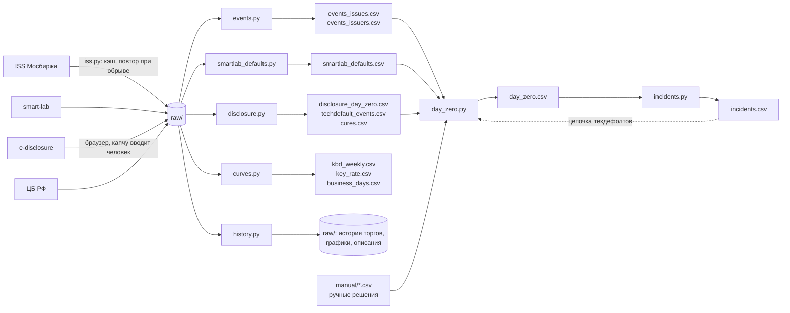

# Данные для исследования предикторов дефолта

Вопрос исследования: по каким признакам можно предсказать техдефолт и дефолт по облигациям
эмитента и за сколько недель. Ниже каждый источник: откуда он взят, что в нём,
зачем он нужен. Данные из источников 1–8 и 13 собраны,
по источникам 9–12 записана только проверка доступа.

<!-- Доступ к источникам проверен 18.09.2026 запросами к ним; сбор этапов 1 и 3 закончен 16.10.2026. -->

Сводка:

| # | Данные | Источник | Роль | Статус |
|---|--------|----------|------|--------|
| 1 | Список всех облигаций | ISS Мосбиржи | список всех облигаций исследования, контрольная группа | собрано |
| 2 | Режимы торгов выпуска | ISS Мосбиржи | **список дефолтов**, дата перевода в «Д» | собрано |
| 3 | Дневная история торгов | ISS Мосбиржи | цена, доходность, объём — основные признаки | собрано |
| 4 | Купоны, оферты, амортизации | ISS Мосбиржи | график платежей, недели до оферты или погашения | собрано |
| 5 | Кривая доходности ОФЗ | ISS Мосбиржи | G-спред | собрано |
| 6 | Ключевая ставка | ЦБ РФ | доходность минус ключевая ставка, режим рынка | собрано |
| 7 | Годовые списки дефолтов | smart-lab | нераскрытые техдефолты, сверка | собрано |
| 8 | Описание выпуска | ISS Мосбиржи | тип купона, структурные облигации, флаги дефолта | собрано |
| 9 | Новости Мосбиржи | moex.com | сверка дат | не собрано |
| 10 | Бухгалтерская отчётность | RFSD (Росстат + ФНС), ГИР БО | долговая нагрузка в предупреждении, этап 6 | не собрано |
| 10а | Налоговая задолженность, численность | открытые данные ФНС | признак стресса | найдено, не проверено |
| 11 | Агрегаты рейтинговых агентств и NUS-CRI | Эксперт РА, НРА, АКРА, NUS | внешний ориентир | второстепенно |
| 12 | События эмитентов, отраслевая статистика | агентства раскрытия, рейтинги, ЕГРЮЛ, ЦБ | события и отрасль | поиск сделан, структура не проверена |
| 13 | Сообщения эмитентов | сервер раскрытия Интерфакса | **дата неплатежа**, техдефолты, причина, выплата, реструктуризации | собрано |

---

## 1. Список всех облигаций

**Откуда.** `iss.moex.com/iss/securities.json?group_by=group&group_by_filter=stock_bonds`,
отдельно с `is_trading=1` (торгуются) и `is_trading=0` (сняты с торгов, погашены).

**Состав данных.** Код, ISIN, название, эмитент (номер, название, ИНН), тип
бумаги, основной режим торгов. В справочнике 15 813 бумаг на 161 странице,
из них 14 753 корпоративные облигации (типы `exchange_bond` 8 556 и
`corporate_bond` 6 197): 3 864 торгуются, 10 889 сняты с торгов или погашены.
Дневная история после 2014 года есть у 8 360 из них, рублёвых среди них 7 737.

**Зачем.** Это знаменатель. Чтобы сказать «признак срабатывает у дефолтных
бумаг», надо знать, как часто он срабатывает у всех остальных. Из этого же
списка берётся контрольная группа.

**Оговорки.**
- Снятые выпуски также попадают в выборку вместе с торгующимися, так как иначе получилась бы
  ошибка выжившего: погашенные и дефолтные бумаги пропали бы, и выборка
  состояла бы из тех, у кого всё хорошо.
- Кроме корпоративных облигаций в справочнике есть субфедеральные (448),
  внебиржевые (213), ОФЗ (210), облигации ЦБ (95), муниципальные (67)
  и международных организаций (27). В исследование идут только типы
  **`exchange_bond` и `corporate_bond`** с номиналом в рублях.
- **В выбору попадают типы `exchange_bond` и `corporate_bond`**.
  Из 389 выпусков, побывавших в «Д», у 253 тип `exchange_bond`, у 135
  `corporate_bond`.
  <!-- Ошибка найдена на ревью 22.09.2026; у МОНОП 1P04 (`RU000A10B396`) тип `exchange_bond`, «Биржевая облигация». Выпуск без строки в справочнике — РТК-Лизинг БО-02 (`RU000A0JTUG0`, эмитент 654, «Дыры в графике платежей»), в карточке у него тип `public_ppif`. -->
- **Список собран полным перебором справочника**, так как поиск по
  названию находит не всё: выпуски ОР Групп по запросам «ОР Групп»
  и «Обувь» не находятся.
- **ИНН эмитента пуст у 962 выпусков из 14 753 (6,5%)**, номер и название
  эмитента — у 716.

## 2. Режимы торгов выпуска — дата дефолта

**Откуда.** Тот же `iss.moex.com/iss/securities/{код}.json`, блок `boards`: по
каждому режиму торгов даты `listed_from` / `listed_till` и `history_from` /
`history_till`. Плюс история режима целиком:
`iss.moex.com/iss/history/engines/stock/markets/bonds/boards/{режим}/securities.json?date=…`.

**Почему по режиму «Д» видны дефолты**. По правилам листинга (moex.com/s28) не позднее 2 торговых дней после дефолта биржа переводит облигации эмитента в режим «Облигации Д» и исключает их из первого и второго уровня. Дефолт — просрочка платежа больше 10 рабочих дней, поэтому перевод приходит примерно через 2,5 календарные недели после неплатежа. На реальных 118 событиях с известной датой неплатежа медиана разрыва составила как раз 18 дней, у половины случаев 16–20 дней. Дата перевода — это дата, когда биржа "признала" дефолт, а не дата неплатежа (см. оговорки ниже).

**Что означают даты режима.** listed_from — дата включения бумаги в режим, календарная, поэтому может выпасть на выходной. history_from — первый день торгов в новом режиме. Датой перевода берём listed_from, первым торговым днём — history_from.

**Режимы «Д»:**
- `TQRD` «Т+: Облигации Д» — примерно с 2020 года;
- `EQDB` «Основной режим: Облигации Д» (Т0) — до 2020 года;
- `TQUD`, `TQED` — то же для облигаций в долларах и евро;
- `PSDB`, `PTDB` — внебиржевые сделки (РПС) по бумагам «Д».

Осторожно: `TQOD` — это обычные облигации в долларах, к дефолту отношения не имеет.

**Состав данных.** С 20.07.2009 по 18.09.2026 через режимы «Д» прошли
389 выпусков 177 эмитентов (`events_issues.csv`, `events_issuers.csv`),
распределение по годам — в разделе «Список событий и даты неплатежа», шаг 4. С 2014 года событий
с датой неплатежа 118 (`day_zero.csv`). 55 событий раньше 2014 года
и 4 события вне выборки (3 эмитента только с валютными выпусками
и Пересвет Кэпитал по ручной проверке) в расчёты не входят.

**Оговорки.**
- **Дата перевода позже реального события.** Дефолт по правилам — это
  просрочка больше 10 рабочих дней, перевод — ещё до 2 торговых дней. То есть
  купон не пришёл примерно на две недели раньше даты перевода. Рынок
  узнаёт о неплатёже в день, когда платёж должен был быть, и цена падает
  уже тогда. Если считать днём ноль дату перевода, признаки последних двух
  недель будут содержать сам дефолт. Решение: время события — дата неплатежа.

  **Дата неплатежа не вычисляется от даты перевода в «Д»**, потому что
  срок от неплатежа до перевода у эмитентов разный.
  <!-- Проверено 24.09.2026. Раньше здесь стояло правило «перевод минус 14 рабочих дней», потом «минус 19 дней, для декабря минус 26». --> Дата неплатежа берётся из сообщения эмитента о неисполнении
  обязательств. Если такого сообщения нет, берётся плановый платёж из
  графика биржи, после которого обвалилась цена, а если подходят
  несколько платежей одного эпизода — самый ранний из них. Способ выбора
  записан в колонке `source` файла `day_zero.csv`. Из 118 событий у 101
  дата взята из сообщений эмитентов, у 1 из списка smart-lab и у 16
  выбрана по графику.
  <!-- Числа на 23.10.2026, после сопоставления сообщений по ИНН и строгого сопоставления имён smart-lab. -->
  Так даты, выбранные по правилу, можно перепроверить отдельно. Событие,
  для которого не подходит ни один способ, остаётся с пустой датой и
  пометкой «нужна ручная проверка».

- **Перевод идёт по всем выпускам эмитента сразу.** Дефолт — событие
  эмитента, у всех его выпусков одна дата. Дата дефолта эмитента =
  самый ранний перевод в «Д» среди его выпусков.  

- **Техдефолты сюда не попадают.** Если эмитент заплатил с опозданием,
  но в пределах 10 рабочих дней, это техдефолт, и в режим «Д» бумаги не
  переводят. Техдефолт — целевое событие задачи A, поэтому режим «Д» даёт
  только те из событий, что закончились дефолтом. Остальные техдефолты
  берутся из сообщений эмитентов о неисполнении обязательств на сервере
  раскрытия Интерфакса (п. 13): ранние неплатежи эмитентов «Д» и эпизоды
  эмитентов, которых в «Д» не переводили («Список событий и даты неплатежа», шаг 7). Если эмитент
  неплатёж не раскрыл, техдефолт берётся из списков smart-lab (п. 7).
- **Видны только дефолты по биржевым бумагам.** Эмитенты, у которых
  облигации к моменту дефолта уже сняты с торгов, и дефолты по кредитам
  без облигаций сюда не попадают.
- **Реструктуризация без дефолта.** Это решение общего собрания
  владельцев облигаций или соглашение о новации либо отступном, которое
  меняет условия в пользу эмитента, пока неплатежа ещё не было. Решение
  может перенести погашение или оферту, отсрочить купон или номинал,
  снизить купон. В режим «Д» бумаги при этом не уходят. Событием задачи A
  реструктуризация не считается, так как у неё нет даты неплатежа. Но и
  обычной такую неделю считать нельзя, потому что у эмитента был
  кредитный стресс и сигнал перед ним засчитался бы как ложная тревога.
  Поэтому 16 недель перед решением не используются ни в подборе порогов,
  ни в оценке. После решения строки эмитента снова идут в выборку.
  Решения, принятые меньше чем за 16 недель до события эмитента или
  после него, не учитываются, так как эти недели уже размечены событием.
  Список решений — `manual/manual_restructuring.csv`, в нём 67 решений
  у 32 эмитентов. Как он собран — ниже, «Реструктуризации без дефолта:
  решения ОСВО».

## 3. Дневная история торгов

**Откуда.** `iss.moex.com/iss/history/engines/stock/markets/bonds/securities/{код}.json`.
Биржа отдаёт историю частями по 100 торговых дней, следующая часть запрашивается параметром start (0, 100, 200…)
Скачана история с 2014 года всех 14 753 корпоративных выпусков
(`history.py history`): 5,7 млн строк, торги были у 8 360 выпусков.

**Состав данных.** Одна строка — один выпуск в один день в одном режиме
торгов. Цена закрытия и средневзвешенная (`CLOSE`, `WAPRICE`,
в % номинала), доходность (`YIELDCLOSE`), оборот в рублях (`VALUE`), число
сделок (`NUMTRADES`), накопленный купонный доход, текущий номинал и его
валюта, дюрация, последний день приёма заявок на ближайшую оферту
(`BUYBACKDATE`, с 2018 года). Поле даты оферты (`OFFERDATE`) пустое
во все годы.

**Зачем.** Из дневной истории считаются признаки: цена, G-спред, доходность относительно
ключевой ставки, скорость падения цены, всплеск оборота и доля недель со сделками
(HYPOTHESES, признаки 1–7 и 10).

**Оговорки.**
- **Если бумаги торгуются редко.** У медианного выпуска сделки были в 29% от всех его
  дней на бирже. У 31% выпусков сделки бывают реже чем в 5% дней, у 1 574
  не было ни одной сделки, а у 35% сделки идут больше чем в 75% дней.
  <!-- Посчитано в out/знакомство_с_данными.ipynb по 8 360 выпускам с историей после 2014 года. --> То есть в обычный день цены нет больше чем у половины выпусков, и признаки считаются по неделям, так как за неделю сделка находится чаще, чем за один день. Доля недель со сделками тоже признак (HYPOTHESES, признак 10).
- **Цена по одной-двум сделкам шумная.** Одна мелкая сделка может дать
  цену заметно ниже рынка. Поэтому цена недели — средневзвешенная
  за неделю (HYPOTHESES, признак 1), а у эмитента берётся самый
  ликвидный выпуск.
- **Режимы торгов менялись.** До 2019 года корпоративные облигации
  торговались в режиме `EQOB` (Т0), потом в `TQCB` (Т+), облигации
  сектора повышенного инвестиционного риска — в `TQIR`. Запрос по коду
  бумаги без указания режима отдаёт все режимы, поэтому в 1,9% дней один
  день выпуска приходит несколькими строками, по строке на режим. Сделки
  при этом почти всегда идут в одном режиме: у рублёвых выпусков сделки
  в двух режимах в один день были один раз за 2014–2026 годы, у юаневых
  (56 выпусков, `TQCB` и `TQOY`) — в 20 488 дней. При сборке недельной
  таблицы строки одного дня складываются в одну.
- **Поле типа облигации (`BONDTYPE`) в истории пустое во все годы**,
  поэтому флоатеры и бумаги с фиксированным купоном различаются по
  описанию выпуска (п. 8) и графику купонов (п. 4). Это важно: доходность
  флоатера ISS считает по текущему купону, и его спред нельзя сравнивать
  со спредом бумаги с фиксированным купоном.
- **Ставка купона (`COUPONPERCENT`) в истории есть только с 2020 года**,
  за ранние годы она берётся из графика купонов (п. 4).
- **Поле Z-спреда (`ZSPREAD`) пустое** у всех торговавшихся
  корпоративных облигаций в срезах 2014–2024 годов, поэтому готовый
  спред ISS не используется, G-спред считается по КБД (п. 5).
- **В качестве признака цены используется % от номинала.** У
  амортизируемых облигаций номинал уменьшается, а цена в процентах от
  этого не падает, чтобы амортизация не казалась падением цены.

## 4. Купоны, оферты, амортизации

**Откуда.** `iss.moex.com/iss/statistics/engines/stock/markets/bonds/bondization/{код}.json`.
Скачан для всех корпоративных выпусков с `limit=unlimited` (`history.py
bondization`).

**Состав данных.** Даты и суммы купонов, даты оферт (дата, окно предъявления,
цена), даты и суммы амортизации.

**Зачем.**
- По графику считается признак «число недель до ближайшей оферты или
  погашения» (HYPOTHESES, признак 9). К этим датам
  эмитенту нужно найти деньги на выкуп или погашение выпуска и часто неплатежи случаются именно здесь.
- По графику выбирается дата неплатежа, если сообщения эмитента нет:
  ею становится плановый платёж, после которого обвалилась цена (п. 2).

**Оговорки.**
- Это график на день скачивания. Будущие купоны флоатеров в нём
  не объявлены, сумма пустая.
- **В графике отсутствует часть оферт.** Из 763 оферт, которые биржа показывала
  в `BUYBACKDATE` у 200 случайных выпусков, в графике нет 215 (28%),
  а у части старых выпусков блок оферт пуст совсем (РТК-Лизинг БО-02).
  Поэтому с 2018 года оферты берутся и из поля `BUYBACKDATE` дневной
  истории (ниже, «Даты оферт: график против BUYBACKDATE»).
- Оферту могут назначить или отменить уже после размещения, а график
  показывает её сегодняшнее состояние. Поэтому признак 9 видит оферту
  только с даты прошлой оферты или размещения, а с 2018 года — по полю
  `BUYBACKDATE` (HYPOTHESES, признак 9; ниже, «Даты оферт: график
  против BUYBACKDATE»). Если оферте предшествовало решение собрания
  владельцев об изменении условий, она считается известной с даты
  решения, а с 2018 года — с появления в `BUYBACKDATE`. Не закрыт случай
  до 2018 года, когда оферту назначили в середине срока без решения
  собрания: правило считает её известной с размещения или прошлой
  оферты.

## 5. Кривая доходности ОФЗ

**Откуда.** `iss.moex.com/iss/engines/stock/zcyc.json?date=…` — кривая
бескупонной доходности (КБД) Мосбиржи, есть с 06.01.2014. Запрос истории КБД history/engines/stock/zcyc отдаёт кривую только за сегодняшний день, поэтому кривая запрашивается на каждую пятницу.

**Состав данных.** 1 строка для 1 недели. В ней записаны параметры кривой (модель
Нельсона — Сигеля — Свенссона, B1–B3, T1, G1–G9) и доходности ОФЗ на
сроках 0,25; 0,5; 0,75; 1; 2; 3; 5; 7; 10; 15 и 20 лет.

**Зачем.** Доходность облигации растёт и когда растут все ставки, и когда
растёт кредитный риск эмитента, а предсказать нужно второе. G-спред (HYPOTHESES,
признак 2) — доходность облигации минус доходность ОФЗ того же срока —
убирает влияние ключевой ставки. Однако в период неопределённости спреды расширяются у всего
рынка. Например, между 01.06.2023 и 20.12.2024 медианный спред ликвидных
корпоративных облигаций вырос с 1,9 до 8,9 п.п. <!-- Проверка 19.09.2026, подробно в JOURNAL. -->
Поэтому считается также процентильный ранг G-спреда облигации среди всех корпоративных облигаций, то есть его место среди спредов всего рынка на той же неделе (признак 3).

**Оговорки.**
- Срок облигации берётся из дюрации в истории торгов (п. 3), а
  доходность ОФЗ на этот срок считается по параметрам кривой той же
  недели, по формуле Мосбиржи.
  <!-- Формула проверена 22.10.2026 на неделе 10.01.2014: на сроках 0,25; 1; 5; 10 и 20 лет совпадает с доходностями ISS до четвёртого знака. -->
- У облигаций с офертой ISS считает доходность к оферте, поэтому и срок
  для кривой берётся до оферты.
- Доходность в истории есть только в дни со сделками (п. 3), поэтому
  G-спред есть только в недели со сделками.
- G-спред вычитает друг из друга разные величины: доходность купонной
  облигации и бескупонную доходность ОФЗ. У длинных облигаций с высоким
  купоном ошибка заметна (HYPOTHESES, признак 2).
- В качестве обозначения недели используется пятница, кривая
  берётся на пятницу или, если в пятницу торгов не было, на предыдущий
  торговый день той же недели. В данных отсутствуют 4 недели: 30.12.2013–03.01.2014, кривая начинается 06.01.2014, и 18.03.2022, когда были торги ОФЗ. У 22 недель с праздничной пятницей используется кривая за предыдущий торговый день.

## 6. Ключевая ставка ЦБ

**Откуда.** `cbr.ru/hd_base/KeyRate/` — таблица ЦБ по дням с 13.09.2013
(`curves.py keyrate` → `out/key_rate.csv`).

**Состав данных.** Значение ключевой ставки на каждый рабочий день: 3 205 дней
с 09.01.2014 по 15.10.2026, 65 изменений, от 4,25 до 21%.

**Зачем.**
- Получить признак 4 «доходность минус ключевая ставка» и правило П1
  на нём (HYPOTHESES), так как по превышению доходности над ключевой
  ставкой видно, насколько дороже рынка эмитенту обходятся деньги.
- Проверить гипотезу A2, в которой правило П1 сравнивается со спредом
  относительно рынка.

**Оговорки.** Ставка меняется скачками по решениям совета директоров ЦБ,
поэтому берётся её значение на пятницу недели или на предыдущий рабочий
день (HYPOTHESES, «Неделя»), а не среднее за неделю.

## 7. Годовые списки дефолтов smart-lab

**Откуда.** Финансовый словарь smart-lab:
`smart-lab.ru/finansoviy-slovar/defaults-2024`, `…/defaults-2025`,
`…/defaults-2026` (`smartlab_defaults.py` → `out/smartlab_defaults.csv`).
Страниц за 2018–2023 годы нет, на них сайт отвечает 404.
<!-- Сводная страница …/russian-bonds-defaults открыта 23.10.2026: одна фраза «не менее 365 дефолтных выпусков до 2023 года» без источника и разбивки по годам, 18 названий эмитентов (в основном кризис 2008–2009) и таблица рейтингового агентства по рейтингуемым объектам. Дат неплатежа нет, поэтому в сбор не входит. Число 365 считается с 1990-х и с выборкой ISS с 2012 года не сравнивается. -->

**Состав данных.** Это не таблица, а текстовый список по эмитентам. Пример записи
2025 года: «ООО «Феррони» (техдефолт по части номинала с 13.01.2025, …,
техдефолт с 03.06.2025, с 20.06.2025 дефолт)». Разобрано 63 записи
с датами: 13 за 2024 год, 22 за 2025 и 28 за 2026.

**Зачем.**
- Чтобы узнать о техдефолтах, которых нет в данных Мосбиржи о режиме «Д» (п. 2).
- Получить дату неплатежа, которая раньше даты перевода.
- Сверка списка, построенного по ISS мосбиржи.

**Оговорки.**
- Список написан людьми текстом. 230 нераспознанных строк — заголовки
  и пояснения, дат в них нет. У одной записи вместо названия эмитента
  попала цитата, и она осталась несопоставленной.
- ISIN в списке нет, поэтому записи сопоставляются с эмитентами ISS
  по названию без формы собственности и кавычек: целиком или по началу,
  так как smart-lab сокращает названия. Два сокращения,
  которые не раскрыть с помощью регулярного выражения («Завод КЭС», «ФПК»), записаны
  в `day_zero.py`. 43 записи сопоставлены с 38 эмитентами, переведёнными
  в «Д». Остальных 20 записей в ISS в режиме «Д» нет: 9 есть среди эпизодов вне «Д»
  (п. 2), у ХК Эволюции и Пром Гаранта облигаций нет в справочнике
  Мосбиржи, Брусника, Остров машин, Самолёт и КЛВЗ Кристалл раскрыли
  техническую причину неплатежа, ЖКХ Саха (2 записи) и Доминион
  неплатёж на e-disclosure не раскрывали, у «Восток-ойла» и записи
  без названия причину не разбирала.
- Дата из smart-lab найдена у 36 событий, но в дату неплатежа попала
  один раз, у Завода КриалЭнергоСтрой, где сообщения эмитента нет.
  У остальных 35 есть дата из раскрытия, а она главнее. У 19 событий
  даты совпадают, у 11 smart-lab позже на день, так как пишет начало
  техдефолта, у 6 расходится от −46 до +14 дней.
  <!-- Числа на 23.10.2026, после строгого сопоставления имён. -->

## 8. Описание выпуска

**Откуда.** `iss.moex.com/iss/securities/{код}.json`, блок `description`.
Скачано для всех 14 753 корпоративных выпусков (`history.py describe`).

**Состав данных.** Дата размещения и погашения, объём выпуска, номинал,
частота купона, текущая ставка купона, уровень листинга, признак «только для
квалифицированных инвесторов», вид облигации (фиксированный купон, флоатер),
код эмитента, флаги `HASDEFAULT` (допущен дефолт) и `HASTECHNICALDEFAULT`
(допущен технический дефолт).

**Зачем.** Получить список всех рублёвых корпоративных облигаций, определить тип
купона (флоатер или постоянный), найти структурные облигации и сверить список
дефолтов с флагами `HASDEFAULT` и `HASTECHNICALDEFAULT`.

**Оговорки.**
- **Это снимок на день скачивания, истории значений нет, поэтому все поля
  здесь считаются изменяемыми.** <!-- Уточнено на ревью 22.09.2026: раньше здесь было записано, что объём, даты, частота купона и признак для квалов не меняются. Описания скачаны 16.10.2026. -->
У бумаг, прошедших реструктуризацию, график платежей и дата погашения переписываются, а признак «для квалов» и уровень листинга меняются по решению биржи. Именно у дефолтнувших выпусков такие правки обычно и случаются. Поэтому в их строках возникает утечка из будущего, то есть в них оказываются значения, записанные после реструктуризации, которых на неделе прогноза ещё не было. Но по этим строкам модель учится находить дефолт и по ним же проверяется. Проверка, при которой признаки недели t считаются только по данным до этой недели, такую утечку не обнаруживает, так как в описании выпуска уже записано новое значение поля.
  Из-за этого признаки берутся из дневной истории торгов (п. 3), где значение
  зафиксировано в день торгов. Поля описания используются для списка
  всех облигаций, отбора рублёвых выпусков, определения типа купона, поиска
  структурных облигаций и сверки флагов дефолта.
- **Флаги дефолта неполны, поэтому список по ним не строится.** Флаг
  `HASDEFAULT` стоит только у 21% выпусков, переведённых в «Д» (проверка — в разделе «Список событий и даты неплатежа», шаг 4).
- **Тип облигации (`BOND_TYPE`) пуст у 4 246 из 7 737 рублёвых выпусков**
  с историей, в основном у старых, а одно и то же значение записано
  по-разному («Флоатер» и «Облигация с плавающим купоном»). Поэтому тип
  купона определяется по графику купонов (ниже, «Тип купона: описание
  и график купонов»).
- **Рубль в описании записан как `SUR`**, а у старых выпусков валюта
  в справочнике пуста (РТК-Лизинг БО-02), поэтому валюта берётся
  из дневной истории (п. 3).

## 9. Новости Мосбиржи

**Откуда.** `www.moex.com/export/news.aspx` — Jessica уже читает этот экспорт.

**Зачем.** Сверка дат перевода в режим «Д» на случаях, где ISS и smart-lab
расходятся.

## 10. Бухгалтерская отчётность

**Откуда.** RFSD — открытая база бухгалтерской отчётности Института
проблем правоприменения (`tochno.st/datasets/rfsd`, зеркало `irlspbru/RFSD`
на Hugging Face): данные Росстата и ФНС за 2011–2025 годы, 223 показателя,
есть ИНН, лицензия CC BY 4.0. Отчётность отдельной компании есть в ГИР БО
ФНС (`bo.nalog.gov.ru`): на сайте она бесплатна, выгрузка всей базы стоит
200 000 ₽ в год и доступна юридическим лицам.
<!-- RFSD найдена на ревью 22.09.2026, доступ к ГИР БО проверен 19.09.2026. Подробные условия доступа, план сбора через сайт и оговорки (опоздание годовой отчётности до 1 апреля, скрытие отчётности с 2022 года по ПП № 1624, СПВ с нулевой выручкой) — в коммите f9369ca. Сокращено 23.10.2026. -->

**Зачем.**
- Показать долговую нагрузку эмитента (долг к EBITDA, к активам) вместе
  с предупреждением Jessica (HYPOTHESES, «Ручная проверка после
  предупреждения»). Для этого достаточно ссылки на страницу эмитента
  в ГИР БО.
- Проверить на этапе 6, добавляет ли отчётность сигнал к рыночным
  признакам, так как цена и доходность отражают то, что рынку уже
  известно, а отчётность показывает причину: долг к выручке, покрытие
  процентов, отрицательный капитал.

**Данные из этого источника не получены.** Этап 6 начинается после модели на рыночных признаках.
Как в RFSD закодированы показатели и насколько полно в ней покрыты
небольшие эмитенты, не проверено.

## 10а. Открытые данные ФНС о налогах
<!-- найдено 22.09.2026 -->

**Откуда.** `nalog.gov.ru/opendata` — наборы в CSV и XML, бесплатно,
по ИНН. Нужные наборы: суммы задолженности по налогам и взносам
(набор `7707329152-debtam`), сведения о налоговых правонарушениях
и штрафах, среднесписочная численность работников, уплаченные налоги.

**Зачем.** Налоговая недоимка — прямой признак того, что у компании
кончились деньги, и появляется он раньше неплатежа по облигациям.
Численность работников показывает, живой ли это бизнес или пустая
финансовая «прокладка».

**Оговорки.**
- **Не проверено**, с какого года лежат наборы, как часто обновляются
  (по описанию — задолженность ежеквартально, налоги и нарушения
  ежегодно), какова задержка публикации. Задержка критична: признак
  на неделю t считаем только по наборам, опубликованным до t.
- Данные раскрываются по правилам ст. 102 НК (сведения, не
  составляющие налоговую тайну). Часть компаний может отсутствовать.
- Сопоставление с эмитентом — по ИНН из справочника биржи.

## 11. Внешние источники — второстепенный ориентир

Открытых микроданных по облигациям с ценами и дефолтами нет, поэтому внешние данные слудат лишь ориентиром для сверки.

- **Матрица дефолтов Эксперт РА** (`raexpert.ru/ratings/managing/matrix/`)
  и **исторические уровни дефолтов НРА** (`ra-national.ru`) — частота
  дефолтов по рейтинговым категориям с 2010 года. Нужно сверить, похожа ли
  доля дефолтов в нашей выборке по годам на их цифры.
- **Исследование АКРА «Дефолты 2025»** (`acra-ratings.ru/research/2834/`) —
  сверка числа дефолтов за год.
- **NUS-CRI** (Сингапур, `nuscri.org`) — бесплатные вероятности дефолта
  по 90 тыс. публичных компаний мира, Россия в том числе. Без подтверждения
  профессиональной квалификации доступ к 3 000 компаний. Эмитенты ВДО почти
  все непубличные, поэтому пригодится только для крупных эмитентов.
  Регистрацию и реальное покрытие не проверяла.
<!-- STOPPED HERE -->
## 12. События эмитентов и отраслевые данные
<!-- поиск 19.09.2026 -->

### События эмитента

| Источник | Что даёт | Доступ | Статус |
|---|---|---|---|
| Раскрытие существенных фактов: Интерфакс (`e-disclosure.ru`) | неплатежи, смена руководства, сделки, решения собраний — официально и с датой | 403, капча | неплатежи, выплаты и решения собраний используются с 25.09.2026 (п. 13), капчу проходит человек |
| Раскрытие: Прайм (`disclosure.1prime.ru`), Азипи (`e-disclosure.azipi.ru`), СКРИН (`disclosure.skrin.ru`), AK&M (`disclosure.ru`) | то же у эмитентов, которые раскрываются через эти агентства | 200, 200, 200, 302 | Азипи, СКРИН и AK&M проверены 24.10.2026 по 17 событиям без даты из раскрытия, дат не добавили; Прайм не проверен, так как поиск работает только в браузере |
| Рейтинговые агентства: АКРА, Эксперт РА, НКР, НРА | понижения, прогнозы, «на пересмотре», отзывы рейтинга — с датами | все 200 | кандидат, сильный |
| ЕГРЮЛ (`egrul.nalog.ru`), «Прозрачный бизнес» (`pb.nalog.ru`) | дата смены руководителя и учредителей, реорганизация | 307, 200 | кандидат |
| Федресурс / ЕФРСБ (`fedresurs.ru`) | намерение кредитора подать на банкротство (публикуется не менее чем за 15 дней до суда), процедуры банкротства | 401 для скриптов, защита Qrator с капчей | не собирали |
| Картотека арбитражных дел (`kad.arbitr.ru`) | иски к эмитенту | 200, но известна защитой от ботов | не проверено; капчу не обходить |
| Новости smart-lab | корпоративные новости, Jessica уже классифицирует их по категориям | RSS — только свежее | глубина архива не проверена |
| GDELT | мировая база новостей, есть русскоязычные СМИ | 429 (лимит запросов); API статей — только последние месяцы, полный архив — через BigQuery | низкий приоритет |

Оговорки:
- **Агентств раскрытия пять**, все аккредитованы ЦБ: 
1. AK&M   
2. Азипи  
3. Интерфакс    
4. Прайм  
5. СКРИН  
Эмитент раскрывается через одно из них.
  **В исследовании используется только Интерфакс**. По его сообщениям
  взята дата неплатежа у 101 из 118 событий с переводом в «Д». 
  *В Азипи, СКРИНе и AK&M ни у одного из этих 17 эмитентов нет сообщения о неплатеже, по которому выбрана дата, поэтому эти агентства дат не добавили. Прайм не проверен, так как поиск по ИНН у него работает только в браузере.*
  <!-- Проверено 24.10.2026 по ИНН. Фабрикс, ЖКХ Саха и Доминион не проверялись. -->
- **С 2022 года часть эмитентов вправе раскрывать сведения в ограниченном
  объёме.** Это эмитенты под санкциями, организации ОПК и компании из новых
  регионов. Не раскрывать они могут сведения о сделках, о контрагентах под
  санкциями и об оборонной продукции (ПП РФ от 04.07.2023 № 1102).
  На сообщения о неплатеже это не повлияло: дата неплатежа из раскрытия
  есть у 57 из 68 событий 2014–2021 годов (84%) и у 44 из 50 событий
  2022–2026 годов (88%). 
  <!-- Проверено 24.10.2026: текст ПП № 1102 на legalacts.ru, сообщения типа 178 по годам из raw/edisclosure/sevents_*.json, доли по day_zero.csv. Акт, действовавший в 2022 году до ПП № 1102, не найден. -->

- **Рейтинг есть не у всех выпусков.** Отсутствие рейтинга само по себе является 
  признаком высокого риска. Отзыв рейтинга по инициативе эмитента — возможно, сильный
  сигнал.
- **Смена гендиректора в ЕГРЮЛ** видна с датой внесения записи. В раскрытии она
  может появиться на недели позже фактического решения.
- **Федресурс** публикует намерение кредитора подать на банкротство
  не позже чем за 15 дней до суда. Сайт закрыт защитой Qrator,
  скрипт получает код 401 и страницу с капчей, поэтому автоматически его не прочитать.
  <!-- Проверено 24.10.2026. -->

### Отрасль и экономика

| Источник | Что можно получить | Статус |
|---|---|---|
| Собственные данные исследования | медианный спред отрасли и скорость его изменения, число дефолтов в отрасли за полгода | внешних данных не нужно |
| ЦБ, таблица 302-09 | просроченная задолженность юрлиц по кредитам в рублях по отраслям (строительство, недвижимость, торговля, обрабатывающие и др.), помесячно, Excel | проверено: апрель 2009 — январь 2019 |
| ЦБ, данные после 2019 | то же, помесячно с 01.02.2019 по 01.09.2026, отрасли те же, что в 302-09 (`cbr.ru`, «Сведения о размещённых и привлечённых средствах», файл `01_02_A_Debt_corp_by_activity.xlsx`, лист «в т.ч. просроч. в рублях») | проверено |
| Росстат | индексы производства по видам деятельности ОКВЭД2, помесячно с января 2015 по декабрь 2025 года (`ind_baza_2018_12-2025.xlsx`); индексы по строительству не найдены | промышленность проверена, строительство нет |

Оговорки:
- **Разрыв ряда ЦБ в 2019 году.** Старые данные написаны по ОКВЭД, новые —
  по ОКВЭД2. Отрасли придётся сопоставлять вручную, и сопоставление
  будет неточным.
- **Статистика ЦБ выходит с задержкой около месяца.** Поэтому обучать будем только на данных, опубликованных до конкретной недели.
- **Для финансовой деятельности (лизинг, МФО)** в таблице ЦБ нет отдельной строки. Для этих отраслей остаются только собственные данные.

## 13. Сообщения эмитентов на сервере раскрытия Интерфакса

**Откуда.** `e-disclosure.ru`. Поиск по сообщениям — POST
`/api/search/sevents`, отдаёт JSON: дата, номер и краткое имя компании,
номер сообщения. Текст сообщения — страница
`portal/event.aspx?EventId=…`.

**Состав данных.** Сообщения эмитентов, нужные исследованию, по типам:
- 178 «`Неисполнение обязательств эмитента перед владельцами его эмиссионных ценных бумаг`» — 4402 сообщения с 2014 года от 465 компаний.
  В сообщении плановая дата платежа, выпуск, вид платежа (купон, номинал,
  оферта), статус «`технический дефолт`» или «`дефолт`» и причина
  неисполнения;
- 167 «Выплаченные доходы или иные выплаты» — фактическая выплата,
  в том числе после неплатежа;
- 253 «`Решения, принятые общим собранием владельцев облигаций`» — 723
  сообщения с 2015 года, и 311 «`Заключение соглашения о новации или предоставлении отступного`» — 11 сообщений.

**Зачем.**
- Получить дату неплатежа из первоисточника, так как от неё отсчитываются
  горизонт 16 недель и опережение сигнала, а перевод в режим «Д» случается позже
  неплатежа, по медиане на 18 дней. Отсюда дата взята у 101 из 118 событий
  с переводом в «Д»: у 76 автоматически и у 25 при ручной проверке
  (`day_zero.csv`, колонка `source`).
- Найти техдефолты, которых нет в режиме «Д» в iss мосбиржи, так как задача A предсказывает
  кредитный техдефолт, а в «Д» биржа переводит только при дефолте. 
- Отделить технический неплатёж от кредитного по причине, указанной
  в сообщении, так как сбой банка или ошибка в платёжном поручении
  о надёжности эмитента ничего не говорят.
- Узнать дату выплаты после техдефолта для задачи B, в которой сравнивается,
  когда техдефолт доходит до дефолта, а когда выплачивается.
- Найти реструктуризации без дефолта, так как 16 недель перед решением
  общего собрания не используются ни в подборе порогов, ни в оценке
  (`manual/manual_restructuring.csv`).

**Оговорки.**
- **Видны только эмитенты, которые раскрываются через Интерфакс.**
Это 101 из 118 событий 
- **Шаблон формы перечисляет оба исхода** («технический дефолт,
  дефолт»), а сбоку страницы стоит лента новостей. Поэтому статус
  ищется только в теле сообщения, после удаления шаблона.
- **Не каждый неплатёж раскрыт.** Мосрегионлифт и Финансовые системы
  о дефолте не сообщали, их даты взяты из ручной проверки. Фабрикс,
  ЖКХ Саха и Доминион о неплатеже не сообщали вовсе, их техдефолты
  известны только по smart-lab (п. 7).

## Порядок этапов и какие данные нужны на каждом

Сначала собираются данные, без которых нельзя получить первую оценку:
список событий, рыночные признаки, правила и модель с проверкой на годах,
на которых она не обучалась (этапы 1–5). Отчётность, отрасль и события
эмитента добавляются потом, по одному блоку, и каждый блок проверяется
на то, улучшает ли он результат по сравнению с рыночными признаками.
<!-- Порядок пересобран 22.09.2026 после ревью: прежний начинался с отрасли, так как её данные собрать проще всего, хотя ожидаемый вклад у неё самый слабый. -->

После каждого этапа — проверка, которую надо пройти, чтобы идти дальше.

| Этап | Задача | Источники | Проверка |
|---|---|---|---|
| 1 | Список событий и даты дефолтов | 1, 2, 7, 8, 9, 13 | сверка сошлась: smart-lab, fin-plan (101 ISIN), ОР Групп, флаги `HASDEFAULT`; известно число эмитентов и выпусков по годам; измерен разрыв «неплатёж → перевод» |
| 2 | Гипотезы и критерии успеха в `HYPOTHESES.md` | — | 6–8 признаков и горизонт 26 недель записаны **до** расчётов |
| 3 | Рыночная панель: выпуск-неделя → эмитент-неделя | 1, 3, 4, 5, 6, 8 | тест на утечку проходит; доля недель со сделками известна; флоатеры отделены |
| 4 | Пороговые правила и event study: три кандидата (цена, спред к ОФЗ, спред к рынку) и признаки скорости | панель этапа 3 | для каждого правила посчитаны опережение и доля ложных тревог; конец периода с неизвестным исходом отброшен |
| 5 | Одна модель выживаемости на рыночных признаках | панель этапа 3 | проверка по времени пройдена, модель сравнена с простым правилом из этапа 4 |
| 6 | Фундаментальный блок: отчётность и налоги | 10, 10а | данные подтянуты «по состоянию на дату»; 5 эмитентов сверены с ГИР БО вручную; видно, добавляет ли блок к рынку |
| 7 | Отрасль и экономика | 12, своя панель | отраслевая медиана считается без самого эмитента; видно, добавляет ли блок |
| 8 | События эмитента (рейтинги, ЕГРЮЛ, раскрытие) | 12 | делаем, только если этапы 4–7 показали нехватку сигнала |
| 9 | Выводы и ограничения в `findings.md` | — | каждое число сверено с ноутбуком, ограничения перечислены |

Правило остановки: если этап 1 не сойдётся по сверке, остальные этапы
не начинаются. Список событий — фундамент, ошибка в нём делает
бессмысленным всё остальное.

## Как данные собираются на практике

Разделы 1–13 описывают, какие данные получены. Этот раздел объясняет,
как они получены и почему правила разбора устроены именно так. 
<!-- Записи сгруппированы по темам, внутри группы идут по датам. Новая запись добавляется в конец своей группы. -->

### Устройство сбора

- **Данные лежат вне репозитория**, как и всё у Jessica. Сырые ответы
  хранятся в `~/Documents/Tracking/Invest/research/raw/`, таблицы
  результатов в `.../research/out/`, в репозитории остаются только ручные
  таблицы `manual/`. Повторный запуск ничего не скачивает заново, поэтому
  сбор можно прерывать.
- **Пауза между запросами к ISS 0,2 с**, таймаут 25 с. После 10 отказов
  подряд скрипт останавливается с сообщением, так как столько отказов
  подряд означает блокировку, а записывать пустоту вместо данных нельзя.

### Список событий и даты неплатежа

#### Шаг 1: поиск выпусков в режиме «Д» (запущен 22.09.2026)

`events.py discover` идёт недельными срезами с 3 января 2011 по сегодня
по режимам `TQRD`, `EQDB`, `TQUD`, `TQED` и собирает коды выпусков,
которые там побывали.

- **Шаг в неделю на точность не влияет:** срезы нужны, чтобы узнать,
  *какие* выпуски были в режиме, а точная дата потом берётся из карточки
  выпуска (`boards.listed_from`). Риск только один — выпуск, пробывший
  в режиме меньше недели, в срез не попадёт. Подстраховка: у найденных
  эмитентов проверяются все их выпуски, а не только попавшие в срез.
- Проверка на отрезке ноябрь 2025 — сентябрь 2026: 47 срезов, 105 выпусков,
  дата перевода МОНОП 1P04 определилась верно (20.12.2025).

#### Шаг 2: кандидаты в дату неплатежа

Для каждого эмитента берутся плановые платежи (`bondization`: купоны,
амортизации, оферты) **по всем его выпускам**, включая непереведённые
в «Д», и отбираются попавшие в окно от 13 до 60 дней до даты перевода.

- Нижняя граница окна — 13 дней: просрочка в 10 рабочих дней это минимум
  14 календарных, поэтому платёж ближе к переводу вызвать его не мог.
- Верхняя — 60 дней, с запасом на новогодние каникулы (расчёт по двум
  календарям дал до 31 дня) и на то, что биржа могла тянуть с переводом.
- Почему проверяются все выпуски: у МОНОП неплатёж случился на погашении
  выпуска 1P02, который в тот же день ушёл с торгов и в режим «Д»
  не попал вовсе.
- Если кандидат один — дата считается определённой. Если их несколько
  или ни одного, строка помечается «нужна ручная проверка», и в таблицу
  кладётся ссылка на поиск по компании на сервере раскрытия
  (`jessica/sources/news.py`, `disclosure_link`).

#### Шаг 3: списки дефолтов smart-lab (сделано 22.09.2026)

`smartlab_defaults.py` разбирает годовые страницы словаря smart-lab.
Результат: **63 записи с датами** — 13 за 2024 год, 22 за 2025, 28 за 2026.
Файлы `smartlab_defaults.csv` и `smartlab_skipped.txt`.

Что выяснилось:
- **Годовые страницы есть только с 2024 года.** Адреса вида
  `defaults-2018` … `defaults-2023` отвечают 404, сводная страница дат
  не содержит. Значит, готовые даты неплатежа доступны примерно для трети
  событий, а для более ранних лет остаются график платежей и ручная
  проверка.
- **Форматы дат разные.** На страницах 2024–2025 пишут `13.01.2025`,
  на странице 2026 года — `04.02` без года. Год для таких дат берётся
  из адреса страницы.
- **Кавычки разные**: «», „“ и ". Шаблон разбора учитывает все.
- **Ничего с датами не потеряно:** из 230 неразобранных строк ни одна
  не содержит даты, это заголовки и пояснения.
- Записи дают не одну дату, а цепочку: «техдефолт с 16.02, 18.02
  обязательства исполнены, 26.08 техдефолт по части номинала, 08.09
  дефолт». Для дня ноль нужна первая дата **настоящего** неплатежа,
  поэтому цепочку разбираем, а не берём первую попавшуюся дату.

#### Шаг 4: результаты сбора событий (23.09.2026)

`events.py build` прошёл целиком: **389 выпусков, 177 эмитентов** в режимах
«Д» с 2011 года. Недельные срезы нашли на 58 выпусков больше, чем месячные:
часть бумаг успевает уйти из режима меньше чем за месяц.

Эмитентов по годам перевода в «Д»:

| Год | Эмитентов |
|------|------|
| 2009 | 42 |
| 2010 | 6 |
| 2011 | 1 |
| 2012 | 1 |
| 2013 | 5 |
| 2014 | 5 |
| 2015 | 7 |
| 2016 | 18 |
| 2017 | 14 |
| 2018 | 11 |
| 2019 | 5 |
| 2020 | 5 |
| 2021 | 4 |
| 2022 | 5 |
| 2023 | 8 |
| 2024 | 5 |
| 2025 | 17 |
| 2026 | 18 (год не закончен) |
| Всего | 177 |

**Флаг `HASDEFAULT` стоит только у 21% выпусков, переведённых в «Д».**
Раньше неполнота флагов была предположением на ошибочном примере, теперь
это измеренная цифра: флаг пропускает четыре дефолта из пяти. Решение
строить список по режиму «Д» подтверждено.

Две ошибки, найденные при первом прогоне:
- **Справочник бумаг выгружался не полностью** — 200 строк вместо тысяч.
  У эндпоинта `/iss/securities.json` нет счётчика `TOTAL`, а код на него
  опирался. Теперь признак конца — пустая страница, курсор только подсказка.
- **Падение на дате `0000-00-00`** в графике платежей. Такие строки
  пропускаются. Падение здесь лучше молчания: события без кандидатов
  не записались бы как «кандидатов нет».

#### Шаг 5: выбор даты неплатежа (`day_zero.py`, 23.09.2026)

Как выбирается дата неплатежа среди кандидатов:
1. **Дата из списков smart-lab**, если имя эмитента совпало и дата попадает
   в окно 70 дней до перевода.
2. **Обвал цены после планового платежа.** Медианная цена за 10 торговых
   дней до платежа против минимума за 10 дней после; падение на 7%
   и глубже считается обвалом. Из подтверждённых берётся самый ранний
   платёж. Порог 7% выбран с запасом: дневные колебания ликвидной бумаги
   редко больше 3–4%, а неплатёж роняет цену на десятки процентов
   (МОНОП 1P01: с 88 до 36 за три дня).
3. **Единственный кандидат**, если реакцию измерить не удалось — у
   неликвидных бумаг сделок в окне может не быть.

Реакция меряется по самому ликвидному выпуску эмитента, а не по тому,
чей платёж проверяется: неплатёж по одному выпуску роняет цену всех,
а у неликвидной бумаги цена скачет от одной сделки.

**Результат: дата определена у 132 эмитентов из 177.** Источники: обвал
цены — 59, единственный кандидат — 39, smart-lab — 34, осталось на ручную
проверку 45.

**Расчёт по календарям подтвердился данными.** Разрыв «неплатёж → перевод»
на 132 случаях: медиана **19 календарных дней**, половина случаев
в диапазоне 17–28, минимум 3, максимум 63. Ровно 19 дней и давал расчёт
по производственному и торговому календарям.

Крайние случаи объяснимы и показывают границы метода:
- **3 дня** (Русская Коммунальная компания, 2025) — похоже на отказ
  платить: тогда биржа не ждёт 10 рабочих дней.
- **63 дня** (Нэппи Клаб, 2026) — цепочка: техдефолт в январе,
  обязательства исполнены, новый техдефолт в феврале. День ноль в таких
  случаях надо выбирать осознанно, автоматика берёт первую дату окна.

**Ручная проверка смещена в прошлое:** 18 случаев из 45 приходятся
на 2009 год, ещё 6 — на 2010 и 2013. С 2014 года таких 21, с 2019 года — 6.

#### Шаг 6: проверка на выходе (`check_stage1.py`, 26.09.2026)

Перепрогнана после замены дат на раскрытие. Скрипт работает по готовым
таблицам и сохранённой странице fin-plan, в сеть не ходит.

- **fin-plan:** в списке теперь 124 ISIN (было 101). 99 есть среди наших
  выпусков. Остальные 25 торгуются в основном режиме TQCB и по недельным
  срезам в «Д» не попадали ни разу — это техдефолты без перевода (Самолёт,
  ЮГК, Почта России, Брусника, Ультра и др.), вне определения события.
- **smart-lab:** из 63 записей с 2014 года 40 нашлись у наших эмитентов,
  у 35 из них день ноль или первый техдефолт в пределах 3 дней от даты
  smart-lab (он пишет начало техдефолта, обычно день после платежа).
  Пять расхождений объяснены: РКК и Магнум Ойл — smart-lab записал дату
  дефолта, Бизнес-Лэнд — запись о более раннем эпизоде, «Восток-ойл» —
  ложное совпадение имени. Из 23 ненайденных: 17 — техдефолты без
  перевода в «Д»; ХК Эволюция и Пром Гарант — дефолты, но их облигаций
  нет в справочнике Мосбиржи; Росгео (две записи), Завод КЭС, Гарант-Инвест — есть
  у нас под полными именами, сопоставление по имени их не узнаёт.
- **ОР Групп:** 8 выпусков в списке, день ноль 20.01.2022 по раскрытию,
  перевод 07.02.2022.
- **Флаги `HASDEFAULT`:** измерено в шаге 4 (флаг у 21% выпусков в «Д»).
  Обратной сверки (все ли бумаги с флагом у нас) нет: в справочнике
  флага нет, нужна карточка каждого выпуска.
- **По годам** (эмитентов / выпусков, по году дня ноль): 2014 — 5/14,
  2015 — 10/14, 2016 — 15/35, 2017 — 14/28, 2018 — 10/30, 2019 — 5/18,
  2020 — 5/29, 2021 — 4/5, 2022 — 6/19, 2023 — 4/4, 2024 — 7/16,
  2025 — 15/45, 2026 — 18/59 (год не закончен).
- **Разрыв «неплатёж → перевод»** на 118 событиях: медиана 18 дней,
  9–48. По источникам (22.10.2026): раскрытие e-disclosure 17 (9–38),
  ручная проверка 19 (9–48), график с обвалом цены 18 (16–20), один
  эпизод с ранней датой 20,5 (18–27).
- **Первый техдефолт раньше дня ноль** — у 22 событий из 118.

Вывод: пропущенных дефолтов биржевых облигаций с переводом в «Д» сверка
не нашла; все расхождения объяснены. Ограничение то же, что в
определении события: техдефолты без перевода в «Д» в выборку не входят.

#### Шаг 7: техдефолты вне режима «Д» (`disclosure.py extra`, 26.09.2026)

Решение владелицы: расширить выборку эмитентами, у которых был неплатёж,
но биржа в «Д» их не переводила. Для них известно только второе целевое
событие — первый техдефолт. Таблица отдельная, `techdefault_events.csv`;
в `day_zero.csv` они не входят (там события с переводом в «Д»).

Отбор из списка Интерфакса (4402 сообщения с 2014 года, 465 компаний):
- компания сопоставлена со справочником ISS по ИНН (с 21.10.2026).
  В выдаче поиска ИНН нет, только номер компании и краткое имя, а по
  имени сходятся не все: Стройжилинвест записан как «ООО "СЖИ"».
  Поэтому на каждую компанию скачан один текст, и номер компании
  связан с ИНН из первого пункта текста (`disclosure.py cid-texts`).
  ИНН известен у 455 компаний из 465, у остальных 10 его нет в тексте,
  они сопоставляются по имени. Эмитентов корпоративных облигаций среди
  них 197, остальные — в основном эмитенты акций (невыплата дивидендов:
  Сургутнефтегаз, ГАЗ);
- берутся эмитенты, которых нет среди событий «Д», и ранние сообщения
  эмитентов «Д», вышедшие раньше чем за 450 дней до перевода: их не
  разбирает `parse`, у которого окно 450 дней (Вейл Финанс не заплатил
  купон 14.03.2018, а в «Д» попал 21.09.2021). Ранний эпизод эмитента
  «Д» — только техдефолт, даже с отметкой «дефолт» в сообщении, так как
  дефолт этого эмитента уже записан по переводу (решение владелицы
  21.10.2026). Сопоставление по имени давало ложные ранние сообщения:
  35 сообщений Концессий водоснабжения (Волгоград) приписывались
  Концессиям водоснабжения — Саратов;
- в тексте ИНН эмитента или ISIN его облигации; сообщение про облигации,
  а не акции: осталось 116 сообщений;
- статус «дефолт» ищется только в теле сообщения, от пункта 2 до
  подписи: на страницах, скачанных с октября 2026 года, сбоку лента
  новостей Интерфакса («первичный дефолт в 2027 году»);
- **причина неплатежа** (пункт «Причина неисполнения»). Техническая —
  деньги были, но не дошли: держатели не пришли в кассу или не дали
  реквизиты (Акрон — 4 703 руб. процентов, Транснефть — 637 облигаций
  без сведений о владельцах, Мечел-2017 — 169 руб.), ошибка в платёжке
  (КЛВЗ Кристалл), банк-корреспондент, платёж дошёл на день позже
  (Самолёт, Брусника), техническая задержка (Ноябрьская ПГЭ), согласие
  спецдепозитария пришло поздно (ИА Санрайз-2). Таких 49 сообщений у 24
  эмитентов (с Петербургснабом по ручному решению 20.10.2026), в эпизоды
  они не входят. Кредитная — нет денег, задержка или недопоступление
  доходов, арест или приостановка операций по счетам (Борец Капитал,
  Победа, ИНВЕСТ-ДЕВЕЛОПМЕНТ), реструктуризация или новация вместо
  платежа (Вейл Финанс); объявленный дефолт — всегда кредитная.
- санкционных причин (Euroclear, иностранные держатели) в отобранных
  сообщениях не нашлось: они у эмитентов акций и еврооблигаций,
  отсеянных раньше.

Эпизод — неплатежи одного эмитента с разрывом не больше 200 дней
(полугодовые купоны идут через 181–184 дня, 180 рвал бы подряд идущие
неплатежи ТТБ Инвест Продакшн).

**Результат: 41 эпизод у 35 эмитентов** (21.10.2026; до сопоставления
по ИНН было 34 у 28). Роли по решениям владелицы 26.09.2026 (колонка `role`):
- **дефолт** — 5 эмитентов, сами объявивших дефолт без перевода в «Д»
  (Еврофинансы-Недвижимость, КИСТОЧКИ Финанс, Кириллица, Стройжилинвест
  16.06.2020, Фондовые стратегические инициативы 05.10.2020);
  дата неплатежа — из сообщения о дефолте, по правилу льготного окна;
- **только техдефолт** — 28 эмитентов, 34 эпизода, из них 3 ранних
  у эмитентов «Д» (Соломенский лесозавод 06.04.2016, Вейл Финанс
  14.03.2018, ИНВЕСТ-ДЕВЕЛОПМЕНТ 09.04.2020); положительные случаи
  для цели «первый техдефолт», в цели «дефолт» не участвуют (ни событием,
  ни контролем: их судьба после неплатежа неизвестна);
- **исключён** — Вторресурсы (причина не доказана) и Петербургснаб
  (технический неплатёж, хотя в сообщении статус «дефолт»).
Решения по отдельным эпизодам — в `manual_techdefault.csv` (ГЕОТЕК —
кредитный, реструктуризация по решению собрания; Вторресурсы —
исключён; Петербургснаб — техническая причина, оплачено назавтра по
smart-lab; Фабрикс — кредитный техдефолт 09.08.2026 без сообщения на
e-disclosure, известен только по smart-lab, эпизод задан колонкой
`tech_first`). Металлэнергомонтаж 2019 — кредитный: «блокировка расчётного
счёта» добавлена к кредитным причинам наравне с арестом.
Повторные эпизоды эмитента (ТелеХаус три года подряд, Мечел,
Металлэнергомонтаж, ТТБ Инвест) помечены `first_for_issuer = False`:
в расчёт идёт первый эпизод эмитента. Период 2014–2026.

Итого событий с 2014 года: дефолт — 121 (118 с переводом в «Д» + 3),
первый техдефолт — 144 эмитента (121 + 23).

Сверка со smart-lab: из 19 техдефолтов в годовых списках, которых нет
среди событий «Д», 9 найдены эпизодом с датой в пределах 1–3 дней,
4 распознаны как технические (Брусника, Остров машин, Самолёт, КЛВЗ
Кристалл), 3 у нас есть под полными именами (Росгео, Завод КЭС,
Гарант-Инвест), 3 у Интерфакса не раскрывались (ЖКХ Саха, Доминион,
Фабрикс).

### Дата неплатежа и техдефолты

#### Выгрузка с сервера раскрытия: платная (проверено владелицей 22.09.2026)

У Интерфакса выгрузка сообщений платная, бесплатно — только поиск
по одной компании вручную. Поэтому массовый сбор дат неплатежа из
первоисточника отменяется; вместо него ручная проверка спорных случаев
по ссылке из таблицы.

#### Льготный срок бывает короче 10 рабочих дней (24.09.2026)

Разбор ИНВЕСТПРО по раскрытию (проверка владелицы) показал цепочку:
17.10.2017 техдефолт по купону → 20.10.2017 техдефолт по оферте
(4,495 млрд руб., в 15 раз больше купона) → 25.10.2017 признан дефолт
по тому же купону → 26.10.2017 перевод в «Д».

Дефолт наступил через **6 рабочих дней**, а не через 10. Причина —
в самом правиле биржи: «просрочка более 10 рабочих дней, **если меньший
срок не предусмотрен эмиссионными документами**». Эмитент вправе прописать
более короткий льготный срок в решении о выпуске.

Следствия:
- единого срока «19 дней» нет, есть типичный; разброс 3–28 дней
  в измерении — это не шум, а разные льготные сроки;
- решение опустить нижнюю границу окна поиска до 2 дней подтверждено;
- второе неисполнение внутри эпизода (оферта через 3 дня после купона)
  днём ноль не становится: день ноль — первый неплатёж. Но сам факт
  «после купона не исполнена и оферта» — кандидат в признаки.

#### Ежеквартальный отчёт эмитента — источник дат неплатежа (24.09.2026)

У «Концессий теплоснабжения» сообщений о неисполнении на сервере
раскрытия нет, зато есть ежеквартальные отчёты. В разделе 8.7.2
(«Сведения о начисленных и выплаченных доходах по облигациям») по
каждому купону указаны срок выплаты, сколько выплачено, доля в процентах
и **причина невыплаты**. В отчёте за 4 квартал 2020 прямо написано:
выпуск БО-01, купон со сроком 09.12.2020, выплачено 0 руб., причина —
«Дефолт», а купон 28.10.2020 по другой серии выплачен полностью.

Это надёжнее реакции цены для неликвидных бумаг, где сделок в окне нет.
Оговорки: отчёты бывают сканами без текстового слоя (этот — 57 страниц
сканов, `pdftotext` не берёт, читается только просмотром), и выходят они
раз в квартал, то есть дата известна с задержкой.

**Обе эвристики выбора кандидата промахиваются, и в разные стороны.**
У ИНВЕСТПРО верной оказалась средняя дата из трёх, у «Концессий» —
самая поздняя (ранние платежи были исполнены). Объединяет случаи то,
что бумаги неликвидны и проверка ценой не работает. Вывод для выводов
исследования: дата, выбранная автоматикой без подтверждения обвалом
цены, — слабое место, и такие случаи надо помечать отдельно.

#### smart-lab даёт начало техдефолта, а не дату платежа (25.09.2026)

Вторая партия ручных проверок по раскрытию (9 эмитентов) показала: дата
из списков smart-lab — это день, с которого считается техдефолт, обычно
на день позже планового платежа (Кузина 17.03 → 18.03, Антерра 18.08 →
19.08, Оил Ресурс 20.08 → 21.08). Хуже при цепочках: у Нэппи Клаба
smart-lab дал 26.02.2026, а дефолт случился по купону 13.04.2026 после
четырёх техдефолтов подряд; у РКК первый неплатёж был 21.12.2023, за
год с лишним до дефолта. Для таких цепочек в `manual_day_zero.csv`
заведена колонка `tech_first`.

Домашние деньги: автоматика взяла купон 24.04.2018 с обвалом −50%, но
купон выплачен, а неисполнена оферта 26.04. Обвал цены указывает
на эпизод, а не на конкретный платёж.

ТД «Мясничий» и «ОбъединениеАгроЭлита»: раскрытие обрывается в октябре
2023, до неплатежа; проверить по раскрытию нельзя, остаются на автоматике.

#### Сообщения e-disclosure вместо ручной проверки (25.09.2026)

Отмена решения от 22.09.2026 про массовый сбор. Платна выгрузка, а
поиск по сообщениям на сайте бесплатный и отдаёт JSON: POST
`/api/search/sevents`, тип события 178 («Неисполнение обязательств
эмитента перед владельцами его эмиссионных ценных бумаг»), размер
страницы «Все» до 1200 записей. За 2014–2026 — 4402 сообщения, по году
на запрос. Капчу проходит владелица в окне браузера (`disclosure.py`),
за ~620 страниц она появилась дважды. Владелица сняла запрет на
e-disclosure в CLAUDE.md 25.09.2026.

Сопоставление: в выдаче нет ИНН, только краткое имя («ООО ТК
"Нафтатранс плюс"», «ЗАО «ИА Кама»»), поэтому кандидаты — по имени
в кавычках и окну 450 дней до перевода, а принадлежность проверяется
по ИНН или ISIN дефолтного выпуска в тексте. ISIN нужен для
реорганизаций: Нэппи Клаб до перехода в АО подписывался прежним ИНН.
Из 598 кандидатов чужих 8 (банки цепляли друг друга).

Разбор текста, на чём обжигались:
- шаблон формы перечисляет исходы: «(технический дефолт, дефолт)»,
  в старой форме «по его вине (дефолт):» — без их удаления любое
  сообщение выглядит дефолтом;
- в сообщении о дефолте «дата окончания срока» бывает концом льготного
  периода («с 27.11.2020 по 10.12.2020 — технический дефолт»), поэтому
  день ноль — самый ранний неплатёж по тому же выпуску в 25 днях до неё;
- повторное сообщение о том же платеже через 10+ дней — это дефолт,
  даже без слова (МОНОПОЛИЯ: номинал 04.12.2025, сообщение 18.12);
- даты словами в старых сообщениях («23 января 2017 года», «29» июля 2016 г.), значение
  строкой ниже подписи; опечатки в годе (РЖД-Развитие вокзалов:
  «25.07.2013» при купонном периоде до 25.07.2014) — даты дальше
  120 дней от публикации не берутся.

Проверка на ручных датах владелицы: 19 из 25 эмитентов есть
у Интерфакса, у 15 дата совпала до дня. Расхождения: Концессии
теплоснабжения — раскрытие даёт 26.11.2020 по серии 02, раньше ручных
09.12 по БО-01; Роял Капитал — дефолт объявлен по выпуску с платежом
03.05, ручная 29.04 — более ранний неплатёж другого выпуска;
Мосрегионлифт и Финансовые системы — о дефолте не сообщали.

Результат (118 событий с датой): раскрытие e-disclosure — 70 (из них
15 — неплатёж без слова «дефолт», старая форма), ручная проверка — 25,
автоматика — 23. Разрыв «неплатёж → перевод» по раскрытию 9–38 дней,
медиана 17. Автоматика ошибалась на 2–6 недель у Калиты, ЕвроТранса,
СЕЛЛЕРа, С-Принта, ОР, Гарант-Инвеста, ЭБИСа, Уралсиб-лизинга:
обвал цены приходится на эпизод, а не на конкретный платёж.

**После сопоставления по ИНН (22.10.2026).** Поиск сообщений эмитентов
из «Д» шёл только по имени, а в выдаче имена сокращены («АО "РТК"»,
«ООО "ПСН ПМ"», «ООО «ГТС»»). С ИНН из `_cid_inns` нашлись сообщения
ещё у 10 эмитентов. У 5 дата прежде была выбрана по графику (РТК, ТКК,
ПСН ПМ, ГазТрансСнаб, Внешпромбанк), у четырёх она совпала с
сообщением, у Внешпромбанка сдвинулась на 2 дня (16.12 → 18.12.2015).
У ГазТрансСнаба и Строй Системы Механизации нашёлся более ранний
неплатёж (29.07.2025 и 20.03.2025). Итог: раскрытие — 101 (76
автоматически, 25 при ручной проверке), график с обвалом цены — 11,
один эпизод с ранней датой — 6, smart-lab — 0. В сообщении Строй Системы
Механизации плановая дата записана как «Дата начала купонного периода:
19.12.2024. Дата окончания купонного периода: 20.03.2025», и разбор брал
первую из них. Теперь дата начала периода пропускается, из 654 сообщений
это изменило одну дату.

У ИА «Кама» неплатёж по купону 15.12.2017 и дефолт по нему, а перевод
в «Д» только 03.07.2018 — вне окна 70 дней, дата оставлена автоматике
(15.06.2018) по решению владелицы.

#### Производственный календарь и даты выплат техдефолтов (21.10.2026)

Нужны для задачи B: день льготного срока k — это число рабочих дней
от плановой даты платежа до выплаты.

- **Календарь** — `curves.py calendar` → `out/business_days.csv`,
  3 212 рабочих дней с 09.01.2014 по 30.12.2026. Источник —
  `xmlcalendar.ru/data/ru/<год>/calendar.json` (сырые ответы в
  `raw/xmlcalendar_<год>.json`, текущий год перекачивается). Сайт
  отвечает только запросу с заголовком `User-Agent`. Сокращённый
  предпраздничный день считается рабочим. Нерабочие дни по указам
  президента (30.03–30.04.2020, 06–08.05.2020, 04–07.05.2021,
  01–03.11.2021 и 05.11.2021) считаются рабочими, так как биржа и
  платёжная система в эти дни работали и льготный срок шёл. Выходные
  24.06.2020 (парад) и 01.07.2020 (голосование) остаются нерабочими.
- **Даты выплат** — `disclosure.py cures` → `out/cures.csv`. Выплата
  засчитывается по сообщению типа 167 о том же выпуске, где плановая дата
  совпадает с датой неплатежа и сказано о полном исполнении. Дата
  выплаты — дата исполнения из текста, а без неё дата сообщения, если она
  позже плановой даты. k — рабочие дни после плановой даты до выплаты
  включительно.
- Неплатежей 126 (21.10.2026, после сопоставления по ИНН; было 106):
  80 техдефолтов вне «Д» и 46 ранних неплатежей эмитентов, потом
  переведённых в «Д». Дата выплаты найдена у 49 (24 и 25), у 45 из
  них — по дате сообщения, у 4 — из текста. Распределение k: 1 — 13
  неплатежей, 2 — 5, 3 — 4, 4 — 4, 5 — 4, 6 — 2, 7 — 3, 8 — 2, 9 — 6,
  10 — 6.
- Без даты выплаты 77. До 2019 года их 33: 21 технический (у держателей
  нет реквизитов или они не пришли в кассу, платёж ушёл не по тем
  реквизитам, выплаты по ним не ждут), у 3 есть только сообщение о
  частичной выплате в плановую дату, у 8 нет ни одного сообщения типа
  167 (возможно, они подавались как тип 9 «Сроки исполнения
  обязательств», не проверено), у Вейл Финанс купон заменён новацией.
  У 44 неплатежей с 2019 года причины поштучно не разобраны. 19 из них —
  ранние неплатежи эмитентов, потом ушедших в дефолт, выплаты у них
  могло не быть вовсе.
  Четыре неплатежа августа — сентября 2026 года (Кириллица, Л-Старт,
  Эффективные технологии, Альфа Дон Транс) надо перепроверить позже, так
  как сообщение о выплате могло ещё не выйти.

#### Сопоставление имён smart-lab (23.10.2026)

Имена сравнивались вхождением одной строки в другую в двух местах:
дата smart-lab в `day_zero.py` и цепочки техдефолтов в `incidents.py`.
Короткое «ОР» находилось в названиях шести чужих записей, «НИКА» —
в «Бруснике», а «Концессии водоснабжения — Саратов» доставались
и «Концессиям водоснабжения». Даты это не испортило, так как дата
smart-lab берётся только в 70 днях до перевода, а переводы этих эмитентов
были в 2020–2022 годах.

Теперь название из smart-lab должно совпасть с названием ISS целиком или
быть его началом не короче 6 букв (`_same_company`). В `_normalize`
добавлены полные формы «непубличное», «закрытое» и «открытое акционерное
общество» и опечатка «ОО», а сокращения, которые правилом не раскрыть, —
в `ABBREVIATIONS` («ФПК», «Завод КЭС»). Нашлись два эмитента, которых
сопоставление раньше не узнавало: Гарант-Инвест (дата smart-lab
14.03.2025 совпала с раскрытием) и Завод КриалЭнергоСтрой, у которого
сообщения эмитента нет, и дата 14.06.2024 теперь взята из smart-lab,
а не по графику. Итог: раскрытие — 101, smart-lab — 1, график с обвалом
цены — 10, один эпизод с ранней датой — 6.

### Границы выборки

#### Решение: период исследования — с 2014 года (23.09.2026)

События до 2014 года исключаются. Причины:
- кривой доходности ОФЗ (п. 5) для них нет — она начинается в 2014-м,
  а без неё не посчитать спред;
- графика платежей в ISS для тех лет почти нет, отсюда и 35 эмитентов
  без кандидатов;
- там же скопилась почти вся ручная работа.

После отсечения остаётся **101 эмитент с определённой датой** и около
двадцати случаев на ручной разбор.

#### Реструктуризации без дефолта: решения ОСВО (20.10.2026)

Источник — сервер раскрытия Интерфакса, типы сообщений из справочника
`/api/data/sevent-types`: 253 «Решения, принятые общим собранием
владельцев облигаций эмитента», 311 «Заключение эмитентом соглашения о
новации или предоставлении отступного», 338 и 339 (списание
субординированных облигаций банка и отказ от купона по ним).
`disclosure.py restruct-list` выгружает список по годам (тип за запрос:
несколько типов через запятую сайт не принимает), `restruct-texts` —
тексты, `restruct` — разбор в `out/restruct_decisions.csv` (строка на
сообщение: эмитент, состоялось ли собрание, что меняли) и сверка
`manual_restructuring.csv` с событиями. Сверка печатает решения, которые
оказались ближе 16 недель к событию эмитента или после него, так как
события добавляются и такое решение надо убрать из ручной таблицы.
Под типом 338 встречается и обычное извещение о выплате купона (ТД РКС,
20.02.2024), поэтому такие сообщения без слов о прекращении обязательств
в кандидаты не идут.

- Сообщений типа 253 — 723 за 2015–2026 годы, в 2014 году ни одного:
  общие собрания владельцев облигаций появились в законе с 2015 года.
  Типа 311 — 11 (2025–2026), 338 — 1 (2024), 339 — ни одного.
- В выдаче название компании сокращено («ПАО "ДВМП"», «ООО "СЖИ"»), по
  названию с эмитентами справочника совпадают 547 сообщений из 735.
  Поэтому качаются все тексты, а эмитент определяется по ИНН в тексте.
- В пункте 2.3 сообщения — повестка, в 2.4 — формулировки решений или
  «Решение не принято». В конце 2015 года много формальных собраний:
  эмитенты приводили решения о выпуске в соответствие с новым законом о
  представителе владельцев облигаций. Слова «досрочное погашение» есть и
  в таких поправках, поэтому кандидаты из разбора по ключевым словам
  проверяются вручную.

Решение по разметке (20.10.2026) — в HYPOTHESES, «Реструктуризации без
дефолта»: событием не считаются, 16 недель перед решением собрания не
используются. Ручной список — `manual/manual_restructuring.csv`.

**Разбор текстов (21.10.2026).** Скачаны все 735 текстов, страниц с
капчей среди них нет. Эмитент определяется по ISIN или регистрационному
номеру выпуска из текста, а если их нет — по ИНН из шапки сообщения;
без эмитента остались 28 сообщений. По каждому сообщению определяется:
- **собрание не состоялось или решение не принято** (157 сообщений):
  слова «не принято», «нет кворума» или число голосов участников меньше
  числа, нужного для решения. Последнее нужно, так как часть сообщений
  приводит только голоса без итоговой фразы;
- **только избрание представителя владельцев** (77) и **собрания
  акционеров**, ошибочно поданные с типом 253 (16) — не реструктуризации;
- **изменение условий** (262) — в повестке и решениях есть срок
  погашения, купон, амортизация, оферта, отказ от досрочного погашения,
  новация, отступное или обеспечение;
- **изменения без описания** (215) — «согласие на изменения в решение о
  выпуске» без сути изменений: она в приложениях, которых в сообщении нет.

Последние две группы дают 152 эмитента. Слово «срок погашения» стоит и в
описании самого выпуска, поэтому категории по ключевым словам — только
подсказка, и решения 88 эмитентов с описанием изменений я прочитала.
Таблица на проверку владелице — `ручные_проверки/restructuring_review.csv`,
по строке на эмитента, с предложением:
- **реструктуризация** (17) — продление срока погашения, снижение купона,
  новация или отступное у эмитента без дефолта в ближайшие 16 недель;
- **проверить** (36) — отказ от права досрочного погашения или от
  оснований выкупа, изменения оферт, изменения без описания у
  небольших эмитентов;
- **часть события** (5) — решение меньше чем за 16 недель до перевода в
  «Д» или до техдефолта; такие недели уже размечены событием;
- **после дефолта** (15) — первое решение после перевода в «Д» или после
  техдефолта, эмитент к этому времени из выборки вышел;
- **техническое** (79) — ипотечные агенты и специализированные
  финансовые общества, банки (изменения субординированных выпусков),
  госкомпании и крупные эмитенты.

На проверке только первые две группы (53 строки). Остальные 99 вынесены в
`ручные_проверки/restructuring_dropped.csv`, чтобы было видно, кто и
почему отброшен.

Строки, которые владелица подтвердит как реструктуризацию, переходят в
`manual/manual_restructuring.csv`.

**Итог проверки (21.10.2026).** 17 строк «реструктуризация» проверила
владелица. 36 строк «проверить» я разобрала по документам эмитентов на
e-disclosure: в разделе «Файлы» сравнивала старую и новую редакции
решения о выпуске. Нужны они потому, что в сообщении о собрании суть
изменений часто только в приложении. Всего «да» у 35 эмитентов и «нет»
у 18. Реструктуризацией считается решение, после которого владельцы
получают деньги позже или меньше, чем по прежним условиям: продление
срока погашения, отсрочка купона или номинала, снижение купона, отмена
оферты, новация, отступное. Не реструктуризация — досрочное погашение,
новое поручительство или право на выкуп, ослабленный ковенант,
технические правки, отказ от выкупа при смене собственника или
аудитора, изменения при единственном владельце.

В `manual_restructuring.csv` — по строке на собрание: ИНН, номер
эмитента ISS, название, дата решения, примечание с источником. Берутся
даты, названные в примечании, иначе все решения эмитента об условиях.
Решения, принятые меньше чем за 16 недель до события эмитента или
после него, отброшены, так как эти недели уже размечены событием.
Событие здесь — самая ранняя из дат: неплатёж, первый техдефолт,
перевод в «Д», кредитный техдефолт вне «Д». Осталось 67 решений у 32
эмитентов, отброшено 12: Открытие Холдинг 26.12.2019 и 13.01.2020, Прайм
Финанс 02.11.2017, Татфондбанк 26.08.2016, О1 Пропертиз 01.10.2020, ДВМП
29.12.2016, РЕГИОН-ИНВЕСТ 30.03.2021, а после сопоставления эпизодов по
ИНН ещё Вейл Финанс 14.03.2018, Соломенский лесозавод 24.06.2016,
Стройжилинвест 27.04.2020 и 03.07.2020, ИНВЕСТ-ДЕВЕЛОПМЕНТ 21.01.2020.
Неплатежи Вейл Финанс и Стройжилинвеста, которые упоминались в решениях
собраний, нашлись в сообщениях Интерфакса и стали событиями.

### График платежей, оферты и тип купона

#### Дыры в графике платежей: оферт может не быть вовсе (24.09.2026)

РТК-Лизинг: дефолт 11.06.2014 случился по оферте на 896,7 млн руб.,
а в `bondization` у выпуска `RU000A0JTUG0` блок `offers` пустой —
только купоны и амортизации. Автоматика подставила ближайший купон
06.06.2014 и ошиблась на 5 дней, причём этот купон был исполнен
(обвал цены -14% относился к ожиданию оферты).

Следствия:
- **график платежей ISS неполон по офертам**, особенно у старых выпусков;
- дефолты «по оферте» автоматически датируются хуже, чем по купонам;
- обвал цены подтверждает беду у эмитента, но не доказывает, что
  не исполнен именно этот платёж.

Там же найдена ошибка в коде: кандидаты собирались только по выпускам
эмитента из справочника, а сам дефолтный выпуск в справочник попадает
не всегда (у эмитента 654 в справочнике три выпуска, дефолтного БО-02
среди них нет). Теперь платежи берутся по объединению: дефолтные выпуски
плюс выпуски из справочника.

#### Поля дневной истории ISS и даты оферт (15.10.2026)

Проверено на срезах `TQCB` 2020, 2021, 2023, 2024 и `EQOB` 2014, 2016, 2018
(режим корпоративных облигаций до 2019 года — `EQOB`, после — `TQCB`,
собирать оба):
- `WAPRICE`, `YIELDCLOSE`, `YIELDATWAP`, `DURATION`, `MATDATE`, `FACEVALUE`,
  `FACEUNIT` заполнены почти у всех бумаг со сделками во все годы;
- `OFFERDATE` пуст во все годы;
- `COUPONPERCENT` есть только в последние годы (в 2020 и раньше пуст);
- `BONDTYPE` пуст — флоатеры отличать по описанию выпуска;
- `BUYBACKDATE` есть с 2018 года (2014 и 2016 — пусто). Это последний
  день приёма заявок на оферту, на 3–5 дней раньше самой оферты
  (RU000A100UT2: `BUYBACKDATE` 18.03.2025, оферта 21.03.2025, заявки
  12–18.03). У части бумаг равен дате погашения (RU000A1065R7), у части —
  дата, которой нет в графике оферт (RU000A0JX3M0, возможно колл-опцион,
  не проверено).

Пустой `BUYBACKDATE` против графика `bondization` (по 40 случайных бумаг):
на 15.03.2024 ни у одной из 40 будущей оферты в графике нет; на 15.03.2018
у 8 из 40 оферта в графике есть. Значит, в ранние годы поле неполное.

`bondization` тоже неполон по офертам у старых выпусков (РТК-Лизинг, «Дыры в графике платежей» выше),
поэтому у ранних лет признак «недель до оферты» будет местами завышен
(оферта не видна — берётся погашение). Первое решение по признаку 9
(погашение из истории, оферты из графика, известной на неделе t
считается ближайшая оферта после последней прошедшей) уточнено
20.10.2026, см. следующий раздел.

`bondization` с `limit=100` обрезает купоны на сотом: у RU000A0ZYDH0
140 купонов, приходило 100 (последний — 2042 год). В кэше этапа 1 так
обрезаны 15 из 718 графиков, у всех обрезанная часть начинается не раньше
ноября 2029 года, поэтому на день ноль это не повлияло. `history.py` берёт `limit=unlimited` — один
запрос, все строки.

Скорость полного сбора (`history.py`, пробный прогон 15.10.2026): 40
случайных выпусков — 66 с, 173 запроса, торги после 2014 года у 23 из 40.
Оценка на 14 753 выпуска — около 7 часов для истории.

#### Даты оферт: график против BUYBACKDATE (20.10.2026)

Проверка допущения признака 9 («следующая оферта известна с прошлой
оферты»). Выборка — 200 случайных рублёвых неструктурных выпусков, у
которых в графике `bondization` не меньше двух оферт и хотя бы одна в
сентябре 2018 — сентябре 2026 года (из 652 таких, seed 20261020). Для
каждого скачан `BUYBACKDATE` из дневной истории с 2018 года: это
ближайшая оферта в том виде, как её знала биржа в день торгов.
Скрипт проверки лежал во временной папке, в репозиторий не вошёл.

- **Допущение верно.** Пар «прошлая оферта → следующая», видимых в поле,
  571 у 169 выпусков (даты одной оферты, отстоящие не больше чем на 10
  дней, склеены: после 23.06.2025 поле то показывает конец приёма
  заявок, то саму оферту). Следующая оферта появляется в поле за 0–30
  дней до прошлой в 507 парах (89%), через 1–14 дней после неё в 14 (2%),
  позже — в 37 (6%), раньше чем за 30 дней — в 13 (2%). Медиана — за 3
  дня до прошлой оферты, квартили — за 6 и за 1 день.
- **Поздние появления — запаздывание биржи.** Почти все 37 приходятся на
  общие даты, когда поле заполнилось у многих выпусков разом: 10.12.2024,
  11.08.2025, 09.12.2025, 08.04.2026, 08.10.2026. 23.06.2025 поле пусто у
  всех выпусков, после этого заполняется с опозданием.
- **График теряет оферты.** Из 763 оферт, которые биржа показывала в
  `BUYBACKDATE` (без дат у погашения), в графике нет 215 (28%) у 81
  выпуска из 200; до 2022 года 121, с 2022 года 94. Примеры: Держава
  БО-01 — оферты каждый квартал в 2018–2020 годах, в графике ни одной;
  Полипласт БО-03 — нет 11.2018, 05.2019, 11.2020; Элемент Лизинг БО-04 —
  нет 04.2019.
- **В графике есть оферты, которых нет в поле.** Из 584 оферт графика
  внутри периода с историей биржа показала 468 (80%). Остальные, судя по
  примерам, — колл-оферты (право эмитента погасить досрочно, бессрочный
  МКБ П02) и отменённые.

**Решение (20.10.2026).** С 2018 года ближайшая оферта на неделе t —
ближайшая из двух дат: `BUYBACKDATE` последнего дня торгов недели и
оферта из графика по правилу «известна с прошлой оферты». Поле
закрывает пропуски графика, график — запаздывание поля после июня 2025
года и его неполноту в 2018 году (выше: 8 из 40 бумаг с пустым полем
при оферте в графике). До 2018 года — только график и правило; график
там теряет часть оферт, и признак в эти годы местами завышен (оферта
не видна — берётся погашение).

`BUYBACKDATE` не входил в столбцы истории этапа 3, поэтому качается
отдельно: `history.py buyback`, только `TRADEDATE` и `BUYBACKDATE` с
2018 года, по выпускам с торгами после 2018 года (старый кэш истории не
трогается).

**Оферты после решений собраний (22.10.2026).** Проверка 20.10.2026 брала
пары «прошлая оферта → следующая» и не касалась оферт, назначенных в
середине срока. Для них взяты решения об изменении условий из
`restruct_decisions.csv` (виды «изменение условий» и «изменения без
описания»), графики 237 выпусков из кэша и оферты, перед которыми было
решение позже прошлой оферты или размещения, — 167 оферт:
- 42 появились в `BUYBACKDATE` после решения, а правило видело их
  с прошлой оферты или размещения, на 12–430 недель раньше биржи,
  медиана 146 недель. 13 из них — у Открытие Холдинга, события «Д»,
  остальные у ипотечных агентов, специализированных финансовых обществ,
  ЕАБР, ГМК и ПСБ;
- 54 биржа в поле не показывала вовсе, судя по прежней проверке это
  колл-оферты и отменённые;
- 39 оферт до 2018 года и 18 видных с первого дня поля проверить нельзя;
- 14 были видны до решения, утечки у них нет.

Не проверено, что оферту назначило именно это решение: иногда между
решением и появлением оферты проходят годы. Для признака это не важно,
так как правило в любом случае видело оферту раньше рынка. Скрипт
проверки лежал во временной папке, в репозиторий не вошёл.

**Решение (22.10.2026).** Оферта, перед которой было решение собрания
об изменении условий, считается известной с даты решения, а с 2018
года — с её появления в `BUYBACKDATE`, если поле её показывало
(HYPOTHESES, признак 9).

#### Тип купона: описание и график купонов (20.10.2026)

Полный сбор этапа 3 (`history.py history`, `bondization`, `describe`)
закончен 16.10.2026: история торгов после 2014 года есть у 8 360 из
14 753 корпоративных выпусков, рублёвых из них 7 737. Скачан весь рынок,
а не только выпуски с неплатежами, так как FPR меряется на эмитентах
без событий.

- **Валюта номинала.** В дневной истории рубль — `RUB`, а до 2018 года
  `RUR`; `SUR` бывает только в справочнике и описании. Поле в истории
  заполнено во все годы, в справочнике у старых выпусков пусто
  (РТК-Лизинг БО-02). Валютных выпусков с историей 623 (USD 474, CNY 94,
  EUR 48, прочие 7), в расчёты не входят (HYPOTHESES, «Валютные выпуски»).
- **Поле `BOND_TYPE` описания** пусто у 4 246 из 7 737 рублёвых выпусков,
  в основном старых. Одно и то же записано по-разному: «Флоатер» и
  «Облигация с плавающим купоном», «Фикс с известным купоном» и
  «Облигация с фиксированным (известным) купоном», «Амортизируемая
  облигация» и «Амортизируемые облигации». Структурных облигаций 623
  рублёвых (купон привязан к индексу или активу, в основном банки).
  Описание — состояние на день скачивания, а не на дату торгов.
- **Тип по графику купонов.** В `bondization` у флоатеров будущие ставки
  не объявлены, а прошлые меняются почти каждый период; у бумаг с
  офертами ставка меняется блоками раз в год. Правило: флоатер, если в
  графике нет ни одной известной ставки или ставка менялась хотя бы в
  половине периодов. Проверено на выпусках с известным типом, разделённых
  по эмитентам пополам (seed 20261020): на проверочной половине найдено
  82,5% флоатеров (255 из 309), за флоатер принято 4,1% бумаг с
  постоянным купоном (21 из 507). Проверка — без структурных облигаций
  (по последней версии правила, 2 008 выпусков): с ними в эталоне
  «постоянного купона» было 971 выпуск и ошибка 2,3%, так как ноты
  Сбербанка ИОС и ВТБ Б-1 записаны в описании как фиксированный купон.
  Из 3 369 рублёвых выпусков без типа (без структурных) правило называет
  флоатерами 249 (33 без ставок). Ещё у 756 в графике известны только
  1–2 ставки, долю смен не посчитать, и они считаются бумагами с
  постоянным купоном.
- **Отвергнуто: «4 и больше разных ставок».** На подборе ошибка 3,4%, на
  проверочной половине 8,4% (посчитано до расширения правила структурных). Ручная проверка 10 выпусков без типа, которых
  оно назвало флоатерами (ставка купона против ключевой ставки на ту же
  дату): явный флоатер один (ПСБ БО-01 — ключевая плюс 0,2–0,5 п.п. каждый
  квартал), шесть — оферты раз в год (Держава БО-01, ХКФ Банк 06, СОЮЗ
  Банк 06, ДОМ.РФ А24), «лесенка» (Группа Продовольствие 001P-02) и
  снижение до 0,1% (Финанс-менеджмент 01), три неясных — ставка новая
  каждые полгода (РЕГИОН Капитал БО-02, РЕГИОН-ИНВЕСТ БО-05, Связь-Банк
  БО-03). Новое правило из этих десяти оставляет флоатерами ПСБ и три
  неясных, ошибается на СОЮЗ Банке (доля смен 0,56).
- **Пустой НКД — повод проверить выпуск.** С 2019 года `ACCINT`
  пуст в 20–39% строк истории, но пропуски сосредоточены в отдельных
  выпусках: биржа не считает НКД, если купон зависит от базового актива.
  У флоатеров НКД есть (пуст в 1% строк, ни у одного из 653 выпусков
  не пуст почти всегда), так как ставка текущего периода у них известна.
  У 385 из 1 395 выпусков, записанных в описании как «постоянный купон»,
  НКД пуст почти всегда — это структурные ноты (Сбербанк ИОС, ВТБ Б-1 и
  др.); по последней версии правила таких осталось 10 из 1 178. НКД пуст
  в среднем в 84% строк у структурных и в 3% у остальных; у нот с
  символическим купоном биржа НКД считает, он просто копеечный.
- **Ручной разбор 274 выпусков с пустым НКД без меток** (НКД пуст больше
  чем в 90% строк с 2019 года): структурных 181 — купон 0,01–0,1% (ВТБ
  серии Б-1 130, ГПБ 002P, МКБ П12–П23, Райффайзенбанк БРО, Россельхозбанк
  RIB, ПСБ EQ-FIX) и индексируемые ноты ТБанка ИО-1 (первый купон 0,01%,
  второй 605,9%). Обычный долг 93: ипотечные облигации 38 (ДОМ.РФ 29, ИА
  Титан, ТБ, Абсолют, СФО ГПБ-СПК — купон зависит от платежей по пулу и
  заранее неизвестен), эмитенты событий 27 у 14 эмитентов (история с 2019
  года начинается уже после дефолта: Диджитал Инвест 8, РЕГИОН-ИНВЕСТ 6,
  ЕвроТранс, Пересвет, ИА Кама и др.), бескупонные облигации 18 (Сбербанк
  SBERD, ГПБ 006Р, Альфа-Банк Б1Р14–Б1Р17 — цена растёт к номиналу,
  доходность 14–23%), прочие 10
  (флоатеры Альфа-Банк Б1Р07 и ВЭБ ПБО, РГ Лизинг, ТрансФин-М и др.).
  Отсюда правило: пустой НКД выпуск не исключает, а символический купон
  исключает. Разбор с примечаниями — `ручные_проверки/nkd_review.csv`.
- **Символический купон.** Структурной считается облигация, у которой
  первый купон в графике известен, все известные ставки не выше 0,1%, а
  номинал гасится одной выплатой. Правило нашло 477 выпусков среди
  неструктурных по меткам, 298 из них с НКД (копеечным). По эмитентам: ВТБ 278,
  ГПБ 74, Альфа-Банк 36, Совкомбанк БО-И 15, «Инвестиционные облигации» 12,
  Росбанк 10, МКБ 10, БКС Банк 9, ВТБ Капитал Финанс 8 и др. Эмитентов
  событий среди них нет. Без условия про первый купон правило задевало
  КИВИ Финанс 001P-02: после неплатежа купон снижен до 0,1%, прошлые
  ставки в графике пустые. Финанс-Авиа 02 (купон 0,01%, техдефолт) не
  задевает, так как номинал гасится частями.
  МФК Т-Финанс 001P-02 (номинал 122,79 руб., только для
  квалифицированных инвесторов) по открытым данным не определить, но
  сделок по нему не было ни одной, поэтому на признаки он не влияет.
- **Структурные облигации исключаются** (HYPOTHESES, «Структурные
  облигации»), всего 2 008 рублёвых выпусков с историей. Метки в названии:
  «ИОС» (747, ни один не помечен в описании как структурный), «SP Plc»
  (60), «Инвест. Продукты» (3), серии «СО-» (10), «БО-ИО» (12) и «ИО-»
  ТБанка (3); символический купон — 477. Ниже —
  первая версия правила. С пометкой «Структурная облигация» 623 рублёвых выпуска
  с историей у 13 эмитентов: Сбербанк КИБ 459, ВТБ 102 (96 из них серии
  С-1, краткое имя `ВТБС…`), около 60 у специализированных обществ («БКС
  Структурные Ноты», «Румберг Структурные Продукты», «Теллуриум» и др.),
  ТБанк 1. Без пометки находятся по названию ещё 58: 55 со словом
  «структур» в названии выпуска или эмитента либо у Сбербанк КИБ (у него
  все 505 выпусков структурные, 46 без пометки) и 3 выпуска ВТБ серии
  С-1. Обратная проверка: у 112 помеченных выпусков (в основном ВТБ серии С-1) слова
  «структур» в названии нет, поэтому одного названия мало. Событий у
  этих 13 эмитентов нет; сделки по структурным нотам бывают в 14% дней,
  в среднем 4 сделки в такой день (60 случайных выпусков).
- **НКД не отличает выплату от неплатежа.** В дату купона `ACCINT`
  обнуляется и дальше растёт по графику и у выплаченного, и у
  дефолтного выпуска (проверено на С-Принте, Кузине и двух дефолтах).
  Дату выплаты техдефолта по истории торгов не определить.

### КБД и ключевая ставка (`curves.py`, 15.10.2026)

- **КБД** — `out/kbd_weekly.csv`, 663 недели с 10.01.2014 по 09.10.2026:
  параметры кривой B1–B3, T1, G1–G9 и доходности на сроках 0,25–20 лет.
  Исторический эндпоинт `history/engines/stock/zcyc` отдаёт только
  сегодняшний день, поэтому кривая запрашивается на каждую пятницу.
  На неторговую дату ISS отдаёт пустой ответ — берётся ближайший
  предыдущий день не дальше недели (22 недели с заменой, праздники).
  Нет 4 недель: 03.01.2014 (кривая ISS начинается 06.01.2014) и три
  недели марта 2022 года, когда торги стояли.
- **Доходность ОФЗ на любой срок** t лет по параметрам строки (проверено
  22.10.2026 на неделе 10.01.2014, совпадение с доходностями ISS до
  четвёртого знака): G(t) = B1 + (B2 + B3)·(T1/t)·(1 − e^(−t/T1)) −
  B3·e^(−t/T1) + Σ Gᵢ·e^(−(t − aᵢ)²/bᵢ²), в базисных пунктах, доходность
  в процентах — (e^(G/10000) − 1)·100. Постоянные Мосбиржи: a₁ = 0,
  a₂ = 0,6, aᵢ₊₁ = aᵢ + 0,6·1,6^(i−1); b₁ = 0,6, bᵢ₊₁ = 1,6·bᵢ.
- **Ключевая ставка** — `out/key_rate.csv`, 3205 рабочих дней с 09.01.2014
  по 15.10.2026, 65 изменений, от 4,25 до 21%. Источник — таблица
  `cbr.ru/hd_base/KeyRate`, сырой ответ лежит в `raw/cbr_keyrate_<дата>.html`.
## Что не используем и почему

- **Cbonds, RusBonds** — полные базы с датами дефолтов и рейтингами,
  но платные.
- **e-disclosure.ru, массовая выгрузка** — платная. Поиск по сообщениям
  используется (см. «Сообщения e-disclosure вместо ручной проверки»).
- **fin-plan.org** — список из 124 дефолтных бумаг с ISIN, но без дат
  дефолта. 99 из них есть среди выпусков «Д», остальные 25 — техдефолты
  без перевода в «Д» («Список событий и даты неплатежа», шаг 6), поэтому сверх ISS и сообщений
  эмитентов список ничего не добавляет.
- **История кредитных рейтингов эмитентов** — открытого структурированного
  источника не нашла. Пресс-релизы агентств есть, но собирать историю
  по каждому эмитенту долго. Отложено.

## Общие оговорки к исследованию

- **Утечка из будущего** — главный риск. Каждый признак на неделе t
  строится только из данных, известных до t. Проверяется тестом:
  если отрезать историю после t, признак не меняется.
- **Ошибка выжившего** — снятые и погашенные выпуски взяты в список (п. 1).
- **Смещение отбора** — в выборке только эмитенты, которые вышли на
  биржу. Выводы относятся только к ним.
- **Смена режимов рынка** — 2014, 2020, 2022 и высокие ставки 2024–2025.
  Проверка обученного на другом периоде (обучение до 2024, проверка
  2024–2026) покажет, переносится ли результат.
- **Мало событий** — с 2014 года 121 дефолт и 144 эмитента с первым
  техдефолтом («Список событий и даты неплатежа», шаг 7). Для описательного анализа и анализа
  выживаемости этого хватит, для сложных моделей нет.

<!--
Структура файла на 26.10.2026:

DATA.md
├── 1. Список всех облигаций
├── 2. Режимы торгов выпуска — дата дефолта
├── 3. Дневная история торгов
├── 4. Купоны, оферты, амортизации
├── 5. Кривая доходности ОФЗ
├── 6. Ключевая ставка ЦБ
├── 7. Годовые списки дефолтов smart-lab
├── 8. Описание выпуска
├── 9. Новости Мосбиржи
├── 10. Бухгалтерская отчётность
├── 10а. Открытые данные ФНС о налогах
├── 11. Внешние источники — второстепенный ориентир
├── 12. События эмитентов и отраслевые данные
│   ├── События эмитента
│   └── Отрасль и экономика
├── 13. Сообщения эмитентов на сервере раскрытия Интерфакса
├── Порядок этапов и какие данные нужны на каждом
├── Как данные собираются на практике
│   ├── Устройство сбора
│   ├── Список событий и даты неплатежа
│   │   ├── Шаг 1: поиск выпусков в режиме «Д» (запущен 22.09.2026)
│   │   ├── Шаг 2: кандидаты в дату неплатежа
│   │   ├── Шаг 3: списки дефолтов smart-lab (сделано 22.09.2026)
│   │   ├── Шаг 4: результаты сбора событий (23.09.2026)
│   │   ├── Шаг 5: выбор даты неплатежа (`day_zero.py`, 23.09.2026)
│   │   ├── Шаг 6: проверка на выходе (`check_stage1.py`, 26.09.2026)
│   │   └── Шаг 7: техдефолты вне режима «Д» (`disclosure.py extra`, 26.09.2026)
│   ├── Дата неплатежа и техдефолты
│   │   ├── Выгрузка с сервера раскрытия: платная (проверено владелицей 22.09.2026)
│   │   ├── Льготный срок бывает короче 10 рабочих дней (24.09.2026)
│   │   ├── Ежеквартальный отчёт эмитента — источник дат неплатежа (24.09.2026)
│   │   ├── smart-lab даёт начало техдефолта, а не дату платежа (25.09.2026)
│   │   ├── Сообщения e-disclosure вместо ручной проверки (25.09.2026)
│   │   ├── Производственный календарь и даты выплат техдефолтов (21.10.2026)
│   │   └── Сопоставление имён smart-lab (23.10.2026)
│   ├── Границы выборки
│   │   ├── Решение: период исследования — с 2014 года (23.09.2026)
│   │   └── Реструктуризации без дефолта: решения ОСВО (20.10.2026)
│   ├── График платежей, оферты и тип купона
│   │   ├── Дыры в графике платежей: оферт может не быть вовсе (24.09.2026)
│   │   ├── Поля дневной истории ISS и даты оферт (15.10.2026)
│   │   ├── Даты оферт: график против BUYBACKDATE (20.10.2026)
│   │   └── Тип купона: описание и график купонов (20.10.2026)
│   └── КБД и ключевая ставка (`curves.py`, 15.10.2026)
├── Что не используем и почему
└── Общие оговорки к исследованию
-->
