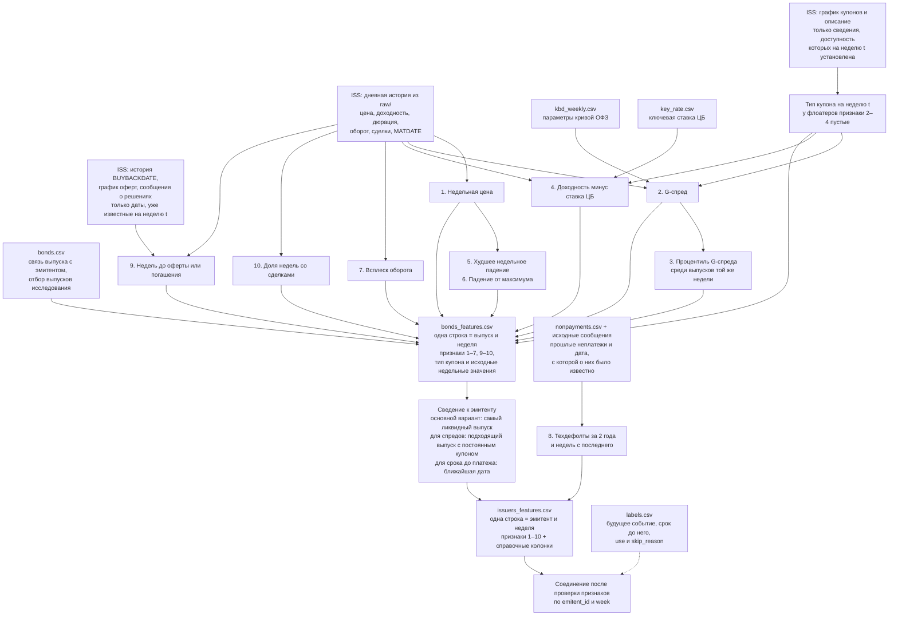

# Источники признаков и структура таблиц

План от 04.11.2026. Таблицы признаков пока не собраны.

Сначала рассчитываются признаки каждого выпуска за неделю. Затем из них
собирается одна строка на эмитента за ту же неделю. История неплатежей
добавляется на уровне эмитента. Метка будущего события присоединяется
после расчёта и проверки признаков.

Неделя длится с понедельника по воскресенье и обозначается датой пятницы.
Прогноз строится после окончания недели. В расчёт попадают только сведения,
доступные к этому моменту.

## Схема сборки



`raw/` и `out/` находятся в `~/Documents/Tracking/Invest/research/`.
Сырые ответы ISS уже скачаны скриптом `history.py`, КБД и ставка — `curves.py`.
Оферты и решения собраний требуют проверки доступности сведений во времени.
Стрелки показывают план расчёта, а не выполненную обработку.

## Каркас итоговой таблицы эмитентов

В каждой строке — один эмитент на одну неделю. Ниже строка показана
вертикально, чтобы были видны все колонки и их источники.

| Колонка | Тип данных | Содержание ячейки | Источник |
|---|---|---|---|
| `emitent_id` | Строка | Идентификатор эмитента ISS | Связь выпуска с эмитентом из `bonds.csv` |
| `week` | Дата | Дата пятницы каждой недели; формат `YYYY-MM-DD` | Даты дневной истории |
| `f1_price` | Вещественное число | Средневзвешенная цена недели, % номинала: `сумма(VALUE / FACEVALUE) / сумма(VOLUME) × 100` | `VALUE`, `VOLUME` и исторический `FACEVALUE` каждой дневной строки; оборот делится на соответствующий номинал до суммирования, включая недели с амортизацией |
| `f2_gspread` | Вещественное число | Доходность минус доходность ОФЗ на соответствующий срок, п.п. | Доходность и дюрация из дневной истории + параметры `kbd_weekly.csv`; у флоатеров пусто |
| `f3_spread_pct` | Вещественное число | Процентиль G-спреда выпуска среди спредов рынка, от 0 до 100; при числе допустимых спредов меньше 50 — пропуск | Значения `f2_gspread` допустимых выпусков той же недели |
| `spread_market_n` | Целое число | Число выпусков с допустимым спредом в расчёте процентиля | Число значений `f2_gspread` в рыночном сравнении той же недели |
| `f4_ytm_minus_key` | Вещественное число | Доходность минус ключевая ставка, п.п. | Доходность из дневной истории + `key_rate.csv`; у флоатеров пусто |
| `f5_worst_week` | Вещественное число | Худшее недельное изменение цены за 13 недель, п.п. номинала | Недельные цены того же выпуска до сведения к эмитенту |
| `f6_drawdown` | Вещественное число | Падение от максимума за 13 недель, п.п. номинала | Максимальная и текущая недельные цены того же выпуска |
| `f7_volume_spike` | Вещественное число | Оборот недели / медиана оборота за 13 недель; отношение без единицы измерения | Дневной оборот `VALUE`, сложенный по неделям; текущая неделя входит в медиану |
| `f8_td_2y` | Логический | Флаг: у эмитента был известный техдефолт за последние 2 года | Прошлые неплатежи из `nonpayments.csv`, о которых уже было известно |
| `f8_weeks_since_td` | Целое число | Число полных недель с последнего известного техдефолта | Дата этого неплатежа; дата доступности проверяется по источнику |
| `f9_weeks_to_offer_or_maturity` | Число; округление ещё не согласовано | Число недель до ближайшей известной оферты или погашения | Исторический `MATDATE` и версии `bonds_events.csv`, известные к концу недели: выплата по put, call после публикации решения; ближайшая дата среди выпусков. Возможный call и окончание приёма заявок put в признак не входят |
| `f10_trade_share` | Вещественное число | Доля недель хотя бы с одной сделкой за 13 недель, от 0 до 1 | `NUMTRADES` из дневной истории того же выпуска |
| `main_secid` | Строка | Код основного выпуска для рыночных признаков | Выбор по доступной истории ликвидности; точное правило ещё не согласовано |
| `n_issues` | Целое число | Число выпусков исследования в обращении на этой неделе | Список выпусков и сведения об их обращении |
| `floater_only` | Логический | Флаг: у эмитента только флоатеры | Типы купонов его выпусков на эту неделю; неизвестный тип не приравнивается к постоянному купону |
| `is_bank` | Логический | Флаг: эмитент — банк или МФО; нужен для отдельной проверки результатов | Справочные сведения об эмитенте; источник и правило предстоит определить |
| `f1w_` … `f7w_` | Вещественные числа | Альтернативные значения по худшим выпускам; единицы измерения совпадают с соответствующими признаками `f1_` … `f7_` | Та же таблица выпусков; направление выбора зависит от признака: ниже цена, выше спред и т. д. |

Типы в таблице — планируемые типы значений после чтения данных. CSV хранит
их текстовую запись, включая даты и логические значения. Точное обозначение
логических значений в файле предстоит выбрать. Истинное значение флага
означает выполнение условия после «Флаг:», ложное — его невыполнение.
Неизвестное значение остаётся пустым, а не заменяется ложным или нулём.
Если прошлых техдефолтов нет, число недель с последнего не определено
и `f8_weeks_since_td` остаётся пустым.

Цена и её изменения берутся из одного выбранного выпуска, но для спредов
может потребоваться другой — с постоянным купоном. Код выпуска, из которого
взято значение, нужно сохранять и для этой группы; название дополнительной
колонки предстоит определить. Признаки по худшим выпускам — отдельный
вариант сравнения, основной вариант они не заменяют.

## Таблица признаков выпусков

`bonds_features.csv` сохраняет значения до выбора основного выпуска:

```text
secid + emitent_id + week
│
├── Недельные данные: цена, доходность, оборот, дни со сделками
├── Признаки 1–7, 9–10 по этому выпуску
├── Тип купона на эту неделю
└── Известные на эту неделю даты погашения и ближайшей оферты
```

Признак 8 относится к эмитенту и добавляется в `issuers_features.csv`.
Падения цены считаются внутри истории каждого выпуска: смена основного
выпуска не должна выглядеть как падение цены.

## Пропуски в признаках

| Условие | Колонки с пропусками |
|---|---|
| В текущую неделю сделок нет | Цена и доходность этой недели, а также признаки, которым они необходимы |
| Не накоплено 13 календарных недель наблюдения | Падение от максимума, всплеск оборота, доля недель со сделками |
| Не хватает недельных изменений | Худшее недельное падение; точное требование при пропусках ещё не согласовано |
| Неизвестен необходимый тип купона, нет КБД или дюрации | Соответствующие признаки доходности и спреда, которые без этих сведений рассчитать нельзя |
| Нельзя восстановить прошлое состояние источника | Значение, для которого нужны эти сведения; сегодняшнее состояние вместо прошлого не подставляется |

Новый выпуск не обнуляет историю эмитента. Если у него есть другие выпуски
с достаточной историей, они могут дать рыночные признаки. Если подходящих
данных нет, отсутствие оценки не означает низкий риск.

## Граница между признаками и будущим исходом

В `issuers_features.csv` не входят `label`, `weeks_to_event`, `use`,
`skip_reason`, будущий исход неплатежа и будущая дата его исправления.
Они нужны для разметки и оценки, но не для расчёта признаков и рыночных
процентилей. При соединении с `labels.csv` проверяются уникальность ключа
`emitent_id + week` и сохранение числа строк.

Для признака 8 одной плановой даты неплатежа недостаточно: нужно установить,
когда сведения о нём стали доступны. Сам `nonpayments.csv` не содержит
полной истории публикаций, поэтому этот шаг ещё предстоит выполнить.

Перед полной сборкой остаётся проверить применимость пары доходности и дюрации
для выпусков с особыми условиями, согласовать
правило выбора самого ликвидного выпуска и требования к пропускам в окнах.
Основания отбора структурных выпусков и исторические типы купона также
требуют проверки: отбор по сегодняшним сведениям может повлиять на прошлые
значения, даже если дневная история обрезана правильно.

Определения признаков — в [HYPOTHESES.md](HYPOTHESES.md), состав данных
и принятые правила — в [DATA.md](DATA.md). Сборка таблиц начнётся только
по отдельной команде автора.
