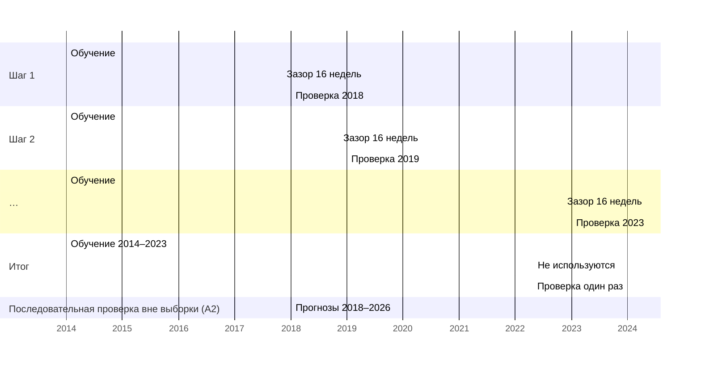

# 
Гипотезы и план проверки

<i>Черновик от 30.09.2026 
Это этап исследования №2: то, что здесь записано, фиксируется до расчётов этапов 3–5, для "чистоты эксперимента". 
Правки после расчётов, если таковые будут, записываются ниже с датой и причиной.</i>

## 
Задачи

Каждый дефолт — это техдефолт, не исправленный за льготный срок (10 рабочих дней, если эмиссионные
документы не установили меньше).

<b>P(дефолт) = P(техдефолт) · P(дефолт | техдефолт)</b>

Исследование делится на две задачи:
- **Задача A — раннее предупреждение, найти P(техдефолт).** До неплатежа
  держатель решает, выходить из бумаги или нет. Предупреждение помогает выйти без потерь и должно прийти до техдефолта. Это основная задача.
- **Задача B — выплатят ли техдефолт, найти P(дефолт | техдефолт).** После неплатежа держатель решает, продавать ли по упавшей цене или ждать выплаты. 

## 
Что сделано до этих записей

Две проверки сделаны раньше, чем записаны гипотезы (`JOURNAL.md`, 19.09.2026):
- срезы G-спреда на 01.06.2023 и 20.12.2024 — повлияли на выбор
  кандидатов в признаки П2–П3;
- Гипотеза А3 о скорости падения цены выведена из личного опыта, для примера был разобран один случай: МОНОП 1P04.
Поэтому МОНОПОЛИЯ (`emitent_id` 15817) исключается из проверки A3
В остальных гипотезах она участвует как обычное событие. Срезы g-спреда — иллюстрация, в проверке гипотез
не используются.

## 
Задача A: раннее предупреждение

### Событие

**Новый техдефолт эмитента** — любой, а не только первый <!-- решение 27.09.2026 -->. Техдефолтом считается неплатёж, при котором эмитент не перечислил платёж целиком в срок: из-за нехватки денег, задержки от контрагентов, ареста или блокировки счетов, а также по причине, которую эмитент назвал технической (ошибка в платёжном поручении, обработка платежа в банке). Не считается техдефолтом неплатёж держателям, когда эмитент заплатил, но часть денег не дошла до держателей без банковских реквизитов или данных в реестре.
<!-- 26.10.2026: раньше событием был только кредитный техдефолт, а неплатежи с технической причиной не считались. Изменено решением автора, так как техническую причину по тексту сообщения проверить нельзя, а у Еврофинансов-Недвижимости и ФСИ «технические сложности» 06.05.2020 закончились объявленным дефолтом в октябре 2020 года. Эпизоды с заявленной технической причиной отмечены в techdefault_events.csv (cause_class = «заявлена техническая»), поэтому расчёт можно сделать с ними и без них. -->

День дефолта — плановая дата купона, по которому произошла невыплата. Дата формального дефолта (`default_date`) хранится отдельно и событием не считается. Цена бумаги обваливается после техдефолта, поэтому если бы событием стал конец срока, опережение оказалось бы завышено на две недели.

**Проверка устойчивости к дате неплатежа** <!-- добавлено 22.10.2026 --> Правила и модель пересчитываются ещё дважды: с датой неплатежа каждого события, сдвинутой на неделю раньше и на неделю позже. Результаты при сдвиге приводятся рядом с основными, основным остаётся расчёт без сдвига. Так видно, держится ли результат на точной дате неплатежа, ведь дата из источника тоже может быть ошибочной.

<!-- Добавлено 22.10.2026, перенесено из DATA.md (раздел 2). Проверка была предложена на ревью 22.09.2026, когда дату неплатежа собирались вычислять из даты перевода в «Д». Теперь все даты взяты из источников, но при сборе автоматика ошибалась на 2–6 недель (Калита, ЕвроТранс; исправлено вручную), поэтому проверка остаётся. -->

У эмитента, уже переживавшего техдефолт, новое неисполнение обязательств - это частый сценарий, но покупатель может о нём не знать или попросту не заметить эту информацию. Тем не менее, намного ценнее предсказание первого неплатежа.

В данных, которые у меня есть сейчас около 194 событий с 2014 по 2026
- 123 эпизода, закончившихся дефолтом (118 с переводом в «Д» и 5 с объявленным дефолтом без перевода);
- 48 выплаченных техдефолтов у 42 эмитентов, которых в «Д» не переводили, из них 17 с заявленной технической причиной;
  <!-- 26.10.2026: пересчитано после сопоставления по ИНН и включения неплатежей с технической причиной, было 29 у 23 и всего около 173 событий. -->
- около 23 выплаченных техдефолтов у 21 эмитента, который позже всё-таки допустил дефолт.
  <!-- Проверено 30.09.2026: неплатежи до дня ноль есть у 21 эмитента из «Д» (day_zero.csv, disclosure_defaults.csv). Сколько из них отдельных выплаченных техдефолтов, зависит от разбиения на эпизоды: при разрыве 200 дней отдельных эпизодов 6, у остальных 17 эмитентов ранние неплатежи лежат в 200 днях до дня ноль. Уточнить на этапе 3 по датам фактических выплат. -->

Дефолт и техдефолт - событие эмитента, а не одного выпуска. Так как часто неплатежи идут подряд по нескольким выпускам, цена падает на все выпуски и биржа переводит все выпуски в категорию "Д". 

### Признаки предстоящего техдефолта

Если по ходу исследования откроются ещё какие-либо признаки будет записано ниже с пометкой.

***Цена и доходность***
1. **Цена** - % номинала, средневзвешенная за неделю.
2. **G-спред** — доходность к погашению, а у облигаций с офертой — к оферте, минус доходность ОФЗ на тот же срок по кривой бескупонной доходности (КБД) Мосбиржи. Оговорка: это разные величины, для длинных бумаг с высоким купоном ошибка заметна.
3. **Спред относительно рынка** — место G-спреда бумаги среди всех корпоративных облигаций, торговавшихся на той же неделе, в процентах (процентиль). Место в ряду, а не сам спред, потому что уровень спредов всего рынка меняется со ставкой. Процентиль в любой год выделяет одну и ту же долю самых рискованных бумаг. Минус: общий для всего рынка рост спредов на нём не отражается, поэтому он сравнивается с порогом относительно ключевой ставки (гипотеза A2).
4. **Доходность к погашению (у облигаций с офертой — к оферте) минус ключевая ставка**
<!-- Изменено 22.10.2026 в признаках 2 и 4: ISS в `YIELDCLOSE` отдаёт у облигаций с офертой доходность к оферте, так было записано и в DATA.md, п. 5; формулировка «к погашению» с этим расходилась. Суть признаков та же. -->

***Скорость падения цены***

5. **Худшее недельное изменение цены за последние 13 недель** - самое сильное падение цены за одну неделю. После падения цена может отрасти, а риск остаётся, поэтому берётся худшая неделя, а не текущая. Цена этой недели сравнивается с ценой прошлой недели. Если на прошлой неделе сделок не было, то с последней неделей, когда они были. У неликвидной бумаги такое изменение может накопиться за несколько недель, поэтому резкое падение от постепенного отличают по обороту, так как при распродаже он резко растёт.
6. **Падение от максимума цены за 13 недель** - разница между самой высокой ценой за последние 13 недель и ценой текущей недели, в п.п. номинала. Признак 5 отражает резкое падение за одну неделю, а этот признак — постепенное снижение, при котором цена каждую неделю теряет понемногу, ни одно недельное падение не бросается в глаза, но за несколько месяцев потеря набирается большая.
7. **Всплеск оборота**: оборот недели к медиане оборота выпуска за квартал.

***История эмитента***

8. **Кредитный техдефолт за последние 2 года** (да/нет) и количество недель с последнего.

***Структура долга и ликвидность***

9. **Число недель до ближайшей оферты или погашения.** Дата погашения берётся из дневной истории торгов (`MATDATE`). Ближайшая оферта на неделе t определяется так. По графику выпуска известной считается только ближайшая оферта после последней прошедшей оферты или после размещения, так как следующую оферту эмитент назначает, когда определяет купон на новый период. С 2018 года к ней добавляется поле `BUYBACKDATE` дневной истории за последний день торгов недели, так как в нём ближайшая оферта записана такой, какой её знала биржа в этот день, и берётся более ранняя из двух дат. До 2018 года поле не заполнено, поэтому используется только график. Если между прошлой офертой (или размещением) и офертой было решение общего собрания владельцев облигаций об изменении условий выпуска, оферта считается известной только с даты решения, так как её могло назначить это собрание. С 2018 года такая оферта считается известной с первого дня, когда она появилась в `BUYBACKDATE`, а если поле её не показывало — с даты решения.
<!-- Изменено 15.10.2026 по проверке полей ISS: `OFFERDATE` в дневной истории пуст во все годы; `BUYBACKDATE` есть с 2018 года, но в 2018 у 8 из 40 бумаг с пустым полем оферта в графике была. Правило «оферта известна с прошлой оферты» — предположение, проверить на нескольких выпусках по сообщениям эмитентов до расчёта признака. -->
<!-- Изменено 20.10.2026 по проверке на 200 выпусках с 2018 года: правило «оферта известна с прошлой оферты» подтвердилось (в 91% пар следующая оферта появляется в `BUYBACKDATE` между 30 днями до прошлой оферты и 14 днями после неё, медиана — за 3 дня до), но в графике нет 28% оферт, которые показывала биржа (у 81 выпуска из 200). Поэтому с 2018 года добавлено поле `BUYBACKDATE`. До 2018 года проверка правила по сообщениям эмитентов ещё не сделана. Подробно — DATA.md, «Даты оферт: график против BUYBACKDATE». -->
<!-- Изменено 22.10.2026: уточнено название («Число недель…» вместо «Недель…»), суть признака та же. -->
<!-- Изменено 22.10.2026 по проверке оферт после решений собраний: правило «известна с прошлой оферты» видело раньше биржи 42 оферты из 167, перед которыми было решение об изменении условий (`restruct_decisions.csv`, виды «изменение условий» и «изменения без описания»), на 12–430 недель, медиана 146. 13 из них — у Открытие Холдинга, события «Д». Поэтому оферта после такого решения известна с даты решения, а с 2018 года — с появления в `BUYBACKDATE`. Подробно — DATA.md, «Даты оферт: график против BUYBACKDATE». -->
10. **Доля недель со сделками за 13 недель** — чтобы отличать сигнал
    от молчания неликвидной бумаги.

**Одно число для одного эмитента** 
Признаки 1–7 и 9–10 считаются по каждому выпуску, а в таблице 1 запись для 1 эмитента. Если у эмитента пять выпусков нужно одно значение цены на неделю, а не пять. Правила выбора этого значения:
- для 1–7 основной вариант — значение **самого ликвидного выпуска**, так как цена неликвидной бумаги скачет от одной сделки;
- Альтернатива — **худший выпуск**. Цена каждого выпуска случайно колеблется, и чем больше у эмитента выпусков, тем ниже в среднем худшая из них, даже если риск не изменился. Поэтому у эмитентов со многими выпусками этот вариант завышает сигнал, и FPR проверяется по числу выпусков (см. «Критерии»);
- для 9 — ближайшая дата среди всех выпусков;
- для 10 — у самого ликвидного выпуска.

**Флоатеры.** У облигации с плавающим купоном ISS считает доходность по текущему купону, как будто он не изменится, — доходность и спред (признаки 2–4) нельзя сравнивать с бумагами с постоянным купоном. Поэтому у флоатеров признаки 2–4 не считаются, остаются цена, скорость и оборот. Спред эмитента берётся только из его бумаг с постоянным купоном; если у эмитента одни флоатеры — спреда у него нет, работают правила по цене.

**Тип купона** <!-- решение 20.10.2026 -->
Флоатером в исследовании считается выпуск, у которого купон пересматривается почти каждый период, так как для признаков 2–4 важна частота пересмотра купона, а не название бумаги. Если купон каждые полгода устанавливают заново по рынку через оферту, цена держится у номинала так же, как у флоатера, и спред к КБД о риске эмитента почти ничего не говорит. Тип определяется так:
- если в описании выпуска указан плавающий купон («Облигация с плавающим купоном», «Флоатер») или линкер, выпуск считается флоатером;
- если в описании указан постоянный купон, выпуск считается бумагой с постоянным купоном;
- если тип в описании не указан, он определяется по графику купонов. Выпуск считается флоатером, если в графике нет ни одной известной ставки купона или ставка менялась хотя бы в половине купонных периодов. Иначе это бумага с постоянным купоном.

<!-- Добавлено 20.10.2026. Без структурных облигаций рублёвых выпусков с торгами после 2014 года 5 729, тип в описании пуст у 3 369 из них. Проверка на выпусках с известным типом (без структурных), разделённых по эмитентам пополам: порог 0,5 подобран на одной половине, на другой правило нашло 82,5% флоатеров (255 из 309) и приняло за флоатер 4,1% бумаг с постоянным купоном (21 из 507). Отвергнуто правило «4 и больше разных ставок в графике»: на проверочной половине (до расширения правила структурных облигаций) 8,4% бумаг с постоянным купоном приняты за флоатер, а из 10 выпусков без типа, которые оно назвало флоатерами, явным флоатером был один (ПСБ БО-01), шесть оказались бумагами с офертами раз в год или со ставкой «лесенкой». Подробно — DATA.md, «Тип купона: описание и график купонов». -->

### Правила

Правило - это один признак и его порог. Например: «есть риск неплатежа, если признак на неделе t перешёл значение x». X подбирается на обучающем периоде (2014–2023) так, чтобы FPR равнялся 3%. У каждого правила подбирается один порог.

<!-- 26.10.2026: заголовок столбца «Риск есть, если» переименован, смысл правил не менялся -->
| | Правило | Условие риска |
|---|---|---|
| П1 | высокая доходность | доходность выше ключевой ставки на X п.п. (признак 4) |
| П2 | G-спред | спред выше X п.п. (признак 2) |
| П3 | спред относительно рынка | спред выше X-го процентиля рынка той же недели (признак 3) |
| П4 | низкая цена | цена ниже X % номинала (признак 1) |
| П5 | резкое падение | за последние 13 недель была неделя, когда цена упала на X п.п. и больше, а оборот был не меньше 3 медиан (признаки 5, 7); порог оборота задан заранее, подбирается только X |

### Понятия и обозначения

#### Наблюдения

Наблюдение — **состояние определённого эмитента в одну неделю**: у каждого эмитента, у которого на этой неделе в обращении есть облигации, одна запись в таблице на неделю. В ней содержатся независимые переменные, то есть признаки, известные к концу этой недели, и значение зависимой переменной, а именно ответ на вопрос: «будет ли у эмитента новый техдефолт в ближайшие 16 недель». Строки всех эмитентов за все недели с 2014 года — это и есть данные, на которых подбираются правила и модель.

**Неделя** — календарная неделя с понедельника по воскресенье, в таблицах она обозначается датой своей пятницы. Признаки недели t считаются по сделкам этой недели, включая рабочие субботы, а кривая ОФЗ и ключевая ставка берутся на пятницу или, если в пятницу торгов не было, на предыдущий торговый день той же недели. Событие относится к той неделе, в которую попадает дата неплатежа.
<!-- Добавлено 22.10.2026: до этого неделя нигде не была определена, а КБД уже собрана по пятницам (`kbd_weekly.csv`). Облигации торгуются и в рабочие субботы по производственному календарю (в выборке 8 000 выпусков из кэша сделки по субботам только в такие дни: 20.02.2016, 09.06.2018, 29.12.2018, 20.02.2021, 27.04.2024, 02.11.2024, 01.11.2025), поэтому неделя кончается воскресеньем, а не пятницей. -->

Эмитенты — все эмитенты корпоративных рублёвых облигаций (`exchange_bond`, `corporate_bond`). Отбора по доходности или спреду нет.

**Валютные выпуски** <!-- решение 20.10.2026 -->
Рублёвым считается выпуск, у которого номинал в рублях, то есть поле `FACEUNIT` дневной истории ISS равно `RUB` или `RUR` (так рубль обозначен в истории до 2018 года). Валюта берётся из дневной истории, а не из справочника, так как у старых выпусков в справочнике она не заполнена (РТК-Лизинг, БО-02). Валютные выпуски не участвуют ни в признаках, ни в правилах, ни в модели, потому что их доходность нельзя сравнивать с рублёвой КБД и ключевой ставкой. Спред долларовой облигации к ОФЗ отрицательный из-за валюты, а не из-за надёжности эмитента. Кроме того, еврооблигации и замещающие выпуски дешевели в 2022 году из-за санкций и сбоев в расчётах, хотя кредитного события у эмитентов не было. Событие эмитента остаётся в выборке, если у него есть рублёвые выпуски.

<!-- Добавлено 20.10.2026 по кэшу этапа 3: из 8 360 корпоративных выпусков с историей после 2014 года валютных 623 (USD 474, CNY 94, EUR 48, прочие 7), из них 104 — еврооблигации через иностранные компании без ИНН (Gaz Capital, RZD Capital и т. п.). -->

**Структурные облигации** <!-- решение 20.10.2026 -->
Структурные облигации не участвуют ни в признаках, ни в правилах, ни в модели, потому что их купон и цена зависят от базового актива (акций, индекса, золота), а не от надёжности эмитента. Падение цены такой бумаги вслед за базовым активом выглядело бы как обвал цены перед техдефолтом. Эмитент остаётся в выборке, если у него есть другие выпуски (Сбербанк, ВТБ, ТБанк), а специализированные общества, выпускающие только структурные ноты, выпадают целиком. Структурной считается облигация, у которой в описании указан тип «Структурная облигация» или в названии выпуска есть одна из меток структурного продукта: «структурные», «ИОС» (инвестиционные облигации Сбербанка), «SP Plc», «Инвест. Продукты», серии «СО-» и «БО-ИО». Структурными считаются также все выпуски Сбербанк КИБ, выпуски ВТБ серии С-1 и индексируемые ноты ТБанка серии «ИО-». Структурной считается и облигация с символическим купоном, то есть такая, у которой первый купон в графике известен, все известные ставки купона не выше 0,1% годовых, а номинал выплачивается один раз в дату погашения, так как доход по ней идёт от базового актива. Первый купон должен быть известен, потому что после неплатежа эмитент может снизить купон до 0,1% по новому графику (КИВИ Финанс, 001P-02). Описанию ISS одному верить нельзя, так как структурные ноты Сбербанка и ВТБ записаны в нём как облигации с фиксированным купоном. Пустой НКД сам по себе выпуск не исключает, так как он бывает у ипотечных облигаций, у бескупонных облигаций и у выпусков после дефолта.

<!-- Добавлено 20.10.2026, в тот же день расширено дважды по пропускам НКД: среди 7 737 рублёвых выпусков с торгами после 2014 года структурных 2 008 (с пометкой в описании 623, из них Сбербанк КИБ 459 и ВТБ 102; «ИОС» 747, «SP Plc» 60, серии «СО-» и «БО-ИО» 22, символический купон 477, из них ВТБ серии Б-1 278, ГПБ 74, Альфа-Банк 36; прочие по названию). Биржа не считает НКД, если купон зависит от базового актива. Из 274 выпусков с пустым НКД без меток после ручного разбора структурными оказались 181 (купон 0,01–0,1%, ТБанк ИО-), остальные 93 — обычный долг: ипотечные облигации 38, эмитенты событий 27 (НКД пуст после дефолта: Диджитал Инвест, РЕГИОН-ИНВЕСТ, ЕвроТранс и др.), бескупонные облигации Сбербанка SBERD, ГПБ 006Р и Альфа-Банка 18, прочие 10. Разбор — `ручные_проверки/nkd_review.csv`. Событий (дефолтов и техдефолтов) у эмитентов структурных нот нет. -->

**Банки и МФО** <!-- решение 27.09.2026 -->
Считаются вместе со всеми. Их среди событий около пяти (Татфондбанк, Пересвет, НОТА-Банк, Внешпромбанк, Домашние деньги). Дефолт банка обычно наступает после отзыва лицензии — решения регулятора, которое рынок может не предвидеть. Поэтому результат дополнительно будет посчитан без банков и после этого будет видно, создают ли они шум.

**Реструктуризации без дефолта** <!-- решение 20.10.2026 -->
Реструктуризация без дефолта — это решение общего собрания владельцев облигаций, принятое до неплатежа, которое меняет условия в пользу эмитента: переносит погашение или оферту, меняет график амортизации, снижает купон, освобождает от досрочного погашения, или соглашение о новации либо отступном. Событием задачи A она не считается, так как у неё нет даты неплатежа, а целевое событие — техдефолт. Но и «нормальной» такую неделю считать нельзя, потому что у эмитента был кредитный стресс, и сигнал перед ним засчитался бы как ложная тревога. Поэтому строки эмитента, у которых дата решения собрания попадает в ближайшие 16 недель, не используются ни в подборе порогов, ни в оценке. После недели решения строки эмитента снова идут, так как он может не заплатить уже по новым условиям. Собрания, решение которых не принято, и собрания с одними формальными вопросами (представитель владельцев, приведение решения о выпуске в соответствие с законом) реструктуризацией не считаются. Список — `manual/manual_restructuring.csv`, собирается по сообщениям Интерфакса о решениях общих собраний владельцев облигаций (тип 253) и о новации или отступном (тип 311) с 2015 года, раньше таких собраний закон не предусматривал.

<!-- Добавлено 20.10.2026. Отвергнуто: считать реструктуризацию событием в метке. У неё нет даты неплатежа, только дата собрания, которое готовится неделями, а целевое событие в README — техдефолт. Цена решения: правила не получают попаданий за предупреждение перед реструктуризацией, хотя для держателя это тоже плохое событие. -->

**В каких случаях запись по эмитенту не добавляется.** 
Запись имеет смысл, только если ответ на её вопрос известен.
- От неплатежа до исправления строк нет: техдефолт случился, цена упала. После исправления строки снова идут, эмитент может не заплатить ещё раз. После дефолта записи не ведутся.
- Эмитент погасил все выпуски и нет новых — после погашения записей нет, не по чему платить.
- Выпуски ушли с биржи без погашения (делистинг, выкуп всего объёма по оферте) — что было дальше, не известно. Строки, у которых 16 недель вперёд заходят за дату ухода с биржи не используются.
- То же в конце данных: данные кончаются 25.09.2026, недели после 05.06.2026 пока не используются.

#### Горизонт

- **16 недель** от недели t. <!-- решение 28.09.2026; изначально было 26 недель -->
  - Это значение выбрано мной на основе сугубо личного эмпирического ощущения того времени, за которое можно распознать невыплаты. 
  - За четыре месяца до неплатежа возможно принять решение, выйти из бумаги или держать.
  - Больше данных для проверки. Для последних 16 недель данных исход ещё неизвестен, при 26 неделях — для последних 26. А 2025–2026 годы — самые насыщенные событиями.
  - У рискованных эмитентов купоны обычно ежемесячные или квартальные: за 16 недель проходит несколько платежей.
  -  Ответы на горизонтах 8 и 26 недель посчитаю для проверки устойчивости. Горизонт выбран до расчётов
  и после них не меняется.

#### Критерии

- **Предсказанный техдефолт.** Техдефолт, перед которым было хотя бы одно предупреждение в течение 16 недель до неплатежа.
Отдельно следует посчитать долю техдефолтов, предсказанных только в последние 2 недели, чтобы понимать, сколько предупреждений приходит в последний момент. 

- **Полнота R.** Доля предсказанных техдефолтов среди всех техдефолтов данного периода. Индексы R₁ у П1, R₃ у П3, Rм у модели.
- **Опережение L.** Число недель от первого предупреждения до неплатежа.
- **Ложное срабатывание** — предупреждение, после которого у эмитента в течение 16 недель не было техдефолта.
- **FPR** (false positive rate) — доля ложных срабатываний среди всех недель, после которых у эмитента в течение 16 недель не было техдефолта, то есть вероятность получить предупреждение по эмитенту, у которого техдефолта не будет. Это ошибка первого рода для определённого правила, аналог α. Правила и модель сравниваются при FPR = 3%, так как порог предупреждения Jessica (вероятность техдефолта не меньше 10%) при частоте техдефолта около 1% и полноте R допускает FPR ≈ 0,09·R, то есть 3–4,5% при R = 0,3–0,5. Частота 1% — прикидка, на обучающем периоде она измеряется. Устойчивость выводов проверяется при FPR = 5% и 10%. FPR считается только среди недель без техдефолта, поэтому почти не зависит от того, как часто случаются техдефолты, и порог, подобранный на 2014–2023, сохраняет смысл в 2024–2026.
- **Лучшее правило.** Правило с наибольшей полнотой при FPR = 3% на кросс-валидации внутри 2014–2023 годов (см. «Разделение по времени»). В A3 оно выбирается среди П1–П4, в A4 среди П1–П5. Выбор делается до того, как открывается проверочный период.
- **Разделение по времени.** Правила и модель подбираются на 2014–2023 годах, а проверяются на 2024–2026. Это отдельный рынок со ставкой до 21% и рекордным числом дефолтов ВДО, и именно в нём предстоит работать Jessica.
  - Внутри 2014–2023 варианты сравниваются кросс-валидацией с расширяющимся окном (схема ниже).
  - **Последовательная проверка вне выборки.** Каждый год с 2018 по 2026 предсказывается порогами, подобранными только на предыдущих годах, и прогнозы всех лет объединяются. Так событий для оценки больше 48. На каждом шаге из обучения исключаются последние 16 недель перед проверяемым годом, так как их исход приходится на проверяемый год. Так оценивается A2, в которой оба правила заданы заранее. Гипотезы A3 и A4, в которых выбирается лучшее правило, проверяются только на 2024–2026.
  - 2024–2026 проверяется один раз, для уже выбранной модели. Событий там около 48, поэтому при сравнении нескольких моделей на этом периоде лучшая могла бы оказаться лучшей случайно.
  - По тому же правилу записи с 11.09.2023 не используются, так как их 16 недель вперёд заходят в проверочный период.
  - Перемешивать недели разных лет или делить выборку по эмитентам нельзя. Записи одного эмитента за соседние недели почти одинаковы, неплатежи разных эмитентов зависят от общего состояния рынка, а у связанных эмитентов идут вместе. При таком делении обучающая и проверочная части пересекаются по времени, и качество модели завышается.
  - После проверки модель переучивается на всех годах, и с ней работает Jessica.

- **Доверительные интервалы** оцениваются bootstrap'ом по эмитентам, а не по записям, так как записи одного эмитента за соседние недели почти одинаковы, и если считать их независимыми, интервалы выйдут обманчиво узкими. Когда сравниваются два правила или правило и модель, оба оцениваются на одних и тех же событиях, поэтому разность считается внутри каждой bootstrap-выборки, а не из двух отдельных интервалов.
- **PR-AUC** считается для модели и для каждого правила как дополнительная метрика, так как показывает качество сразу на всех порогах, а не только при FPR = 3%. Главным остаётся сравнение при 3%, так как эта точка согласована с порогом предупреждения о дефолте от Джессики.
- **FPR с разным числом выпусков.** FPR дополнительно считается для эмитентов с 1, 2–3 и 4 и более выпусками. Если FPR у эмитентов с 4 и более выпусками выше, чем у эмитентов с одним выпуском, и 95%-ный доверительный интервал разности (bootstrap по эмитентам) не содержит ноль, число выпусков добавляется в модель как признак.
- **Минимальная обнаружимая разница.** Наименьшее значение d из гипотез A2–A4 (разница полнот в A2 и A4, разница опережений в A3), при котором H₀ отвергается не меньше чем в 80% случаев при имеющемся числе событий. Считается до расчётов этапа 4 на искусственных выборках с тем же числом событий и заданным значением d. Если H₀ не отвергнута, вывод формулируется так: разница меньше минимальной обнаружимой. Утверждать, что разницы нет, нельзя.

### Гипотезы

Главная гипотеза задачи A — A4, только по ней делается вывод «подтверждена» или «не подтверждена». A2 и A3 вторичные: их разности приводятся с 95%-ными доверительными интервалами без поправки на множественность и читаются как описательные. A1 отвечает на отдельный вопрос об определении события и проверяется по своему критерию.

<b style="color: #DB95BD">A1.</b> **После неплатежа цена падает сильнее, чем при объявлении дефолта.** Данная гипотеза проверяется
первой: от неё зависит, какая из задач важнее. 

Проверка: берутся выпуски, закончившиеся дефолтом, у которых есть сделки в неделю до неплатежа, в неделю самого неплатежа и в неделю дефолта. <!--Эпизоды, где сообщение о дефолте вышло в ту же неделю, что и неплатёж, исключаются, так как два падения там не разделить.--> 
Для каждого эпизода считается Δн, изменение цены в неделю неплатежа, и Δд, изменение цены в неделю дефолта, обе величины в п.п. номинала. Разность d = Δн − Δд.

> **H₀:** Неплатёж и дефолт двигают цену одинаково, поэтому медиана d равна нулю.  
> **H₁:** После неплатежа цена падает сильнее, поэтому медиана d меньше нуля.

Применяется односторонний критерий знаковых рангов Уилкоксона для парных наблюдений, так как каждый эпизод даёт пару изменений, а распределение изменений цены далеко от нормального. H₀ отвергается на уровне значимости 0,05. Если H₀ не отвергается, значит, льготный срок несёт для рынка больше информации, чем кажется, и задача B получает больший вес.

<b style="color: #DB95BD">A2.</b> **Спред относительно рынка предсказывает больше техдефолтов, чем доходность выше ключевой ставки, при одинаковом FPR.** Уровень спредов всего рынка меняется вместе со ставкой, поэтому место бумаги среди других точнее показывает риск, чем разница с ключевой ставкой. По сути, этот признак обозначает высокую доходность.
Проверка: пороги П1 и П3 подбираются так, чтобы FPR у обоих равнялся 3%. Полнота считается последовательной проверкой вне выборки за 2018–2026 (см. «Разделение по времени»), R₁ для П1 и R₃ для П3. Разность d = R₃ − R₁.

> **H₀:** Оба правила предсказывают одинаковую долю техдефолтов, d = 0.  
> **H₁:** Правило 3 предсказывает больше, d > 0.

H₀ отвергается на уровне значимости 0,05, если 95%-ный доверительный интервал для d целиком лежит выше нуля. Интервал оценивается bootstrap'ом по эмитентам (см. «Понятия и обозначения»). Так как пороги подбираются на прошлых годах, FPR у правил на годах прогноза может разойтись, поэтому он приводится рядом.

<b style="color: #DB95BD">A3.</b> **Резкое падение цены предупреждает о техдефолте раньше, чем текущее значение цены или доходности.** 

Проверка: берутся П5 и лучшее правило из П1–П4 (см. «Понятия и обозначения»). Для обоих подбираются пороговые значения, при которых FPR на 2014–2023 годах равен 3%. На проверочном периоде (2024–2026) отбираются техдефолты, предсказанные обоими правилами. Для каждого из них считается опережение, то есть число недель от первого предупреждения до неплатежа: L₅ для П5 и Lу для выбранного правила из П1-П4. Проверяется разность d = L₅ − Lу.

> **H₀:** Оба правила предупреждают техдефолт одновременно, медиана d равна нулю.  
> **H₁:** П5 предупреждает раньше, медиана d больше нуля.

H₀ отвергается на уровне значимости 0,05, если 95%-ный доверительный интервал для медианы d (bootstrap по эмитентам) целиком лежит выше нуля. Раннее предупреждение бесполезно, если П5 предсказывает заметно меньше техдефолтов. Поэтому H₁ засчитывается, только если полнота П5 меньше, чем у выбранного правила из П1–П4, не больше чем на 10 п.п.

<b style="color: #DB95BD">A4.</b> **Модель предсказывает больше техдефолтов, чем лучшее из правил, при одинаковом FPR.** Каждый признак отражает свою сторону трудностей эмитента, поэтому сочетание признаков должно предсказывать техдефолты, которые не предсказывает ни один признак в отдельности.

Проверка: сравниваются модель и лучшее правило из П1–П5 (см. «Понятия и обозначения»). Для обоих подбираются пороги, при которых FPR на 2014–2023 годах равен 3%. На 2024–2026 считаются полнота модели Rм и полнота правила Rп и их разность d = Rм − Rп.

> **H₀:** Модель предсказывает столько же, сколько правило, d = 0.  
> **H₁:** Модель предсказывает больше, d > 0.

H₀ отвергается на уровне значимости 0,05, если 95%-ный доверительный интервал для d целиком лежит выше нуля. Если H₀ не отвергается, в Jessica идёт правило, так как оно проще и его логику видно.

## 
Задача B: выплатят ли техдефолт

### Событие

**Эпизод** — один неплатёж эмитента от плановой даты платежа до исхода. Исход эпизода двоякий. Если эмитент заплатил в льготный срок, это выплаченный техдефолт, если не заплатил, это дефолт.

Выплата после `default_date` не отменяет дефолт. Эмитент может заплатить после конца льготного срока (КИВИ Финанс, дефолт по оферте 11.04.2024, обязательства исполнены 31.05.2024), договориться с держателями о реструктуризации или вернуть бумаги в обычные торги («Пересвет», через 3,5 года). Во всех этих случаях эпизод остаётся дефолтом.

- **Дефолты.** 123 эпизода, в которых неплатёж перешёл в дефолт.
- **Выплаченные кредитные техдефолты.** Около 52 эпизодов. Из них 29 у эмитентов, которых в «Д» не переводили, и около 23 ранних у 21 эмитента, который позже допустил дефолт.
- **Технические неплатежи.** Опозданий всего платежа с технической причиной (ошибка в платёжке, сбой банка) 18 эпизодов у 18 эмитентов, в задаче A они считаются событиями. Неплатежей держателям без реквизитов 17 (25 сообщений) у 4 эмитентов, в задаче A они событиями не считаются. Здесь нужны и те и другие, так как Jessica в реальном времени получит о них такое же сообщение с причиной, как о кредитных.
<!-- 26.10.2026: числа пересчитаны после разделения технических причин, раньше было 30 неплатежей (41 сообщение) у 16 эмитентов. -->

<!-- Собрать до расчёта задачи B: дату фактической выплаты каждого выплаченного техдефолта. Источники: цепочки smart-lab («обязательства исполнены 24.06.2024») — есть у 31 записи из 63, только с 2024 года; сообщения Интерфакса типа 167 «Выплаченные доходы или иные выплаты» с датой фактической выплаты — поиск по названию эмитента в окне 60 дней после неплатежа, около 200 запросов. -->

### Признаки

Все признаки известны в момент неплатежа или в первые дни после него, поэтому Jessica сможет показать их держателю сразу. По причине неплатежа есть гипотеза B2, остальные признаки нужны, чтобы разбить эпизоды на группы и сравнить доли дефолтов между ними.

1. **Причина из сообщения эмитента.** Нет денег, задержка от контрагентов, арест или блокировка счетов, техническая причина (реквизиты, платёжка, банк).
2. **Вид обязательства.** Купон, амортизация, оферта, погашение номинала.
3. **Сумма неплатежа** относительно объёма выпуска в обращении.
4. **Сколько выпусков эмитента не выплачено** в первую неделю.
5. **Были ли у эмитента техдефолты раньше.**
6. **Как изменилась цена** за первые 1–3 торговых дня после неплатежа.

### Понятия и обозначения

#### Наблюдения

Отсчёт начинается в плановую дату платежа, которую эмитент пропустил (день 0). Дальше идут рабочие дни льготного срока k = 1, …, 10. Если в документах выпуска льготный срок короче (у ИНВЕСТПРО 6 рабочих дней, у РКК 3 дня), эпизод наблюдается только до его конца. Держателю в день k нужна величина

<b>f(k) = P(дефолт | к k-му дню ещё не выплатили)</b>

Посчитать сами значения f(k) и P(дефолт | техдефолт) по этим данным нельзя. Выплаченные техдефолты раскрываются хуже дефолтов, поэтому их в выборке меньше, чем было на самом деле, и доля дефолтов завышена на неизвестную величину. Поэтому гипотезы задачи B утверждают не значения вероятности, а различия между днями льготного срока и между причинами неплатежа.

Скорее всего, недоучтены прежде всего быстрые и технические неплатежи, которые исправили за день-два, не сообщив об этом. Если это так, недоучёт уменьшает различия, которые проверяют B1 и B2, поэтому отвергнутая H₀ остаётся надёжным результатом, а неотвергнутая может объясняться недоучётом.

#### Критерии

Задача B описательная. Выплаченных техдефолтов около 50, поэтому модели, которая предсказывает исход отдельного эпизода, здесь нет, и отложенного периода тоже нет, так как на 2024–2026 годы приходится около 19 выплат.

Результат задачи B складывается из трёх частей:
1. **Кривая f(k)** и гистограмма выплат по дням льготного срока.
2. **Доли дефолтов по группам** каждого признака из списка выше.
3. **Проверка B1 и B2.** Это два сравнения, заданные заранее, поэтому только для них H₀ проверяется на уровне значимости 0,05. Остальные различия между группами приводятся без проверки гипотез, так как при шести признаках и малом числе событий какое-нибудь различие найдётся случайно.

У всех долей и кривых указываются 95%-ные доверительные интервалы, оценённые bootstrap'ом по эмитентам. Из-за недоучёта выплаченных техдефолтов сами доли завышены (см. «Наблюдения»), поэтому сравнивать можно группы между собой, а не отдельную долю с реальной вероятностью.

### Гипотезы

<b style="color: #DB95BD">B1.</b> **Чем дольше эмитент не платит после неплатежа, тем меньше шанс, что он заплатит.** Каждый день без выплаты говорит о том, что денег у эмитента нет, поэтому шанс выплаты со временем снижается, а риск дефолта растёт.

Проверка. Для каждого рабочего дня льготного срока k (k = 1, …, 10) считается h(k), доля эмитентов, заплативших в этот день, среди тех, кто к нему ещё не заплатил. Дефолты входят в расчёт как неплатежи, которые так и не выплатили. Через десять значений h(k) проводится прямая. Вес каждого дня равен числу эмитентов, которые к нему ещё не заплатили, так как доля по 150 эмитентам точнее доли по 20. Наклон этой прямой обозначается b.

> **H₀:** Время не имеет значения, поэтому шанс выплаты одинаков во все дни льготного срока, b = 0.  
> **H₁:** Шанс выплаты снижается от первых дней к последним, b < 0.

H₀ отвергается на уровне значимости 0,05, если 95%-ный доверительный интервал для b целиком лежит ниже нуля. Интервал оценивается bootstrap'ом по эмитентам (см. «Критерии» задачи A). Прямая отражает только изменение в одну сторону. Если много платят в первые дни и в последний день перед концом срока, наклон может выйти около нуля, хотя время имеет значение, поэтому к проверке прилагаются гистограмма выплат по дням и кривая f(k).

<b style="color: #DB95BD">B2.</b> **Причина неплатежа связана с исходом.** Технические неплатежи эмитенты выплачивают почти всегда, потому что деньги у них есть. При причинах «нет денег» и «арест или блокировка счетов» платить нечем, поэтому выплаты редки.

Проверка. Для каждой группы по причине неплатежа считается доля дефолтов, то есть доля эпизодов, которые не выплатили до конца льготного срока. Эпизоды без указанной причины идут в отдельную группу и в проверку не входят.

> **H₀:** Причина не имеет значения, поэтому доля дефолтов у технических неплатежей такая же, как у неплатежей из-за нехватки денег или ареста счетов.  
> **H₁:** Доля дефолтов у технических неплатежей ниже.

Проверяется разность долей d = p(нет денег, арест) − p(технические). H₀ означает d = 0, а H₁ означает d > 0. H₀ отвергается на уровне значимости 0,05, если 95%-ный доверительный интервал для d целиком лежит выше нуля. Доверительный интервал, как и в B1, оценивается bootstrap'ом по эмитентам. Одна разность с направленной H₁ выбрана вместо хи-квадрата по всем группам, так как направление эффекта известно заранее, а в группах технических неплатежей и задержек от контрагентов будет по несколько эпизодов.

## 
Вводные данные для телеграм-бота

- **Порог предупреждения в Jessica.** 
  Я для себя решила, что хочу, чтобы Jessica присылала мне предупреждение, когда   вероятность неплатежа ≥ 10%. Кажется, что это низкий порог, но на самом деле, в силу редкости такого события как техдефолт (в среднем он случается примерно у 1% эмитентов за 16 недель). Вероятность 10% — это риск в десять раз выше обычного, и такие бумаги встречаются нечасто.
- **Вероятность, а не только предупреждение.** Jessica сообщает оценку
  вероятности техдефолта в ближайшие 16 недель — например, «в прошлом при таком сигнале техдефолт случался в 20% случаев». 
  *Для правила это частота техдефолтов среди предупреждений с похожей силой сигнала в прогнозах вне выборки из кросс-валидации, для модели — её откалиброванный прогноз. Проверяется на отложенном периоде: если Jessica говорит «20%», то среди таких предупреждений техдефолтов должно быть около 20% (калибровка, Brier score).*
- **Порог применяется к вероятности.** Порог 10% сравнивается с оценкой вероятности техдефолта, пересчитанной так, чтобы она совпадала с реальной частотой (калибровка): среди случаев с оценкой 20% техдефолт должен случаться примерно в 20%. Калибровка делается по прогнозам вне выборки из кросс-валидации с расширяющимся окном, так как на тех же годах, где подбирались пороги и модель, вероятности выходят слишком уверенными. FPR 3% выбран так, чтобы в среднем среди предупреждений техдефолт случался не реже чем в 10% случаев, а порог 10% применяется к каждому эмитенту отдельно, к его откалиброванной вероятности.
- **Ложные эпизоды.** Подряд идущие недели с предупреждением по одному эмитенту, после которых техдефолта не было, считаются одним ложным эпизодом. Число ложных эпизодов на эмитента в год показывает, сколько лишних сообщений придёт по портфелю из 24 эмитентов. В проверке гипотез эта метрика не участвует.
- **Критерий успеха** — предсказать не меньше трети (33%) техдефолтов с опережением от 2 недель при FPR = 3%. Это минимальная полнота, при которой предупреждения на этом уровне FPR достигают порога предупреждения Jessica (вероятность техдефолта не меньше 10%). При частоте техдефолта около 1% доля предупреждений, после которых техдефолт действительно случился, равна R · 0,01 / (R · 0,01 + 0,03 · 0,99), и при R = 33% она около 10%. При меньшей полноте предупреждения в среднем слабее этого порога.

### Ручная проверка после предупреждения

Часть признаков будущего неисполнения обязательств по нашим данным не проверить. Jessica их не оценивает, а показывает вместе с предупреждением, прикладывая соответствующие ссылки:
- **долговая нагрузка** — долг к EBITDA, к активам (отчётность);
- **свободный денежный поток** — отрицательный или падающий;
- **налоги** — недоимка по открытым данным ФНС;
- **суды** — иски кредиторов, заявления о банкротстве;
- **рейтинг** — снижение или отзыв;
- **раскрытие** — не прекратились ли отчёты и сообщения;
- **новые займы под растущий процент** — купон и объём последних выпусков по сравнению с предыдущими.

## 
Известные ограничения

- **Небольшая выборка.** В задаче A около 173 событий, поэтому модель ограничена небольшим числом признаков, а оценки на проверочном периоде имеют широкие доверительные интервалы (см. «Минимальная обнаружимая разница»).
- **Перекос выборки в задаче B.** Дефолты собраны почти полностью через режим «Д», а выплаченные техдефолты — только те, о которых эмитенты сообщили через Интерфакс или которые попали в списки smart-lab. О выплаченных техдефолтах сообщают реже, поэтому их в выборке меньше, чем было на самом деле, и оценка P(дефолт | техдефолт) ≈ 0,7 завышена. Тот же перекос есть в задаче A. Сравнение причин и видов обязательства между собой от этого страдает меньше.
- **Только рублёвые выпуски.** Событий задачи A фильтр по валюте не убирает. Три эмитента, у которых в «Д» были только валютные выпуски (Raiffeisen Bank International, EVRAZ, Celtic Resources, перевод 04.09.2023), исключены ещё на этапе 1, так как это неплатежи по санкциям, а не кредитные события. О1 Пропертиз Финанс остаётся, так как его дефолт 02.10.2020 начался с неплатежа по рублёвому выпуску БО-01.
- **Эмитенты вне Мосбиржи.** Облигации части эмитентов не торгуются на Мосбирже, поэтому в справочнике и истории ISS их нет, и признаки по ним не посчитать. По сверке со списками smart-lab за 2024–2026 годы это дефолты ХК Эволюция (19.06.2025), УК Доминион (04.09.2025), Пром Гарант (11.09.2025) и выплаченные техдефолты ЖКХ Якутии (2025 и 2026). Их нет ни в задаче A, ни в задаче B, поэтому годовое число дефолтов в исследовании меньше, чем в сводках агентств.
- **Нет истории рейтингов.** «Высокую доходность для своего рейтинга» приходится сравнивать с КС и с рынком, а не с бумагами того же рейтинга.
- **2022 год.** С 2022-го часть отчётности и раскрытия скрыта, поэтому в проверочном периоде признаков систематически меньше, чем в обучающем.
- **Неликвидные бумаги.** В случайный день сделки бывают у 30–45% облигаций, у части эмитентов рыночных признаков не будет. Их долю посчитаю отдельно.
- **Смена рыночных режимов** (2014, 2020, 2022, 2024–2025): порог, выбранный на данных до 2024 года, может не подойти для нового рынка. Это и проверяет отложенный период.
